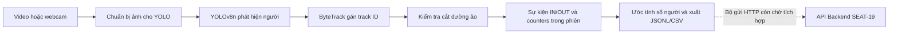

# CV — Đếm người bằng camera

## Mục đích và trách nhiệm

Module CV phụ trách xử lý hình ảnh để đếm số người vào và ra khỏi phòng đọc.
Module dùng YOLOv8n và ByteTrack để phát hiện, theo dõi chuyển động qua cửa.
Số liệu phục vụ cập nhật tình trạng chỗ trống qua Backend và đối chiếu đếm tay.
Theo Charter 1.2, cảm biến/IoT đã ngoài phạm vi. CV hiện xuất kết quả cục bộ;
Backend SEAT-19 đã có API tiếp nhận, nhưng bộ gửi HTTP từ CV còn chờ tích hợp.

## Thuật toán đếm người — SEAT-33

Phần này mô tả hành vi hiện có trong mã CV và phân biệt với cấu hình mục tiêu.
Quyết định dùng đường ảo được ghi ở **DEC-04** trong
[nhật ký quyết định](../docs/decisions.md); đầu ra tuân theo
[hợp đồng CV 1.0](../docs/architecture/cv-data-contract.md) và cần đối chiếu
[hợp đồng API Backend](../docs/architecture/api-contracts.md) khi tích hợp.

### Pipeline và trạng thái tích hợp



1. Video offline được OpenCV đọc tuần tự từng frame; webcam được trình duyệt
   gửi từng JPEG tới dịch vụ CV local. RTSP chưa được hỗ trợ. Camera trực tiếp
   dùng CV trên host ngoài Docker theo DEC-06; video mẫu có thể chạy trong
   container theo cấu hình triển khai, không suy ra container có webcam.
2. YOLOv8n chỉ phát hiện lớp `person`, chuẩn bị đầu vào theo `image_size`.
   Mục tiêu của Jira/Charter là khoảng **416 px, 3–5 frame/giây** để giảm tải;
   CLI hiện mặc định **640** và có thể truyền `--image-size 416`. API/UI hiện
   khởi tạo detector ở mặc định 640, chưa có tùy chọn đổi kích thước ảnh.
3. ByteTrack nối các detection giữa frame để có ID tạm trong phiên. Detector
   lấy ứng viên từ confidence 0.1 cho tracker; chỉ các detection vượt ngưỡng
   hiển thị/đếm (mặc định 0.32) được chuyển sang bộ đếm đường ảo.
4. Bộ đếm dùng track ID và vị trí để phát hiện cắt đoạn thẳng, tạo sự kiện
   IN/OUT, tăng counters tương ứng rồi tính ước lượng số người trong phòng.
5. CV xuất `backend_counts.jsonl`, `events.jsonl`, `counts.csv` và bản debug
   `results.jsonl`. Bản ghi số đếm Backend không chứa bbox; sự kiện cục bộ có
   track ID tạm. Chưa có bước CV tự POST, hàng đợi hay retry. SEAT-34 phụ trách
   tài liệu luồng/payload; không gửi thẳng CrossingEvent vào API CountResult.

**Phân biệt FPS:** video hiện xử lý mọi frame, chưa có tham số lấy mẫu 3–5 FPS.
`--fallback-fps` chỉ thay metadata FPS bị thiếu để tính thời gian nguồn, không
giảm tốc độ xử lý. Webcam gửi tuần tự, chờ phản hồi, với chu kỳ tối thiểu
khoảng 100 ms, nên tối đa khoảng 10 frame/giây và có thể thấp hơn do inference.
FPS hiển thị trên UI suy từ thời gian xử lý frame, không phải FPS camera hay
FPS toàn pipeline. Chỉ tiêu ≥ 5 FPS ở khoảng 416 px cần đo theo SEAT-35;
không coi mục tiêu hoặc số cấu hình là kết quả đã đạt.

### Các số đếm và công thức hiện diện

| Giá trị                   | Ý nghĩa                                                                                                                               |
| --------------------------- | --------------------------------------------------------------------------------------------------------------------------------------- |
| `people_count`            | Số detection người vượt confidence đang thấy trong frame, kể cả chưa có ID. Không tự đại diện số người toàn phòng. |
| `tracked_count`           | Phần trong `people_count` có track ID, luôn ≤ `people_count`. Không phải số khách duy nhất.                                |
| `in_count`, `out_count` | Tổng lượt qua đường theo từng hướng kể từ đầu phiên. Không cộng các counters của nhiều frame với nhau.              |
| `initial_occupancy`       | Số người đầu phiên đã được đếm/xác nhận, không tự mặc định bằng 0.                                                 |
| `estimated_occupancy`     | Số người ước tính trong phòng khi bật line và biết số đầu phiên; ngược lại là `null`.                               |

Khi bật line và biết số ban đầu:

```text
raw_occupancy = initial_occupancy + in_count - out_count
estimated_occupancy = max(0, raw_occupancy)
occupancy_underflow = (raw_occupancy < 0)
```

Công thức rút gọn **IN − OUT** trong Jira áp dụng khi xác nhận phòng trống
đầu phiên (`initial_occupancy = 0`). Không bật line thì IN/OUT là `null`;
bật line nhưng chưa có lượt qua thì là `0`. Biết IN/OUT nhưng chưa biết số
ban đầu vẫn không đủ để suy ra hiện diện. Số `0` hợp lệ khác với `null`.

Ví dụ minh họa logic, không phải số liệu thực nghiệm:

| Số ban đầu | IN | OUT | Số trước kẹp | Kết quả | Cảnh báo                                                                                     |
| ------------- | -- | --- | ---------------- | --------- | ---------------------------------------------------------------------------------------------- |
| 0             | 3  | 1   | 2                | 2         | Không underflow                                                                               |
| 8             | 3  | 1   | 10               | 10        | Không underflow                                                                               |
| 0             | 0  | 1   | -1               | 0         | `occupancy_underflow=true`; cần kiểm tra số ban đầu, hướng line hoặc bỏ sót lượt |
| Chưa biết   | 3  | 1   | Chưa biết      | `null`  | Chưa đủ cơ sở tính hiện diện                                                           |

Theo **BR-02**, khi số người ước tính vượt sức chứa `C`, cần đánh dấu vượt
sức chứa và tính chỗ trống `max(0, C - estimated_occupancy)`; không kẹp số
người xuống `C` vì sẽ che mất tình trạng vượt tải. Ví dụ `C=20`, ước tính 23
thì chỗ trống bằng 0 và cần cờ/cảnh báo vượt sức chứa. Nếu ước tính chưa biết,
chỗ trống cũng chưa thể kết luận bằng công thức này. `CountResult` hiện không
có sức chứa hay cờ vượt sức chứa; phần kết hợp cấu hình phòng và hiển thị
cảnh báo thuộc tích hợp Backend/Frontend, chưa được chứng minh bởi CV.

Counters và trạng thái track bắt đầu lại ở mỗi phiên. Khi khởi động lại,
phải xác nhận lại số đầu phiên; không dùng số cuối phiên cũ nếu chưa đối soát.
Không cộng số đếm giữa camera có vùng quan sát chồng nhau hoặc các phiên
khác nhau khi chưa có quy tắc hợp nhất. Nếu underflow xảy ra, giữ cờ để phân
tích và đối soát; kẹp về 0 không sửa được nguyên nhân lệch đếm.

### Cắt đường ảo và chống đếm lặp

- Đường ảo là đoạn `A=(x1,y1)`, `B=(x2,y2)` trong tọa độ chuẩn hóa [0,1],
  gốc ở góc trên trái. Điểm theo dõi là tâm cạnh dưới bbox:
  `P=((left+right)/(2*width), bottom/height)`.
- Dấu tích có hướng `cross(B-A, P-A)` xác định phía của P. Với đường dọc từ
  trên xuống, bên trái dương, bên phải âm. `positive-to-negative` chọn IN
  từ trái sang phải; `negative-to-positive` chọn chiều ngược lại.
- Lần đầu thấy ID chỉ ghi nhận phía, chưa tính lượt. Một lượt hợp lệ cần hai
  vị trí cùng ID ở hai phía khác nhau ngoài deadband, giao điểm nằm trên
  đoạn A–B và hết cooldown tính từ sự kiện gần nhất của ID đó.
- Trong deadband, bộ đếm giữ phía/vị trí ngoài vùng đệm trước đó và cập nhật
  thời điểm thấy ID; rung trong vùng đệm không tự sinh sự kiện. Mã hiện tại
  không yêu cầu một số frame ổn định tối thiểu ở mỗi phía.
- Sau một lần đổi phía, trạng thái phía được cập nhật cả khi cooldown chặn
  sự kiện; lượt bị chặn không được phát lại muộn. Track được phép quay lại
  và sinh lượt ngược chiều sau cooldown: **mỗi lần cắt hợp lệ một sự kiện**,
  không phải mỗi ID chỉ được đếm một lần trong toàn phiên.
- Track mất dấu quá `max_gap_ms` bị bỏ trạng thái. Khi trở lại sẽ ghi phía
  mới, không suy diễn lượt qua line từ vị trí cũ. Detection chưa có ID không
  sinh IN/OUT nhưng vẫn có thể nằm trong `people_count`.

### Bảng tham số đối chiếu mã hiện tại

Các cờ dưới đây dành cho `run_video.py`; không mặc định tất cả đều chỉnh được
trên UI. Nguồn: [CLI](run_video.py), [detector](app/detection/detector.py),
[tracker](app/detection/tracker.py), [line counter](app/counting/line_counter.py).

| Tham số                        | Mặc định hiện tại                                                  | Ý nghĩa và lưu ý                                                                                                                                 |
| ------------------------------- | ----------------------------------------------------------------------- | ----------------------------------------------------------------------------------------------------------------------------------------------------- |
| `--video`                     | Bắt buộc với CLI                                                     | Đường dẫn video cục bộ; webcam dùng UI/API local, không dùng `--video 0`.                                                                  |
| `--line x1 y1 x2 y2`          | Không bật line                                                        | Hai đầu đoạn khác nhau trong [0,1]. UI khi bật line dùng đường dọc giữa ảnh `(0.5,0) → (0.5,1)`.                                      |
| `--in-direction`              | `negative-to-positive`                                                | Chọn hướng IN theo dấu hai phía; hướng còn lại là OUT.                                                                                      |
| `--deadband`                  | `0.01`                                                                | Khoảng cách vuông góc tới line trong không gian chuẩn hóa.                                                                                    |
| `--cooldown-ms`               | `500`                                                                 | Thời gian tối thiểu giữa hai sự kiện của cùng ID.                                                                                             |
| `--max-gap-ms`                | `1000`                                                                | Hết hạn khi thời gian không thấy ID lớn hơn giá trị này.                                                                                    |
| `--confidence`                | `0.32`                                                                | Ngưỡng đưa detection vào số đếm/line, cho phép 0.1–1; tracker vẫn nhận ứng viên confidence thấp từ 0.1.                               |
| `--image-size`                | `640`                                                                 | Kích thước đầu vào YOLO; truyền 416 cho cấu hình mục tiêu. UI/API hiện dùng 640.                                                         |
| FPS nguồn / `--fallback-fps` | Metadata video; không có fallback mặc định                         | Tính `timestamp_ms` cho video FPS cố định, không phải tham số lấy mẫu. Mục tiêu 3–5 FPS chưa có bộ lấy mẫu tương ứng trong CLI. |
| `--initial-occupancy`         | `null`                                                                | Số nguyên không âm, chỉ dùng cùng line khi biết số người ban đầu.                                                                        |
| `--camera-id`, `--room-id`  | `camera-01`, `null`                                                 | Nhãn nguồn/phòng trong kết quả; không phải cách chọn thiết bị camera.                                                                      |
| `--model`, `--device`       | `CV_MODEL_PATH` hoặc `models/best.pt`; `CV_DEVICE` hoặc `cpu` | Model phải có lớp person; không tự tải khi thiếu file.                                                                                         |

Ví dụ đường dọc, IN từ trái sang phải, đầu phiên xác nhận trống, ảnh 416:

```powershell
.\.venv\Scripts\python.exe run_video.py --video videos/sample.mp4 --image-size 416 --line 0.5 0 0.5 1 --in-direction positive-to-negative --initial-occupancy 0
```

Lệnh trên xử lý toàn bộ frame video, không ép 3–5 FPS. Kiểm tra hướng thực tế
bằng một lượt vào và một lượt ra đã biết trước khi dùng để ghi số liệu.

### Giới hạn và kiểm tra bàn giao

Che khuất, nhiều người đi sát nhau, ánh sáng yếu, ID đổi, chuyển động nhanh
hoặc khoảng cách lớn giữa frame có thể gây bỏ lượt/đếm lặp. Deadband quá rộng,
cooldown quá dài hay hết hạn quá sớm cũng có thể bỏ lượt. Camera phải bao quát
các lối vào/ra và số đầu phiên phải đúng để ước tính phòng có ý nghĩa. ID
tracker chỉ tạm thời, không phải danh tính; video đánh giá chỉ dùng khi được
phép, lưu tạm, hạn chế truy cập và không đưa lên Git.

SEAT-35 lập kế hoạch đo sai số, FPS và độ trễ; SEAT-34 mô tả payload/giao tiếp;
SEAT-36 hoàn thiện hướng dẫn chạy. SEAT-33 chỉ tài liệu hóa thuật toán hiện có,
không tuyên bố đã đạt KPI hay hoàn thành tích hợp gửi Backend.

## Cấu trúc thư mục dự kiến

```text
cv/
├── main.py          # Khởi động dịch vụ
├── config/          # Cấu hình xử lý hình ảnh
├── app/
│   ├── api/         # API của dịch vụ
│   ├── detection/   # Phát hiện và theo dõi người
│   ├── counting/    # Đếm lượt vào/ra
│   ├── services/    # Điều phối xử lý video
│   ├── schemas/     # Định dạng kết quả
│   └── utils/       # Các hàm hỗ trợ
├── models/          # Model dùng để nhận diện người
├── videos/          # Video thử nghiệm
└── tests/           # Kiểm thử phần CV
```

## Chuẩn bị trước khi chạy

### Giai đoạn 1 của SEAT-17

Đã có pipeline offline YOLOv8n + ByteTrack, đếm người đang thấy theo từng
frame, xuất JSONL/CSV và video có bbox/ID tùy chọn. Giai đoạn 2 bổ sung
IN/OUT qua đường kẻ và hợp đồng dữ liệu CV; chưa có giao diện, truyền HTTP
đến Backend hoặc PostgreSQL. Giai đoạn 3 bổ sung giao diện kiểm thử cục bộ.

Chạy các lệnh sau từ thư mục `cv/`. Khuyến nghị Python 3.12 và môi trường
ảo riêng; bản hiện tại đã kiểm chứng với Ultralytics 8.4.191, Torch 2.11.0
và CPU. Cài Torch phù hợp thiết bị nếu cần GPU, truyền `--device 0` khi chạy.

```powershell
py -3.12 -m venv .venv
.\.venv\Scripts\python.exe -m pip install -r requirements.txt
```

Tải file `best.pt` từ [thư mục model trên Google Drive](https://drive.google.com/drive/folders/1q9-reDJxYw5hAdOfVUG4kNONaYuXL7j0?usp=sharing).
Đặt file vào `cv/models/best.pt` tính từ thư mục gốc repo. Model được lưu
trên Drive, không commit lên Git.

Khi chạy từ thư mục `cv/`, đường dẫn model là `models/best.pt`.
Đặt video được phép sử dụng vào
`videos/sample.mp4`. Model phải có lớp `person`; hỗ trợ cả checkpoint
person-only và checkpoint COCO. Không tự tải model khi thiếu file.

```powershell
.\.venv\Scripts\python.exe run_video.py --video videos/sample.mp4 --annotate
```

Tham số: `--model` (mặc định `CV_MODEL_PATH` hoặc `models/best.pt`),
`--device` (mặc định `CV_DEVICE` hoặc `cpu`), `--confidence` (0.1–1, mặc định
0.32), `--image-size` (mặc định 640), `--output` (mặc định `outputs`),
`--fallback-fps` (dùng khi metadata FPS thiếu), `--annotate` (ghi MP4).
Đường dẫn tương đối được tính từ thư mục đang chạy lệnh.

Mỗi lần chạy tạo thư mục UUID riêng trong `outputs/` gồm:

- `results.jsonl`: một dòng mỗi frame, có số đếm, thời gian và bbox/ID.
- `counts.csv`: số đếm và thời gian dạng bảng, không chứa bbox.
- `summary.json`: ghi khi hoàn tất hoặc dừng có kiểm soát; kiểm tra `status`
  để phân biệt `completed` và `cancelled` (kết quả một phần).
- `annotated.mp4`: có khi truyền `--annotate`, phục vụ kiểm tra cục bộ.

`people_count` đếm bbox người vượt ngưỡng, kể cả người mới chưa có ID.
`tracked_count` là phần trong đó đã có ID được xác nhận. Track mất dấu không
được cộng vào số hiện tại. Đây không phải số khách duy nhất hoặc số người
toàn phòng khi camera chỉ thấy một phần phòng.

`frame_index` bắt đầu từ 0. `timestamp_ms = frame_index * 1000 / source_fps`
là thời gian tương đối, dành cho video FPS cố định. `recorded_at` là UTC
lúc xử lý frame, không phải thời gian quay gốc. `processing_ms` đo detector
và tracker, không gồm đọc/ghi file. ByteTrack được tạo mới mỗi video.

CLI trả mã thoát 1 khi lỗi. Nếu chạy bị lỗi, file trong thư mục UUID có thể
chỉ chứa một phần video; không sử dụng như kết quả hoàn tất khi thiếu
`summary.json` có status completed. OpenCV không luôn phân biệt được EOF và video hỏng giữa chừng.

### Kiểm thử pipeline

```powershell
.\.venv\Scripts\python.exe -m unittest discover -s tests -p test_video_pipeline.py -v
```

Để chạy cả kiểm thử inference thật, đặt hai biến trước khi chạy lệnh trên:

```powershell
$env:CV_TEST_MODEL = (Resolve-Path models/best.pt).Path
$env:CV_TEST_VIDEO = (Resolve-Path videos/sample.mp4).Path
```

Video kiểm thử inference phải có ít nhất 16 frame đầu chứa người được model
nhận diện. Test tạo video tạm gồm 16 frame chuyển động và 4 frame đen, kiểm
tra số 0, tracking, thời gian, CSV, MP4 và hai phiên độc lập. Thiếu biến môi
trường thì test inference được ghi rõ là bỏ qua; không đồng nghĩa đã test AI.

Xem [kết quả kiểm thử giai đoạn 1](tests/PHASE1_RESULTS.md).

### Giai đoạn 2 của SEAT-17

```powershell
.\.venv\Scripts\python.exe run_video.py --video videos/sample.mp4 --camera-id cam-01 --room-id room-a --line 0.5 0 0.5 1 --in-direction positive-to-negative --initial-occupancy 0 --annotate
```

`--line X1 Y1 X2 Y2` là hai đầu đoạn thẳng chuẩn hóa [0,1], gốc tọa độ ở
góc trên trái. Với đường dọc từ trên xuống, phía phải có dấu âm, phía trái
có dấu dương. Ví dụ trên đếm IN khi đi từ trái sang phải. Mũi tên trên video
chỉ chiều từ đầu tới cuối đoạn thẳng, không phải chiều IN.

Điểm theo dõi dùng tâm cạnh dưới bbox. Mỗi ID phải được thấy ở hai
phía ngoài vùng đệm mới có thể phát sinh sự kiện. Giao điểm phải nằm trong
đoạn thẳng. `--deadband` mặc định 0.01 trong không gian chuẩn hóa;
`--cooldown-ms` mặc định 500 chống đảo chiều quá nhanh;
`--max-gap-ms` mặc định 1000 hủy trạng thái ID mất dấu quá lâu.
Đây là biện pháp giảm đếm lặp, không bảo đảm loại bỏ mọi lỗi tracking.

Không bật line thì IN/OUT là `null`. Bật line nhưng chưa có lượt qua thì là
`0`. Chỉ truyền `--initial-occupancy` khi biết số người ban đầu; nếu không,
`estimated_occupancy` là `null`. Ước tính bằng số ban đầu + IN - OUT; nếu âm,
giá trị xuất là 0 và `occupancy_underflow=true` để báo cần kiểm tra.
Mỗi phiên bắt đầu lại counters; không cộng giữa các phiên hoặc camera.

Đầu ra bổ sung `backend_counts.jsonl` (không có bbox/ID) và `events.jsonl`
(chỉ sự kiện qua line, có ID cục bộ). JSONL và CSV dùng schema phiên bản 1.0;
CSV để trống ô có giá trị null. `results.jsonl` là bản debug có thêm bbox.
Đây là thay đổi cột CSV so với giai đoạn 1.

Xem [hợp đồng dữ liệu](../docs/architecture/cv-data-contract.md), JSON Schema
và ví dụ đi kèm. Tải model theo link Google Drive ở phần chuẩn bị phía trên.

Chạy toàn bộ kiểm thử với hai biến model/video đã cấu hình:

```powershell
.\.venv\Scripts\python.exe -m unittest discover -s tests -v
```

### Giai đoạn 3 của SEAT-17

Sau khi cài thư viện và đặt model, chạy từ thư mục `cv/`:

```powershell
.\.venv\Scripts\python.exe -m uvicorn main:app --host 127.0.0.1 --port 8001
```

Mở `http://127.0.0.1:8001`.

Script `static/lab.js` nối các nút trên bản mẫu với API xử lý thật:

1. Chọn USB Webcam, bấm Start Test và cho phép camera trong trình duyệt.
   Chỉ lấy hình, không lấy âm thanh; webcam cần localhost hoặc HTTPS.
2. Hoặc chọn Uploaded File, chọn video rồi bấm Start Test (tối đa 200 MB).
3. Cấu hình confidence/camera, bật IN/OUT nếu cần. Đường đếm mặc định dọc
   giữa khung hình; chọn chiều IN và số người ban đầu nếu biết.
4. Bật/tắt Boxes, Tracking IDs, Conf %, Virtual Line; Pause chỉ giữ hình
   xem, không dừng inference. Snapshot tải ảnh frame đang thấy.
5. Nhập số đếm tay rồi Compare Accuracy để giữ frame và tính sai số đếm.
   Không suy ra F1 từ số đếm; số đếm tay 0 cho sai số tương đối N/A.
6. Stop Test tắt webcam và kết thúc phiên; tải CSV/JSONL/summary ở thanh
   kết quả. Reset Count dùng sau khi dừng để chuẩn bị phiên mới.

RTSP chưa hỗ trợ và được vô hiệu hóa. FPS là nghịch đảo thời gian detector

+ tracker, không phải FPS camera hoặc toàn pipeline. Số đầu tiên là số người
  đang thấy, không phải số người ngồi trong toàn phòng. Webcam gửi từng frame
  JPEG (tối đa khoảng 10 frame/giây, phụ thuộc thiết bị) và không tạo hàng đợi
  inference; file kết quả lưu theo các frame thực sự được xử lý.
  API cũng có thể sử dụng qua `/docs`; CLI giai đoạn 1–2 không đổi.

Có thể cấu hình `CV_MODEL_PATH`, `CV_DEVICE`, `CV_OUTPUT_DIR` qua biến môi
trường trước khi khởi động. Mặc định dùng `models/best.pt`, CPU và outputs
trong module CV. Không ghi đường dẫn máy cá nhân vào tài liệu chia sẻ.

Video được tải tới dịch vụ CV và xóa bản đầu vào sau xử lý/dừng/lỗi.
Webcam gửi frame tới dịch vụ local, không ghi video; kết quả bbox/đếm lưu
cục bộ. Bấm Stop Test trước khi đóng trang; nếu tab bị crash, restart dịch
vụ CV để giải phóng phiên còn treo.
Kết quả debug giữ trong outputs; chủ máy tự quản lý và xóa khi không cần.
Mỗi lần chỉ chạy một video, giữ tối đa 20 metadata phiên trong RAM. Restart
làm mất danh sách tải qua UI; file kết quả vẫn còn trên đĩa. Không có tài
khoản hoặc DB; hiện chỉ phục vụ kiểm thử local, chưa dùng để public.

Kiểm thử API/UI (hai biến model/video cấu hình như phần trên):

```powershell
.\.venv\Scripts\python.exe -m pip install -r requirements-dev.txt
.\.venv\Scripts\python.exe -m unittest discover -s tests -v
node --test tests/ui.test.cjs
npm install --no-save --package-lock=false jsdom
node --test tests/lab.test.cjs
```

Xem [báo cáo giai đoạn 3](tests/PHASE3_RESULTS.md).

Có thể khởi động dịch vụ bằng Docker Compose từ thư mục gốc dự án:

```sh
docker compose up --build -d cv
```

## Quản lý model, video và dữ liệu nhạy cảm

- Lưu model trong `models/`, video thử nghiệm trong `videos/`; không đưa các
  file này lên Git. Ghi lại nguồn và phiên bản model để nhóm dễ dùng chung.
- Chỉ quay và dùng video khi được cho phép. Camera tại thư viện cần có sự
  đồng ý và biển thông báo.
- Xử lý hình ảnh tại chỗ, không nhận diện khuôn mặt và chỉ gửi số đếm lên server.
- Không lưu video khi chạy trực tiếp. Video đánh giá chỉ lưu tạm trong nhóm
  và xóa sau khi sử dụng xong.
- Không đưa ảnh người dùng, mật khẩu hay thông tin đăng nhập camera vào mã
  nguồn, log hoặc tài liệu chia sẻ.
