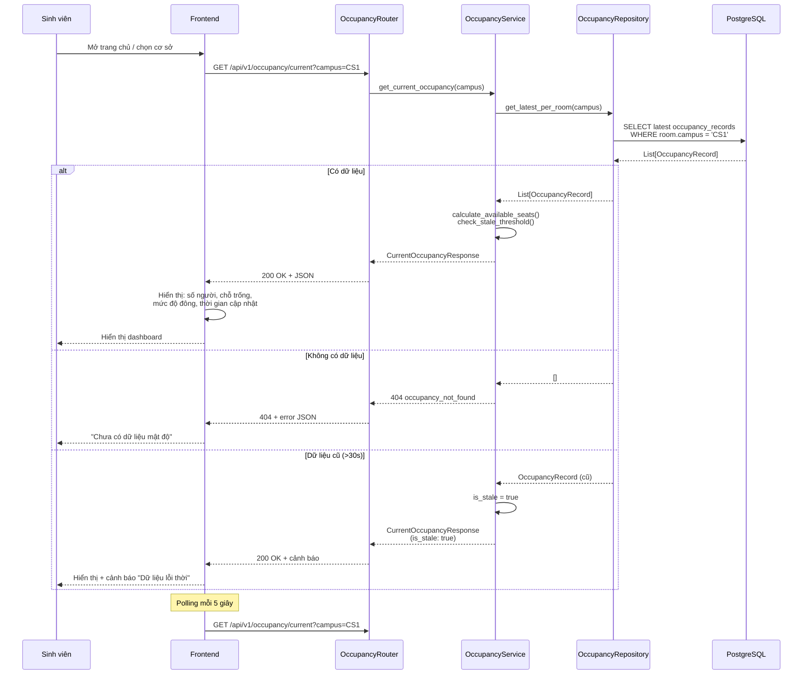

# API Contracts - UTH-SeatSense

> **Task:** SEAT-18 - API contract with the CV module
> **Status:** Contract agreed by Backend, CV, and Frontend; SEAT-19 Backend routes are implemented. CV-to-Backend sender integration remains pending.
> **Source:** CV Data Contract v1.0 and the SEAT-24 PostgreSQL persistence design.
> **Last updated:** 2026-10-30

## Dashboard occupancy endpoint

- `GET /api/v1/occupancy/current` returns the total occupancy from the latest
  record for each active room, with `current_count`, `updated_at`, and
  `location`. The count and timestamp are `null` when no records exist.
- The endpoint aggregates all active rooms because the current room schema has
  no campus identifier. Campus-specific filtering requires adding that mapping
  to the data model.

## 1. Purpose and status

This document records the agreed wire contract for CV count records and the latest occupancy data shown by Frontend. The CV owner agreed to follow the Backend contract, with already committed CV work left untouched. Frontend approved the GET response and display behavior, including null versus zero, no-data handling, the 30-second stale threshold, and 5-second polling.

The CV v1.0 producer currently writes local JSONL records. This document defines the HTTP boundary used by the SEAT-19 Backend routes; the CV sender/retry integration is still pending. CV's local video and webcam testing routes are described in section 12 and are not Backend business endpoints. The existing SEAT-19 occupancy request format remains separate from raw per-frame CV records.

## 2. General conventions

- API base path: `/api/v1`.
- Request and response bodies use UTF-8 JSON with `snake_case` field names.
- JSON integers are numbers, not numeric strings. A missing value is not the same as `0`.
- Timestamps are ISO 8601 date-time strings with a timezone. Backend normalizes returned timestamps to UTC with a `Z` suffix.
- `timestamp_ms` is a relative offset within the source or session timeline. It is not Unix time.
- CV v1.0 payloads reject unknown fields. Do not rename fields silently.
- A `CountResult` is a frame record. A `CrossingEvent` is a separate event and is not accepted by the v1 count-record endpoint below.

## 3. CV v1.0 data fields

### 3.1 CountResult

| Field | Type | Required | Meaning and validation |
|---|---|---:|---|
| `schema_version` | string | No; defaults to `"1.0"` | CV contract version. Backend supports `1.0`. |
| `session_id` | UUID string | Yes | Identifier for one CV processing session. |
| `camera_id` | string | Yes | Camera identifier; 1-100 non-blank characters. |
| `room_id` | string or null | No | CV room code; 1-100 non-blank characters when present. Backend preserves it as `room_code` and links it to `rooms.id` only when it exactly matches `rooms.code`. |
| `source_type` | string | No; defaults to `"video"` | `"video"` or `"webcam"`. Only webcam records feed the current-occupancy GET endpoint. |
| `frame_index` | integer | Yes | Zero-based frame number; non-negative. |
| `timestamp_ms` | number | Yes | Non-negative, finite offset within the video/session. |
| `recorded_at` | date-time string | Yes | Time CV processed the record; must include a timezone. It is not necessarily camera capture time. |
| `people_count` | integer | Yes | People detected in this frame, including detections without confirmed track IDs; non-negative. It is not guaranteed whole-room occupancy. |
| `tracked_count` | integer | Yes | Detected people with confirmed track IDs; `0 <= tracked_count <= people_count`. |
| `line_enabled` | boolean | Yes | Whether virtual-line counting is enabled. |
| `in_count` | integer or null | No | Cumulative IN count for this session. Required when `line_enabled` is true; null when false. |
| `out_count` | integer or null | No | Cumulative OUT count for this session. Required when `line_enabled` is true; null when false. |
| `initial_occupancy` | integer or null | No | Known starting number of people; non-negative. |
| `estimated_occupancy` | integer or null | No | `max(0, initial_occupancy + in_count - out_count)` when calculable; otherwise null. |
| `occupancy_underflow` | boolean | No; defaults to false | True when the unclamped estimate was negative. |

`people_count` describes people visible to the camera. `estimated_occupancy` estimates people in the room and depends on a correct starting count and camera coverage of entrances/exits. `null` means unknown; `0` is a valid estimate. IN/OUT values are cumulative within a session and must not be summed across frames, sessions, or cameras.

### 3.2 CountResult example

```json
{
  "schema_version": "1.0",
  "session_id": "6f228318-ea31-46b3-a1a7-c562288ea97e",
  "camera_id": "cam-01",
  "room_id": "A101",
  "source_type": "webcam",
  "frame_index": 100,
  "timestamp_ms": 10000.0,
  "recorded_at": "2026-10-30T00:00:00Z",
  "people_count": 3,
  "tracked_count": 2,
  "line_enabled": true,
  "in_count": 4,
  "out_count": 1,
  "initial_occupancy": 0,
  "estimated_occupancy": 3,
  "occupancy_underflow": false
}
```

### 3.3 CrossingEvent

CV v1.0 also defines `CrossingEvent` with `event_id`, `session_id`, `camera_id`, optional `room_id`, `frame_index`, `timestamp_ms`, `recorded_at`, `track_id`, `direction` (`IN`/`OUT`) and `confidence` (`0..1`). It is a discrete line-crossing event, not a room occupancy snapshot.

**Agreed v1 scope:** store CountResult records only. Do not send CrossingEvent to the v1 count endpoint. Add an event endpoint and persistence separately if the team later needs event history.

## 4. CV -> Backend: store count records

### 4.1 Endpoint

```http
POST /api/v1/cv/count-records
Content-Type: application/json
```

The request contains a batch of 1-1000 CountResult records. Backend validates the whole batch and saves it in one database transaction; if any record is invalid or conflicting, the batch is rolled back.

```json
{
  "records": [
    {
      "schema_version": "1.0",
      "session_id": "6f228318-ea31-46b3-a1a7-c562288ea97e",
      "camera_id": "cam-01",
      "room_id": "A101",
      "source_type": "webcam",
      "frame_index": 100,
      "timestamp_ms": 10000.0,
      "recorded_at": "2026-10-30T00:00:00Z",
      "people_count": 3,
      "tracked_count": 2,
      "line_enabled": true,
      "in_count": 4,
      "out_count": 1,
      "initial_occupancy": 0,
      "estimated_occupancy": 3,
      "occupancy_underflow": false
    }
  ]
}
```

### 4.2 Mapping and idempotency

- Store one row per frame in `cv_count_records`, separate from `occupancy_records`. Do not map `people_count` to `occupied_count`.
- Keep CV's `room_id` string in `room_code`. Resolve `room_id` to the numeric `rooms.id` only when `room_code` exactly matches `rooms.code`. Preserve unknown or null room codes with a null database room link; do not parse them as numeric IDs or create rooms.
- The count-record idempotency key is `(session_id, frame_index)`. Same key and same content returns the existing record; same key with different CV content returns `409 cv_record_conflict`.
- A retry must use the same session/frame key. Room mapping is metadata and a retry does not rewrite a previously stored record.

### 4.3 Delivery and response

- CV sends all records needed for history in batches, not one HTTP request per frame. Send when a batch reaches 100 records or after 1 second, whichever comes first; maximum batch size is 1000. Flush remaining records when a session ends.
- Retry network timeouts and `503` up to three times with 1, 2, and 4 second delays, keeping the same keys. Do not retry `400`, `409`, or `422`. Retain unacknowledged records locally for later replay.
- Backend returns `200 OK` when the batch is accepted, including idempotent duplicates. Response records retain request order.

```json
{
  "status": "accepted",
  "created_count": 1,
  "duplicate_count": 0,
  "records": [
    {
      "record_id": 8123,
      "session_id": "6f228318-ea31-46b3-a1a7-c562288ea97e",
      "frame_index": 100,
      "room_code": "A101",
      "room_id": 14,
      "received_at": "2026-10-30T00:00:01Z",
      "duplicate": false
    }
  ]
}
```

A response record has `room_id: null` if the CV room code is missing or not yet mapped. An identical retry has `duplicate: true` and does not change `received_at`.

### 4.4 Error response

Backend uses this envelope for errors:

```json
{
  "error": {
    "code": "validation_error",
    "message": "One or more CV records are invalid",
    "details": [
      { "field": "records[0].tracked_count", "issue": "must not exceed people_count" }
    ]
  }
}
```

| Status | Error code | Meaning and CV action |
|---|---|---|
| `400` | `malformed_json` | Body is not valid JSON; correct it before sending again. |
| `409` | `cv_record_conflict` | Same session/frame key has different content; stop retrying and investigate. |
| `422` | `validation_error` | Invalid or missing field; correct the record before retrying. |
| `503` | `database_unavailable` | Temporary Backend/DB failure; retry using the same keys. |

An unknown room code is not an ingestion error: Backend stores the raw code and leaves the database room link null. The API is intended for the internal service network; the production authentication method still needs Backend/security review before external exposure.

## 5. Backend -> Frontend: latest room occupancy

### 5.1 Endpoint

```http
GET /api/v1/occupancy/rooms/{room_id}/latest
```

`room_id` in this URL is the numeric `rooms.id` returned by the Backend room API. The endpoint reads the newest mapped `webcam` record for that room. It does not combine counts from multiple cameras. `video` records are history/test data and do not update live occupancy.

### 5.2 Response when a record exists

```json
{
  "room_id": 14,
  "room_code": "A101",
  "camera_id": "cam-01",
  "source_type": "webcam",
  "people_count": 3,
  "tracked_count": 2,
  "estimated_occupancy": 3,
  "occupancy_underflow": false,
  "recorded_at": "2026-10-30T00:00:00Z",
  "received_at": "2026-10-30T00:00:01Z",
  "is_stale": false
}
```

`is_stale` is true when the record was received more than 30 seconds ago, based on `received_at`. If `estimated_occupancy` is null, Frontend displays `unknown`; if it is zero, Frontend displays `0`. `people_count` may be shown only with a label that makes clear it is the number visible to the camera.

### 5.3 No-data and error response

If the room exists but has no webcam record, return `404 occupancy_not_found`. If the numeric room ID does not exist, return `404 room_not_found`. Frontend distinguishes both from a valid zero count and from request/service errors.

```json
{
  "error": {
    "code": "occupancy_not_found",
    "message": "No live occupancy record is available for this room"
  }
}
```

Frontend approved a polling interval of 5 seconds and a stale threshold of 30 seconds. Frontend treats null as unknown and zero as a valid count.

## 6. Validation rules

- `schema_version` must be supported (`1.0`).
- `session_id` must be a UUID; identifiers must not be blank.
- `frame_index` and counts must be non-negative and fit their documented integer ranges; `timestamp_ms` must be finite and non-negative.
- `tracked_count` must not exceed `people_count`.
- `recorded_at` must include timezone information; Backend stores UTC and returns UTC.
- When `line_enabled` is true, `in_count` and `out_count` are required. When false, they and `initial_occupancy` must be null.
- When `initial_occupancy` is known, `estimated_occupancy` and `occupancy_underflow` must agree with `max(0, initial_occupancy + in_count - out_count)`.
- Unknown fields are rejected. An absent count must not be converted to zero.

## 7. Data limitations and freshness

- `people_count` is the number of people visible in one frame, not guaranteed whole-room occupancy.
- `estimated_occupancy` depends on a correct initial occupancy and a camera covering the relevant entrances/exits.
- CV counters reset for each session. V1 supports one active camera source per room for the live Frontend view; multi-camera aggregation is out of scope.
- `recorded_at` is the CV processing time. `received_at` is assigned by Backend when the row is first stored and is used for freshness. `timestamp_ms` remains a relative source/session offset.
- Logic tests do not prove real-world accuracy. Camera placement, occlusion, dropped tracks, and line configuration can affect results.

## 8. Integration examples to verify

| Case | Expected behavior |
|---|---|
| Valid one-record batch | Save one record and return its receipt. |
| Valid multi-record batch | Save all records atomically and return receipts in request order. |
| Identical session/frame retry | Return the existing record with `duplicate: true`; do not create a second row. |
| Same key, different content | Return `409 cv_record_conflict`; roll back the whole batch. |
| Unknown/null room code | Accept and preserve the code; return `room_id: null`. |
| Zero visible/estimated count | Accept `0` as a valid value. |
| Null estimated occupancy | Preserve null; Frontend shows unknown rather than zero. |
| Missing field, invalid type, invalid counter formula | Return `422 validation_error` with the field path. |
| Timezone-free `recorded_at` | Reject with `422 validation_error`. |
| Backend timeout or `503` | CV retries with the same session/frame keys. |
| GET for room with no webcam data | Return `404 occupancy_not_found`. |
| GET for valid zero estimate | Return `200` with `estimated_occupancy: 0`. |
| GET for record older than 30 seconds | Return the record with `is_stale: true`. |

## 9. Implementation status

| Item | Status |
|---|---|
| CV v1.0 CountResult fields and semantics | Supplied by CV; documented here. |
| Backend storage shape and room-code mapping | Agreed contract based on the SEAT-24 persistence design. |
| CV batch HTTP endpoint and response | Implemented by the SEAT-19 Backend API. |
| CV sender, retry queue, and Backend URL configuration | Not present in the committed SEAT-17 CV material; implementation remains follow-up work. Existing CV commits are unchanged. |
| Frontend latest response and stale/no-data behavior | Confirmed by Frontend; implemented by the SEAT-19 Backend API. |
| CrossingEvent HTTP ingestion | Excluded from the agreed v1 scope. |
| Integration verification across CV, Backend, and Frontend | Pending endpoint implementation; request and response examples are included for that work. |

## 10. Agreement record

| Decision | Agreed contract | Status |
|---|---|---|
| Count value shown as room occupancy | Use `estimated_occupancy`; preserve `people_count` separately. | CV and Frontend confirmed |
| Room mapping | CV `room_id` is a room code; resolve exact `rooms.code`, preserve unmapped code with null FK. | CV agreed to follow Backend contract |
| Camera/session aggregation | One active camera per room in v1; do not aggregate sessions/cameras. | Backend v1 scope; CV follows this contract |
| Count endpoint delivery | Batch up to 1000; flush at 100 records or 1 second; retries reuse `(session_id, frame_index)`. | CV agreed to follow Backend contract; sender is not implemented |
| CrossingEvent | Do not send/store through v1 count endpoint; add separate API in a later task if needed. | Excluded from v1 scope |
| Frontend response | Numeric Backend room ID; `estimated_occupancy`, metadata, `received_at`, and `is_stale`. | Frontend confirmed |
| No-data and freshness | `404 occupancy_not_found`; stale after 30 seconds; FE polling every 5 seconds. | Frontend confirmed |
| Service authentication | Private service network for development; production auth method must be decided before external exposure. | Open deployment decision for Backend/security |

The CV and Frontend confirmations were reported by the Backend owner on 2026-10-30. Update this contract if either team requests a change. Decide production authentication separately before external exposure.

## 11. SEAT-18 acceptance checklist

- [x] Draft lists the CV fields, types, meanings, and validation rules.
- [x] Draft includes CV-to-Backend and Backend-to-Frontend request/response examples.
- [x] Draft defines proposed missing-data, invalid-data, duplicate, timestamp, and connection-failure behavior.
- [x] CV agrees to follow the Backend contract; already committed CV files remain untouched.
- [x] Frontend confirms the GET response, null/zero/no-data/stale behavior, and polling interval.
- [x] JSON examples are available for future integration testing.

The Backend routes and examples are documented for integration. End-to-end verification with the live CV sender and Frontend remains follow-up work; it is not required to approve this contract document.

## 12. SEAT-17 CV local testing APIs

The following routes belong to CV's local testing service. They are separate from Backend business APIs and do not implement the Backend ingestion endpoint in section 4.

### Local CV testing UI

- `GET /`: local HTML testing interface; `/static/` contains its assets.
- `GET /api/config`: model availability and selected device, with no local path.
- `POST /api/jobs`: multipart `file` video and JSON string `options`; returns `202` with a job ID. Limit 200 MB; one job at a time (`409` when busy), `503` if the model is missing, `415` for an unsupported extension, and `422` for invalid options.
- `GET /api/jobs/{id}`: status, latest record and matching JPEG base64, recent events, sanitized summary and error. Status progresses through uploading/loading/processing to completed/cancelled/failed.
- `POST /api/jobs/{id}/stop`: cooperative cancellation after the current frame.
- `GET /api/jobs/{id}/preview`: latest JPEG; `404` before the first frame.
- `GET /api/jobs/{id}/files/{kind}`: csv/jsonl/debug/events/summary; available only after completed/cancelled (`409` otherwise). Unknown ID or kind returns `404`.

These are CV testing routes, not Backend business endpoints. Job metadata is in memory and disappears on restart; outputs remain local until manually removed.

### Browser webcam testing

- `POST /api/webcam`: JSON options as for video; reserves the inference slot and starts a fresh tracking session, returning `202` with a job ID.
- `POST /api/webcam/{id}/frame`: JPEG bytes, maximum 2 MB and maximum decoded edge 1920 px. Returns a count record with `source_type: webcam` and debug bounding boxes. One frame at a time; `409` if busy/stopped, `422` for an invalid frame.
- Stop and exports use the same job endpoints. Webcam source timestamps use monotonic time since session start; `recorded_at` is UTC processing time.
- The browser obtains camera access only after explicit Start Test and permission. No audio or webcam video recording. Stop before leaving the page; a crashed client may require restarting the local service to release an orphan session.

---

## 13. UC-01: Xem chỗ trống - Sequence Diagram và API Spec

> **Task:** SEAT-39 - Sequence UC-01 và đặc tả API occupancy, rooms  
> **Status:** Draft - sẽ được finalize trong SEAT-40  
> **Last updated:** 2026-11-11

### 13.1 Sequence Diagram

Luồng UC-01: Sinh viên xem tình trạng khu tự học tự do



### 13.2 API Endpoint: GET /api/v1/occupancy/current

Lấy mật độ hiện tại của tất cả phòng đang hoạt động.

**Query Parameters:**

| Tham số | Kiểu | Bắt buộc | Mô tả |
|---------|------|----------|-------|
| `campus` | string | No | Lọc theo cơ sở: 'CS1', 'CS3'. Không truyền = tất cả cơ sở |

**Success Response (200 OK):**

```json
{
  "campus": "CS1",
  "rooms": [
    {
      "room_id": 1,
      "room_code": "A101",
      "room_name": "Khu tự học CS1",
      "room_type": "free_area",
      "capacity": 50,
      "current_count": 23,
      "available_seats": 27,
      "occupancy_level": "medium",
      "recorded_at": "2026-11-11T10:25:30Z",
      "updated_at": "2026-11-11T10:25:30Z",
      "is_stale": false,
      "device_status": "online"
    },
    {
      "room_id": 2,
      "room_code": "A201",
      "room_name": "Phòng học nhóm 1",
      "room_type": "topic_room",
      "capacity": 10,
      "current_count": 8,
      "available_seats": 2,
      "occupancy_level": "high",
      "recorded_at": "2026-11-11T10:25:15Z",
      "updated_at": "2026-11-11T10:25:15Z",
      "is_stale": false,
      "device_status": "online"
    }
  ],
  "total_rooms": 2,
  "last_updated": "2026-11-11T10:25:30Z"
}
```

**Field Descriptions:**

- `current_count`: Số người ước tính hiện tại (null nếu chưa có dữ liệu)
- `available_seats`: Số ghế trống = `max(0, capacity - current_count)` (null nếu chưa cấu hình)
- `occupancy_level`: Mức độ đông: `low` (≤50%), `medium` (>50% và <80%), `high` (≥80%)
- `is_stale`: `true` nếu dữ liệu cũ hơn 30 giây (dựa vào `updated_at`)
- `device_status`: Trạng thái thiết bị: `online`, `offline`, `error`

**No Data Response (404 Not Found):**

```json
{
  "error": {
    "code": "occupancy_not_found",
    "message": "Chưa có dữ liệu mật độ cho cơ sở này"
  }
}
```

**Service Unavailable (503):**

```json
{
  "error": {
    "code": "service_unavailable",
    "message": "Không thể kết nối tới nguồn dữ liệu"
  }
}
```

### 13.3 API Endpoint: GET /api/v1/rooms

Lấy danh sách phòng có thể lọc theo cơ sở và loại phòng.

**Query Parameters:**

| Tham số | Kiểu | Bắt buộc | Mô tả |
|---------|------|----------|-------|
| `campus` | string | No | Lọc theo cơ sở: 'CS1', 'CS3' |
| `room_type` | string | No | Lọc theo loại: 'free_area', 'topic_room' |
| `status` | string | No | Lọc theo trạng thái: 'active', 'maintenance', 'closed' |

**Success Response (200 OK):**

```json
{
  "rooms": [
    {
      "id": 1,
      "code": "A101",
      "name": "Khu tự học CS1",
      "room_type": "free_area",
      "building": "CS1",
      "capacity": 50,
      "location": "Tầng 1, Khu A",
      "status": "active",
      "is_active": true,
      "created_at": "2026-10-01T00:00:00Z"
    },
    {
      "id": 2,
      "code": "A201",
      "name": "Phòng học nhóm 1",
      "room_type": "topic_room",
      "building": "CS1",
      "capacity": 10,
      "location": "Tầng 2, Khu A",
      "status": "active",
      "is_active": true,
      "created_at": "2026-10-01T00:00:00Z"
    }
  ],
  "total": 2
}
```

### 13.4 API Endpoint: GET /api/v1/rooms/{room_id}

Lấy chi tiết một phòng cụ thể.

**Success Response (200 OK):**

```json
{
  "id": 1,
  "code": "A101",
  "name": "Khu tự học CS1",
  "room_type": "free_area",
  "building": "CS1",
  "capacity": 50,
  "location": "Tầng 1, Khu A",
  "status": "active",
  "is_active": true,
  "created_at": "2026-10-01T00:00:00Z"
}
```

**Room Not Found (404):**

```json
{
  "error": {
    "code": "room_not_found",
    "message": "Không tìm thấy phòng với ID này"
  }
}
```

### 13.5 API Endpoint: GET /api/v1/rooms/{room_id}/occupancy/history

Lấy lịch sử mật độ của một phòng.

**Query Parameters:**

| Tham số | Kiểu | Bắt buộc | Mô tả |
|---------|------|----------|-------|
| `start_time` | datetime | Yes | Thời gian bắt đầu (ISO 8601) |
| `end_time` | datetime | Yes | Thời gian kết thúc (ISO 8601) |
| `limit` | integer | No | Số bản ghi tối đa (mặc định: 100, max: 500) |

**Success Response (200 OK):**

```json
{
  "room_id": 1,
  "room_code": "A101",
  "room_name": "Khu tự học CS1",
  "start_time": "2026-11-11T09:00:00Z",
  "end_time": "2026-11-11T10:00:00Z",
  "records": [
    {
      "id": 1001,
      "current_count": 20,
      "available_seats": 30,
      "recorded_at": "2026-11-11T09:00:00Z",
      "source": "cv",
      "device_status": "online"
    },
    {
      "id": 1002,
      "current_count": 25,
      "available_seats": 25,
      "recorded_at": "2026-11-11T09:05:00Z",
      "source": "cv",
      "device_status": "online"
    }
  ],
  "total": 2
}
```

### 13.6 Edge Cases và Error Handling

**Dữ liệu lỗi thời (Stale Data):**
- Ngưỡng: Dữ liệu cũ hơn **30 giây** được đánh dấu `is_stale: true`
- Frontend hiển thị cảnh báo: "⚠️ Dữ liệu lỗi thời - cập nhật lần cuối lúc {time}"
- Response vẫn trả 200 OK nhưng có flag `is_stale`

**Mất kết nối (Connection Loss):**
- Khi `device_status: "offline"` hoặc không nhận được dữ liệu mới
- Frontend hiển thị: "❌ Mất kết nối với camera"
- Giữ dữ liệu cũ nhưng disable polling tạm thời

**Không có dữ liệu ban đầu:**
- `current_count: null`, `available_seats: null`
- Frontend hiển thị: "Chưa có dữ liệu - Đang chờ cấu hình"

**Error Codes Summary:**

| HTTP Code | Error Code | Khi nào xảy ra | Frontend xử lý |
|-----------|------------|----------------|----------------|
| 200 | — | Thành công, có thể có `is_stale: true` | Hiển thị dữ liệu + cảnh báo nếu stale |
| 404 | `occupancy_not_found` | Phòng tồn tại nhưng chưa có dữ liệu | "Chưa có dữ liệu mật độ" |
| 404 | `room_not_found` | Room ID không tồn tại | "Không tìm thấy phòng" |
| 503 | `service_unavailable` | Database/service down | "Hệ thống tạm thời không khả dụng" |

### 13.7 Frontend Integration Notes

**Polling Strategy:**
- Interval: **5 giây** (đã thống nhất với Frontend)
- Chỉ poll khi tab active (sử dụng Page Visibility API)
- Exponential backoff khi gặp lỗi: 5s → 10s → 20s → 30s (max)

**Display Logic:**
```javascript
if (data.is_stale) {
  showWarning("Dữ liệu lỗi thời");
}
if (data.device_status === "offline") {
  showError("Mất kết nối camera");
}
if (data.current_count === null) {
  showPlaceholder("Chưa có dữ liệu");
} else if (data.current_count === 0) {
  showCount(0); // Zero là giá trị hợp lệ
}
```

**Occupancy Level Colors:**
- `low` (≤50%): Xanh lá 🟢
- `medium` (>50%, <80%): Vàng 🟡
- `high` (≥80%): Đỏ 🔴

