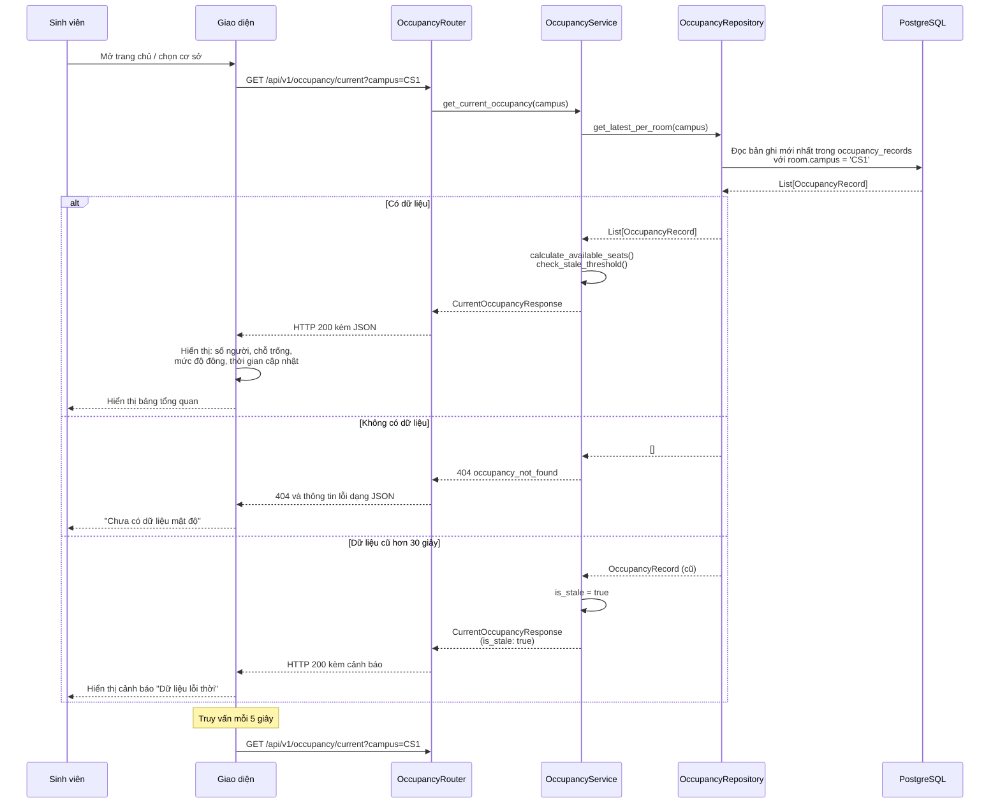

# Hợp đồng API – UTH-SeatSense

> **Nhiệm vụ:** SEAT-18 – Hợp đồng API với mô-đun CV
> **Trạng thái:** Nhóm máy chủ, CV và giao diện đã thống nhất hợp đồng. Các tuyến API phía máy chủ của SEAT-19 đã được triển khai. Phần gửi dữ liệu từ CV lên máy chủ còn chờ tích hợp.
> **Nguồn:** Hợp đồng dữ liệu CV v1.0 và thiết kế lưu trữ PostgreSQL của SEAT-24.
> **Cập nhật lần cuối:** 2026-10-30

## API tổng hợp số người cho bảng tổng quan

- `GET /api/v1/occupancy/current` trả về tổng số người dựa trên bản ghi mới nhất
  của từng phòng đang hoạt động, gồm `current_count`, `updated_at` và
  `location`. Số người và thời điểm cập nhật là `null` khi chưa có bản ghi.
- API tổng hợp tất cả phòng đang hoạt động vì mô hình phòng hiện tại
  chưa có mã cơ sở. Để lọc theo cơ sở, cần bổ sung ánh xạ này
  vào mô hình dữ liệu.

## 1. Mục đích và trạng thái

Tài liệu ghi lại hợp đồng trao đổi dữ liệu đã thống nhất cho bản ghi số đếm CV và số người mới nhất hiển thị trên giao diện. Nhóm CV đồng ý theo hợp đồng của máy chủ và giữ nguyên phần CV đã đưa vào Git. Nhóm giao diện đã xác nhận phản hồi GET và cách hiển thị, gồm phân biệt giá trị chưa biết với số 0, xử lý khi thiếu dữ liệu, ngưỡng lỗi thời 30 giây và chu kỳ truy vấn 5 giây.

Mô-đun CV v1.0 hiện ghi bản ghi JSONL cục bộ. Tài liệu xác định giao tiếp HTTP cho các tuyến máy chủ của SEAT-19. Việc tích hợp bộ gửi và cơ chế gửi lại của CV còn chờ thực hiện. Mục 12 mô tả các tuyến thử video và webcam cục bộ của CV. Các tuyến này tách riêng với API nghiệp vụ của máy chủ. Định dạng yêu cầu về số người hiện có của SEAT-19 tách riêng với bản ghi thô theo từng khung hình.

## 2. Quy ước chung

- Đường dẫn gốc của API là `/api/v1`.
- Nội dung yêu cầu và phản hồi dùng JSON UTF-8 với tên trường theo kiểu `snake_case`.
- Biểu diễn số nguyên bằng giá trị số trong JSON. Phân biệt giá trị bị thiếu với `0`.
- Dấu thời gian dùng chuỗi ngày giờ ISO 8601 có múi giờ. Máy chủ chuẩn hóa thời gian trả về sang UTC với hậu tố `Z`.
- `timestamp_ms` là độ lệch tương đối trên dòng thời gian của nguồn hoặc phiên. Trường này dùng mốc của nguồn hoặc phiên thay cho mốc Unix.
- Dữ liệu CV v1.0 bị từ chối nếu có trường chưa định nghĩa. Cần thông báo nếu đổi tên trường.
- `CountResult` là bản ghi theo khung hình. `CrossingEvent` là sự kiện riêng và tuyến nhận bản ghi số đếm v1 bên dưới từ chối kiểu này.

## 3. Các trường dữ liệu CV v1.0

### 3.1 Bản ghi CountResult

| Trường | Kiểu | Bắt buộc | Ý nghĩa và quy tắc kiểm tra |
|---|---|---:|---|
| `schema_version` | Chuỗi | Không, mặc định `"1.0"` | Phiên bản hợp đồng CV. Máy chủ hỗ trợ `1.0`. |
| `session_id` | Chuỗi UUID | Có | Mã định danh của một phiên xử lý CV. |
| `camera_id` | Chuỗi | Có | Mã camera, dài 1–100 ký tự và không được để trắng. |
| `room_id` | Chuỗi hoặc `null` | Không | Mã phòng do CV gửi. Khi có giá trị, mã dài 1–100 ký tự và không được để trắng. Máy chủ giữ mã dưới trường `room_code` và chỉ liên kết với `rooms.id` khi trùng chính xác `rooms.code`. |
| `source_type` | Chuỗi | Không, mặc định `"video"` | Nhận `"video"` hoặc `"webcam"`. Tuyến GET lấy số người hiện tại chỉ dùng bản ghi webcam. |
| `frame_index` | Số nguyên | Có | Số thứ tự khung hình, bắt đầu từ 0. |
| `timestamp_ms` | Số | Có | Độ lệch hữu hạn và không âm trong video hoặc phiên. |
| `recorded_at` | Chuỗi ngày giờ | Có | Thời điểm CV xử lý bản ghi, bắt buộc có múi giờ. Thời điểm này có thể khác thời điểm camera ghi hình. |
| `people_count` | Số nguyên | Có | Số người phát hiện trong khung hình, kể cả người chưa có mã theo dõi đã xác nhận. Giá trị không âm và chỉ phản ánh vùng quan sát. |
| `tracked_count` | Số nguyên | Có | Số người phát hiện có mã theo dõi đã xác nhận. Điều kiện `0 <= tracked_count <= people_count`. |
| `line_enabled` | Luận lý | Có | Cho biết chế độ đếm qua đường ảo đã bật hay chưa. |
| `in_count` | Số nguyên hoặc `null` | Không | Số lượt vào cộng dồn trong phiên. Bắt buộc khi `line_enabled` là `true`, nhận `null` khi là `false`. |
| `out_count` | Số nguyên hoặc `null` | Không | Số lượt ra cộng dồn trong phiên. Bắt buộc khi `line_enabled` là `true`, nhận `null` khi là `false`. |
| `initial_occupancy` | Số nguyên hoặc `null` | Không | Số người ban đầu đã biết, có giá trị không âm. |
| `estimated_occupancy` | Số nguyên hoặc `null` | Không | Tính theo `max(0, initial_occupancy + in_count - out_count)` khi đủ dữ liệu. Nếu thiếu dữ liệu thì trả `null`. |
| `occupancy_underflow` | Luận lý | Không, mặc định `false` | Nhận `true` nếu số người ước tính trước khi áp dụng ngưỡng dưới 0 có giá trị âm. |

`people_count` cho biết số người trong vùng camera quan sát được. `estimated_occupancy` ước tính số người trong phòng, phụ thuộc vào số người ban đầu và khả năng camera bao quát các lối ra vào. `null` nghĩa là chưa biết. `0` là giá trị ước tính hợp lệ. Số lượt vào/ra đã được cộng dồn trong từng phiên, vì vậy không cộng tiếp qua các khung hình, phiên hoặc camera.

### 3.2 Ví dụ CountResult

```json
{
  "schema_version": "1.0",
  "session_id": "6f228318-ea31-46b3-a1a7-c562288ea97e",
  "camera_id": "cam-01",
  "room_id": "A101",
  "source_type": "webcam",
  "frame_index": 100,
  "timestamp_ms": 10000.0,
  "recorded_at": "2026-10-30T00:00:00Z",
  "people_count": 3,
  "tracked_count": 2,
  "line_enabled": true,
  "in_count": 4,
  "out_count": 1,
  "initial_occupancy": 0,
  "estimated_occupancy": 3,
  "occupancy_underflow": false
}
```

### 3.3 Sự kiện CrossingEvent

CV v1.0 cũng định nghĩa `CrossingEvent` với các trường `event_id`, `session_id`, `camera_id`, `room_id` (không bắt buộc), `frame_index`, `timestamp_ms`, `recorded_at`, `track_id`, `direction` (`IN` hoặc `OUT`) và `confidence` (`0..1`). Mỗi bản ghi mô tả một lượt cắt đường ảo riêng lẻ.

**Phạm vi v1 đã thống nhất:** Chỉ gửi và lưu `CountResult` qua tuyến nhận bản ghi số đếm. Nếu nhóm cần lịch sử sự kiện, bổ sung tuyến và phần lưu trữ riêng cho `CrossingEvent`.

## 4. CV → Máy chủ: lưu bản ghi số đếm

### 4.1 Tuyến API

```http
POST /api/v1/cv/count-records
Content-Type: application/json
```

Mỗi yêu cầu chứa một lô từ 1 đến 1.000 bản ghi `CountResult`. Máy chủ kiểm tra toàn bộ lô và lưu trong một giao dịch cơ sở dữ liệu. Giao dịch được hoàn tác nếu có bản ghi không hợp lệ hoặc xung đột.

```json
{
  "records": [
    {
      "schema_version": "1.0",
      "session_id": "6f228318-ea31-46b3-a1a7-c562288ea97e",
      "camera_id": "cam-01",
      "room_id": "A101",
      "source_type": "webcam",
      "frame_index": 100,
      "timestamp_ms": 10000.0,
      "recorded_at": "2026-10-30T00:00:00Z",
      "people_count": 3,
      "tracked_count": 2,
      "line_enabled": true,
      "in_count": 4,
      "out_count": 1,
      "initial_occupancy": 0,
      "estimated_occupancy": 3,
      "occupancy_underflow": false
    }
  ]
}
```

### 4.2 Ánh xạ và chống ghi trùng

- Mỗi khung hình được lưu thành một hàng trong `cv_count_records`, tách riêng với `occupancy_records`. Không ánh xạ `people_count` sang `occupied_count`.
- Giữ chuỗi `room_id` do CV gửi trong `room_code`. Chỉ gán `room_id` dạng số theo `rooms.id` khi `room_code` trùng chính xác `rooms.code`. Với mã chưa biết hoặc `null`, giữ mã gốc và để liên kết phòng là `null`. Không ép mã sang số hoặc tự tạo phòng.
- Khóa chống ghi trùng là `(session_id, frame_index)`. Cùng khóa và cùng nội dung thì trả về bản ghi đã lưu. Cùng khóa nhưng khác nội dung CV thì trả về `409 cv_record_conflict`.
- Khi gửi lại, dùng nguyên khóa phiên và khung hình. Ánh xạ phòng là thông tin bổ sung. Việc gửi lại không ghi đè bản ghi đã lưu.

### 4.3 Gửi dữ liệu và phản hồi

- CV gom các bản ghi cần lưu lịch sử thành lô. Gửi khi đủ 100 bản ghi hoặc sau 1 giây, tùy điều kiện nào đến trước. Mỗi lô tối đa 1.000 bản ghi. Gửi hết phần còn lại khi kết thúc phiên.
- Khi kết nối hết thời gian chờ hoặc nhận `503`, gửi lại tối đa ba lần, chờ lần lượt 1, 2 và 4 giây và giữ nguyên khóa. Không gửi lại khi nhận `400`, `409` hoặc `422`. Giữ bản ghi chưa được xác nhận ở máy cục bộ để gửi lại sau.
- Máy chủ trả `200 OK` khi chấp nhận lô, kể cả khi có bản ghi gửi trùng hợp lệ. Bản ghi trong phản hồi giữ nguyên thứ tự yêu cầu.

```json
{
  "status": "accepted",
  "created_count": 1,
  "duplicate_count": 0,
  "records": [
    {
      "record_id": 8123,
      "session_id": "6f228318-ea31-46b3-a1a7-c562288ea97e",
      "frame_index": 100,
      "room_code": "A101",
      "room_id": 14,
      "received_at": "2026-10-30T00:00:01Z",
      "duplicate": false
    }
  ]
}
```

Nếu mã phòng CV bị thiếu hoặc chưa ánh xạ, phản hồi có `room_id: null`. Lần gửi lại với nội dung giống hệt nhận `duplicate: true` và giữ nguyên `received_at`.

### 4.4 Phản hồi lỗi

Máy chủ dùng cấu trúc sau để trả lỗi.

```json
{
  "error": {
    "code": "validation_error",
    "message": "Một hoặc nhiều bản ghi CV không hợp lệ",
    "details": [
      { "field": "records[0].tracked_count", "issue": "không được vượt quá people_count" }
    ]
  }
}
```

| Mã HTTP | Mã lỗi | Ý nghĩa và cách CV xử lý |
|---|---|---|
| `400` | `malformed_json` | Nội dung yêu cầu không phải JSON hợp lệ. Sửa trước khi gửi lại. |
| `409` | `cv_record_conflict` | Cùng khóa phiên và khung hình nhưng khác nội dung. Dừng gửi lại và kiểm tra. |
| `422` | `validation_error` | Thiếu trường hoặc giá trị không hợp lệ. Sửa bản ghi trước khi gửi lại. |
| `503` | `database_unavailable` | Máy chủ hoặc cơ sở dữ liệu tạm thời gặp lỗi. Gửi lại với khóa cũ. |

Máy chủ chấp nhận mã phòng chưa biết, lưu mã gốc và để liên kết phòng là `null`. API dùng trong mạng nội bộ giữa các dịch vụ. Nhóm máy chủ và bảo mật cần rà soát cách xác thực cho môi trường vận hành trước khi mở truy cập từ bên ngoài.

## 5. Máy chủ → Giao diện: số người mới nhất theo phòng

### 5.1 Tuyến API

```http
GET /api/v1/occupancy/rooms/{room_id}/latest
```

`room_id` trong URL là mã số `rooms.id` do API phòng của máy chủ trả về. Tuyến này chỉ đọc bản ghi `webcam` đã ánh xạ mới nhất của phòng, không cộng số đếm từ nhiều camera. Bản ghi `video` dùng cho lịch sử hoặc thử nghiệm, không cập nhật số người theo thời gian thực.

### 5.2 Phản hồi khi có bản ghi

```json
{
  "room_id": 14,
  "room_code": "A101",
  "camera_id": "cam-01",
  "source_type": "webcam",
  "people_count": 3,
  "tracked_count": 2,
  "estimated_occupancy": 3,
  "occupancy_underflow": false,
  "recorded_at": "2026-10-30T00:00:00Z",
  "received_at": "2026-10-30T00:00:01Z",
  "is_stale": false
}
```

`is_stale` là `true` khi đã hơn 30 giây kể từ `received_at`. Nếu `estimated_occupancy` là `null`, giao diện hiển thị trạng thái chưa biết (`unknown`). Nếu giá trị bằng 0, giao diện hiển thị `0`. Chỉ hiển thị `people_count` với nhãn nêu rõ đây là số người trong vùng camera quan sát được.

### 5.3 Phản hồi khi thiếu dữ liệu hoặc có lỗi

Nếu phòng tồn tại nhưng chưa có bản ghi webcam, trả `404 occupancy_not_found`. Nếu mã phòng dạng số không tồn tại, trả `404 room_not_found`. Giao diện phân biệt hai trường hợp này với số 0 hợp lệ và với lỗi yêu cầu hoặc dịch vụ.

```json
{
  "error": {
    "code": "occupancy_not_found",
    "message": "Phòng này chưa có bản ghi số người theo thời gian thực"
  }
}
```

Nhóm giao diện xác nhận chu kỳ truy vấn 5 giây và ngưỡng lỗi thời 30 giây. Giá trị `null` biểu thị chưa biết, còn số 0 là số đếm hợp lệ.

## 6. Quy tắc kiểm tra dữ liệu

- `schema_version` phải thuộc phiên bản được hỗ trợ (`1.0`).
- `session_id` phải là UUID. Các mã định danh không được để trắng.
- `frame_index` và các số đếm phải không âm và nằm trong phạm vi số nguyên đã quy định. `timestamp_ms` phải hữu hạn và không âm.
- `tracked_count` không được lớn hơn `people_count`.
- `recorded_at` phải có thông tin múi giờ. Máy chủ lưu và trả thời gian theo UTC.
- Khi `line_enabled` là `true`, bắt buộc có `in_count` và `out_count`. Khi là `false`, hai trường này và `initial_occupancy` phải là `null`.
- Khi đã biết `initial_occupancy`, `estimated_occupancy` và `occupancy_underflow` phải nhất quán với phép tính `max(0, initial_occupancy + in_count - out_count)`.
- Từ chối các trường chưa định nghĩa. Không chuyển số đếm bị thiếu thành 0.

## 7. Giới hạn và độ mới của dữ liệu

- `people_count` chỉ phản ánh số người quan sát được trong một khung hình.
- `estimated_occupancy` phụ thuộc vào số người ban đầu chính xác và camera bao quát các lối ra vào liên quan.
- Bộ đếm CV được đặt lại mỗi phiên. Trong v1, giao diện trực tiếp chỉ dùng một nguồn camera đang hoạt động cho mỗi phòng. Tổng hợp nhiều camera nằm ngoài phạm vi.
- `recorded_at` là thời điểm CV xử lý. Máy chủ gán `received_at` khi lưu bản ghi lần đầu và dùng giá trị này để kiểm tra độ mới. `timestamp_ms` vẫn là độ lệch tương đối trong nguồn hoặc phiên.
- Kiểm thử quy tắc xử lý chưa đủ để xác nhận độ chính xác thực tế. Vị trí camera, tình trạng che khuất, việc mất dấu đối tượng và cấu hình đường ảo có thể ảnh hưởng kết quả.

## 8. Các tình huống cần kiểm thử tích hợp

| Tình huống | Kết quả mong đợi |
|---|---|
| Lô hợp lệ có một bản ghi | Lưu bản ghi và trả xác nhận tiếp nhận. |
| Lô hợp lệ có nhiều bản ghi | Lưu toàn bộ lô trong một giao dịch và trả xác nhận theo thứ tự yêu cầu. |
| Gửi lại cùng khóa phiên và khung hình với nội dung giống hệt | Trả bản ghi cũ với `duplicate: true` mà không tạo thêm hàng. |
| Cùng khóa, khác nội dung | Trả `409 cv_record_conflict` và hoàn tác cả lô. |
| Mã phòng chưa biết hoặc `null` | Chấp nhận, giữ mã gốc và trả `room_id: null`. |
| Số người quan sát được hoặc ước tính bằng 0 | Chấp nhận `0` là giá trị hợp lệ. |
| Số người ước tính là `null` | Giữ `null` và hiển thị trạng thái chưa biết trên giao diện. |
| Thiếu trường, sai kiểu hoặc sai công thức tính | Trả `422 validation_error` kèm đường dẫn tới trường lỗi. |
| `recorded_at` thiếu múi giờ | Từ chối với `422 validation_error`. |
| Máy chủ hết thời gian chờ hoặc trả `503` | CV gửi lại bằng cùng khóa phiên và khung hình. |
| GET cho phòng chưa có dữ liệu webcam | Trả `404 occupancy_not_found`. |
| GET với số người ước tính hợp lệ bằng 0 | Trả `200` với `estimated_occupancy: 0`. |
| GET với bản ghi cũ hơn 30 giây | Trả bản ghi với `is_stale: true`. |

## 9. Trạng thái triển khai

| Hạng mục | Trạng thái |
|---|---|
| Trường và ý nghĩa của `CountResult` trong CV v1.0 | Nhóm CV cung cấp, đã ghi trong tài liệu này. |
| Cấu trúc lưu trữ máy chủ và ánh xạ mã phòng | Đã thống nhất dựa trên thiết kế lưu trữ SEAT-24. |
| Tuyến HTTP nhận lô dữ liệu CV và phản hồi | Đã triển khai trong API máy chủ của SEAT-19. |
| Bộ gửi CV, hàng đợi gửi lại và cấu hình URL máy chủ | Chưa có trong phần CV đã đưa vào Git ở SEAT-17. Triển khai là công việc tiếp theo. Các phiên bản CV đã ghi vào Git được giữ nguyên. |
| Phản hồi dữ liệu mới nhất và xử lý dữ liệu cũ hoặc thiếu | Nhóm giao diện đã xác nhận. API máy chủ của SEAT-19 đã triển khai. |
| Tiếp nhận `CrossingEvent` qua HTTP | Ngoài phạm vi v1 đã thống nhất. |
| Kiểm thử tích hợp giữa CV, máy chủ và giao diện | Chờ triển khai tuyến API. Tài liệu đã có ví dụ yêu cầu và phản hồi phục vụ việc kiểm thử. |

## 10. Nội dung đã thống nhất

| Quyết định | Hợp đồng đã thống nhất | Trạng thái |
|---|---|---|
| Số người hiển thị cho phòng | Dùng `estimated_occupancy` và giữ riêng `people_count`. | Nhóm CV và giao diện đã xác nhận |
| Ánh xạ phòng | `room_id` do CV gửi là mã phòng. So khớp chính xác với `rooms.code`. Nếu chưa ánh xạ, giữ mã và để khóa ngoại là `null`. | Nhóm CV đồng ý theo hợp đồng của máy chủ |
| Tổng hợp theo camera và phiên | V1 dùng một camera hoạt động cho mỗi phòng. Không cộng gộp giữa các phiên hoặc camera. | Thuộc phạm vi v1 của máy chủ, nhóm CV tuân theo hợp đồng này |
| Gửi bản ghi số đếm | Mỗi lô tối đa 1.000 bản ghi. Gửi khi đủ 100 bản ghi hoặc sau 1 giây. Gửi lại với cùng `(session_id, frame_index)`. | Nhóm CV đồng ý theo hợp đồng, bộ gửi chưa được triển khai |
| `CrossingEvent` | Không gửi hoặc lưu qua tuyến số đếm v1. Bổ sung API riêng trong nhiệm vụ sau nếu cần. | Ngoài phạm vi v1 |
| Phản hồi cho giao diện | Mã phòng dạng số từ máy chủ, `estimated_occupancy`, thông tin bổ sung, `received_at` và `is_stale`. | Nhóm giao diện đã xác nhận |
| Thiếu dữ liệu và độ mới | Trả `404 occupancy_not_found` khi thiếu dữ liệu. Ngưỡng lỗi thời là 30 giây, giao diện truy vấn mỗi 5 giây. | Nhóm giao diện đã xác nhận |
| Xác thực dịch vụ | Môi trường phát triển dùng mạng dịch vụ riêng. Cần chốt cách xác thực cho môi trường vận hành trước khi mở truy cập từ bên ngoài. | Nhóm máy chủ và bảo mật chưa chốt phương án triển khai |

Người phụ trách máy chủ ghi nhận xác nhận từ nhóm CV và giao diện vào ngày 2026-10-30. Cập nhật hợp đồng nếu một trong hai nhóm yêu cầu thay đổi. Cách xác thực cho môi trường vận hành cần được chốt riêng trước khi mở truy cập từ bên ngoài.

## 11. Danh sách kiểm tra nghiệm thu SEAT-18

- [x] Bản thảo nêu các trường dữ liệu CV, kiểu, ý nghĩa và quy tắc kiểm tra.
- [x] Bản thảo có ví dụ yêu cầu và phản hồi cho luồng CV → máy chủ và máy chủ → giao diện.
- [x] Bản thảo đề xuất cách xử lý dữ liệu thiếu, sai hoặc trùng, dấu thời gian và lỗi kết nối.
- [x] Nhóm CV đồng ý theo hợp đồng của máy chủ. Các tệp CV đã đưa vào Git được giữ nguyên.
- [x] Nhóm giao diện xác nhận phản hồi GET, cách xử lý giá trị `null`, số 0, dữ liệu thiếu hoặc lỗi thời và chu kỳ truy vấn.
- [x] Có ví dụ JSON phục vụ kiểm thử tích hợp sau này.

Tài liệu cung cấp các tuyến máy chủ và ví dụ để tích hợp. Kiểm thử toàn luồng với bộ gửi CV chạy thực tế và giao diện là công việc tiếp theo, nằm ngoài tiêu chí phê duyệt tài liệu này.

## 12. API thử nghiệm CV cục bộ của SEAT-17

Các tuyến dưới đây thuộc dịch vụ thử nghiệm CV cục bộ. Chúng tách riêng với API nghiệp vụ máy chủ và không triển khai tuyến tiếp nhận ở mục 4.

### Giao diện thử nghiệm CV cục bộ

- `GET /` trả giao diện thử nghiệm HTML cục bộ. `/static/` chứa tài nguyên của giao diện.
- `GET /api/config` trả thông tin mô hình có sẵn hay không và thiết bị đã chọn, không kèm đường dẫn cục bộ.
- `POST /api/jobs` nhận tệp video ở trường `file` và chuỗi JSON `options` qua yêu cầu `multipart`. Trả `202` kèm mã tác vụ. Giới hạn 200 MB và một tác vụ tại một thời điểm. Trả `409` khi đang bận, `503` nếu thiếu mô hình, `415` nếu phần mở rộng không được hỗ trợ, hoặc `422` nếu tùy chọn không hợp lệ.
- `GET /api/jobs/{id}` trả trạng thái, bản ghi mới nhất, ảnh JPEG tương ứng ở dạng Base64, sự kiện gần đây, bản tóm tắt và lỗi đã lọc. Các trạng thái gồm đang tải lên (`uploading`), đang nạp (`loading`), đang xử lý (`processing`), đã hoàn tất (`completed`), đã hủy (`cancelled`) và thất bại (`failed`).
- `POST /api/jobs/{id}/stop` yêu cầu tác vụ dừng sau khi xử lý xong khung hình hiện tại.
- `GET /api/jobs/{id}/preview` trả ảnh JPEG mới nhất. Trả `404` nếu chưa có khung hình đầu tiên.
- `GET /api/jobs/{id}/files/{kind}` hỗ trợ `csv`, `jsonl`, `debug`, `events` và `summary`. Chỉ tải được khi tác vụ đã hoàn tất hoặc đã hủy. Các trạng thái khác trả `409`. Mã tác vụ hoặc loại tệp không tồn tại trả `404`.

Thông tin tác vụ nằm trong bộ nhớ và mất khi khởi động lại. Tệp kết quả được giữ cục bộ cho đến khi xóa thủ công.

### Thử webcam qua trình duyệt

- `POST /api/webcam` nhận tùy chọn JSON giống khi thử video, giữ một suất xử lý suy luận và bắt đầu phiên theo dõi mới. Trả `202` kèm mã tác vụ.
- `POST /api/webcam/{id}/frame` nhận dữ liệu JPEG tối đa 2 MB, với cạnh dài nhất sau giải mã tối đa 1.920 px. Trả bản ghi số đếm có `source_type: webcam` và các khung bao phục vụ gỡ lỗi. Mỗi lần xử lý một khung hình. Trả `409` khi đang bận hoặc đã dừng, hoặc `422` nếu khung hình không hợp lệ.
- Việc dừng và xuất kết quả dùng cùng các tuyến tác vụ. Dấu thời gian của nguồn webcam được tính theo đồng hồ đơn điệu kể từ lúc bắt đầu phiên. `recorded_at` ghi thời điểm xử lý theo UTC.
- Trình duyệt chỉ truy cập camera sau khi người dùng bấm nút `Start Test` và cấp quyền. Giao diện không ghi âm hoặc ghi video webcam. Hãy dừng tác vụ trước khi rời trang. Nếu ứng dụng phía trình duyệt gặp sự cố, có thể cần khởi động lại dịch vụ cục bộ để giải phóng phiên còn treo.

---

## 13. UC-01: Xem chỗ trống – Sơ đồ tuần tự và đặc tả API

**Nhiệm vụ:** SEAT-39 – Sơ đồ tuần tự UC-01 và đặc tả API số người và danh sách phòng
**Trạng thái:** Bản thảo, sẽ hoàn thiện trong SEAT-40
>
> **Cập nhật lần cuối:** 2026-11-11

### 13.1 Sơ đồ tuần tự

Luồng UC-01: Sinh viên xem tình trạng khu tự học tự do



### 13.2 Tuyến API GET /api/v1/occupancy/current

Lấy mật độ hiện tại của tất cả phòng đang hoạt động.

**Tham số truy vấn**

| Tham số | Kiểu | Bắt buộc | Mô tả |
|---------|------|----------|-------|
| `campus` | Chuỗi | Không | Lọc theo cơ sở: 'CS1', 'CS3'. Không truyền = tất cả cơ sở |

**Phản hồi thành công (HTTP 200)**

```json
{
  "campus": "CS1",
  "rooms": [
    {
      "room_id": 1,
      "room_code": "A101",
      "room_name": "Khu tự học CS1",
      "room_type": "free_area",
      "capacity": 50,
      "current_count": 23,
      "available_seats": 27,
      "occupancy_level": "medium",
      "recorded_at": "2026-11-11T10:25:30Z",
      "updated_at": "2026-11-11T10:25:30Z",
      "is_stale": false,
      "device_status": "online"
    },
    {
      "room_id": 2,
      "room_code": "A201",
      "room_name": "Phòng học nhóm 1",
      "room_type": "topic_room",
      "capacity": 10,
      "current_count": 8,
      "available_seats": 2,
      "occupancy_level": "high",
      "recorded_at": "2026-11-11T10:25:15Z",
      "updated_at": "2026-11-11T10:25:15Z",
      "is_stale": false,
      "device_status": "online"
    }
  ],
  "total_rooms": 2,
  "last_updated": "2026-11-11T10:25:30Z"
}
```

**Mô tả các trường**

- `current_count`: Số người ước tính hiện tại (`null` nếu chưa có dữ liệu)
- `available_seats`: Số ghế trống = `max(0, capacity - current_count)` (null nếu chưa cấu hình)
- `occupancy_level`: Mức độ đông: `low` (≤50%), `medium` (>50% và <80%), `high` (≥80%)
- `is_stale`: `true` nếu dữ liệu cũ hơn 30 giây (dựa vào `updated_at`)
- `device_status`: Trạng thái thiết bị: `online`, `offline`, `error`

**Phản hồi khi chưa có dữ liệu (HTTP 404)**

```json
{
  "error": {
    "code": "occupancy_not_found",
    "message": "Chưa có dữ liệu mật độ cho cơ sở này"
  }
}
```

**Dịch vụ không khả dụng (HTTP 503)**

```json
{
  "error": {
    "code": "service_unavailable",
    "message": "Không thể kết nối tới nguồn dữ liệu"
  }
}
```

### 13.3 Tuyến API GET /api/v1/rooms

Lấy danh sách phòng có thể lọc theo cơ sở và loại phòng.

**Tham số truy vấn**

| Tham số | Kiểu | Bắt buộc | Mô tả |
|---------|------|----------|-------|
| `campus` | Chuỗi | Không | Lọc theo cơ sở: 'CS1', 'CS3' |
| `room_type` | Chuỗi | Không | Lọc theo loại: 'free_area', 'topic_room' |
| `status` | Chuỗi | Không | Lọc theo trạng thái: 'active', 'maintenance', 'closed' |

**Phản hồi thành công (HTTP 200)**

```json
{
  "rooms": [
    {
      "id": 1,
      "code": "A101",
      "name": "Khu tự học CS1",
      "room_type": "free_area",
      "building": "CS1",
      "capacity": 50,
      "location": "Tầng 1, Khu A",
      "status": "active",
      "is_active": true,
      "created_at": "2026-10-01T00:00:00Z"
    },
    {
      "id": 2,
      "code": "A201",
      "name": "Phòng học nhóm 1",
      "room_type": "topic_room",
      "building": "CS1",
      "capacity": 10,
      "location": "Tầng 2, Khu A",
      "status": "active",
      "is_active": true,
      "created_at": "2026-10-01T00:00:00Z"
    }
  ],
  "total": 2
}
```

### 13.4 Tuyến API GET /api/v1/rooms/{room_id}

Lấy chi tiết một phòng cụ thể.

**Phản hồi thành công (HTTP 200)**

```json
{
  "id": 1,
  "code": "A101",
  "name": "Khu tự học CS1",
  "room_type": "free_area",
  "building": "CS1",
  "capacity": 50,
  "location": "Tầng 1, Khu A",
  "status": "active",
  "is_active": true,
  "created_at": "2026-10-01T00:00:00Z"
}
```

**Không tìm thấy phòng (HTTP 404)**

```json
{
  "error": {
    "code": "room_not_found",
    "message": "Không tìm thấy phòng với ID này"
  }
}
```

### 13.5 Tuyến API GET /api/v1/rooms/{room_id}/occupancy/history

Lấy lịch sử mật độ của một phòng.

**Tham số truy vấn**

| Tham số | Kiểu | Bắt buộc | Mô tả |
|---------|------|----------|-------|
| `start_time` | Ngày giờ | Có | Thời gian bắt đầu (ISO 8601) |
| `end_time` | Ngày giờ | Có | Thời gian kết thúc (ISO 8601) |
| `limit` | Số nguyên | Không | Số bản ghi tối đa (mặc định: 100, tối đa 500) |

**Phản hồi thành công (HTTP 200)**

```json
{
  "room_id": 1,
  "room_code": "A101",
  "room_name": "Khu tự học CS1",
  "start_time": "2026-11-11T09:00:00Z",
  "end_time": "2026-11-11T10:00:00Z",
  "records": [
    {
      "id": 1001,
      "current_count": 20,
      "available_seats": 30,
      "recorded_at": "2026-11-11T09:00:00Z",
      "source": "cv",
      "device_status": "online"
    },
    {
      "id": 1002,
      "current_count": 25,
      "available_seats": 25,
      "recorded_at": "2026-11-11T09:05:00Z",
      "source": "cv",
      "device_status": "online"
    }
  ],
  "total": 2
}
```

### 13.6 Các trường hợp ngoại lệ và cách xử lý lỗi

**Dữ liệu lỗi thời**
- Ngưỡng: Dữ liệu cũ hơn **30 giây** được đánh dấu `is_stale: true`
- giao diện hiển thị cảnh báo: "⚠️ Dữ liệu lỗi thời - cập nhật lần cuối lúc {time}"
- Máy chủ vẫn trả HTTP 200 kèm trường `is_stale`

**Mất kết nối**
- Khi `device_status: "offline"` hoặc không nhận được dữ liệu mới
- giao diện hiển thị: "❌ Mất kết nối với camera"
- Giữ dữ liệu cũ nhưng tạm dừng truy vấn định kỳ

**Không có dữ liệu ban đầu:**
- `current_count: null`, `available_seats: null`
- giao diện hiển thị: "Chưa có dữ liệu - Đang chờ cấu hình"

**Bảng mã lỗi**

| Mã HTTP | Mã lỗi | Khi nào xảy ra | Cách giao diện xử lý |
|-----------|------------|----------------|----------------|
| 200 | — | Thành công, có thể có `is_stale: true` | Hiển thị dữ liệu + cảnh báo nếu dữ liệu lỗi thời |
| 404 | `occupancy_not_found` | Phòng tồn tại nhưng chưa có dữ liệu | "Chưa có dữ liệu mật độ" |
| 404 | `room_not_found` | Mã phòng không tồn tại | "Không tìm thấy phòng" |
| 503 | `service_unavailable` | Cơ sở dữ liệu hoặc dịch vụ không hoạt động | "Hệ thống tạm thời không khả dụng" |

### 13.7 Lưu ý tích hợp giao diện

**Cách truy vấn định kỳ**
- Chu kỳ **5 giây**, đã thống nhất với nhóm giao diện
- Chỉ truy vấn khi thẻ trình duyệt đang hiển thị, dùng Page Visibility API
- Khi gặp lỗi, tăng thời gian chờ giữa các lần thử lên 5 → 10 → 20 → tối đa 30 giây

**Quy tắc hiển thị**
```javascript
if (data.is_stale) {
  showWarning("Dữ liệu lỗi thời");
}
if (data.device_status === "offline") {
  showError("Mất kết nối camera");
}
if (data.current_count === null) {
  showPlaceholder("Chưa có dữ liệu");
} else if (data.current_count === 0) {
  showCount(0); // Số 0 là giá trị hợp lệ
}
```

**Màu biểu thị mức độ đông**
- `low` (≤50%): Xanh lá 🟢
- `medium` (>50%, <80%): Vàng 🟡
- `high` (≥80%): Đỏ 🔴

## 14. UC-06: Dữ liệu CV gửi máy chủ cho SEAT-34

Bản đề xuất cho luồng sự kiện IN/OUT. Xem [sơ đồ tuần tự UC-06](system-architecture.md#sơ-đồ-tuần-tự-uc-06-đếm-qua-đường-ảo). Các tuyến, cấu trúc dữ liệu và hành vi trong mục này cần được nhóm CV và nhóm máy chủ xác nhận trước khi tích hợp.

### 14.1 Hiện trạng và ranh giới tương thích

| Nội dung | Hợp đồng hoặc mã hiện có | Cần cho thiết kế sự kiện |
|---|---|---|
| Tiếp nhận | POST `/api/v1/cv/count-records`, nhận lô bản ghi số đếm, khai báo 200 | Tuyến riêng; đề xuất POST `/api/v1/cv/events`, mỗi yêu cầu một sự kiện |
| Chống trùng | Mục 4.2 đặc tả khóa phiên/khung hình. Trên bản dev đối chiếu, lớp truy cập dữ liệu cập nhật bản ghi khi trùng khóa và tuyến API tham chiếu đến một lớp lỗi chưa được định nghĩa tại đó | `event_id` duy nhất, xác nhận tiếp nhận gốc và cập nhật số người đúng một lần |
| Phòng | Bản ghi số đếm nhận mã chuỗi như `A101`, ánh xạ `rooms.code` → `rooms.id` | Sự kiện dùng mã phòng dạng số đã xác minh cùng nguồn/phiên |
| Lưu trữ | Bản ghi số đếm lưu vào `cv_count_records`; mô hình `CountEvent` dùng mã số nguyên | Cập nhật cấu trúc dữ liệu để nhận mã sự kiện từ CV và lưu sự kiện, số người, xác nhận tiếp nhận trong một giao dịch |
| Giao diện đang dùng | `/occupancy/current`, làm mới 30 giây, đọc `occupancy_records` | Chốt tuyến GET theo phòng, theo cơ sở và chốt thông tin trạng thái từ nguồn sự kiện |
| GET bản ghi số đếm | `/occupancy/rooms/{room_id}/latest` đọc `cv_count_records` | Không giả định đã đọc `OccupancyRecord` hoặc tổng hợp sự kiện |
| Xác thực/trạng thái | Chưa có khóa tiếp nhận hoặc tuyến trạng thái thiết bị | Chốt khóa API, quyền nguồn và tín hiệu định kỳ báo nguồn còn hoạt động

### 14.2 Nội dung sự kiện và ánh xạ từ CV

| Trường | Kiểu / bắt buộc trong bản đề xuất | Quy tắc và ánh xạ |
|---|---|---|
| `schema_version` | chuỗi / có | `event-draft-1`; không dùng lẫn bản ghi số đếm `1.0` |
| `event_id` | chuỗi UUID / có | Bộ gửi tạo một lần và lưu bền vững trước gửi; giữ khi gửi lại/khởi động lại; không nhúng mã theo dõi |
| `session_id` | chuỗi UUID / có, bổ sung đề xuất | Phiên CV, gắn số người ban đầu N0; mỗi phiên mới cần bản ghi số ban đầu mới |
| `sequence_no` | số nguyên ≥ 0 / có, bổ sung đề xuất | Thứ tự liên tiếp của sự kiện trong nguồn/phiên, bắt đầu 0; không dùng `frame_index` vì khung hình có thể không sinh sự kiện |
| `room_id` | số nguyên > 0 / có | Ánh xạ mã phòng CV qua danh mục đã xác nhận; không ép chuỗi `A101` thành số hoặc tự tạo phòng |
| `source` | chuỗi / có | `cv`; phân biệt nguồn xử lý với định danh thiết bị |
| `device_id` | chuỗi / có | 1–100 ký tự không rỗng, ánh xạ từ `camera_id`, nguồn ổn định được phép ghi vào phòng |
| `direction` | giá trị liệt kê / có | `IN` hoặc `OUT`; một sự kiện là một lượt, không phải bộ đếm cộng dồn |
| `event_time` | ISO 8601 UTC / có | Thời điểm xác nhận cắt đường ảo, hậu tố `Z`, đồng hồ đã đồng bộ; không đổi độ lệch `timestamp_ms` thành thời gian Unix |
| `device_status` | giá trị liệt kê / có | `online` tại thời điểm cắt đường ảo; trạng thái `offline`/`error` gửi bằng thông điệp riêng |
```json
{
  "schema_version": "event-draft-1",
  "event_id": "076ccfac-ea81-4213-9d9f-6b7bb4387010",
  "session_id": "6f228318-ea31-46b3-a1a7-c562288ea97e",
  "sequence_no": 0,
  "room_id": 14,
  "source": "cv",
  "device_id": "cam-01",
  "direction": "IN",
  "event_time": "2026-11-11T07:00:00Z",
  "device_status": "online"
}
```
### 14.3 Giao dịch, xác nhận tiếp nhận và lỗi

| Trường hợp | Hành vi mục tiêu |
|---|---|
| Sự kiện mới hợp lệ | HTTP 201 sau khi xác nhận lưu giao dịch (COMMIT); sự kiện, số người và xác nhận tiếp nhận lưu trong một giao dịch |
| Cùng `event_id`, cùng nội dung chuẩn hóa | HTTP 200, xác nhận gốc với `duplicate=true`; không đổi số đếm hoặc `received_at` |
| Cùng `event_id`, khác nội dung | HTTP 409 `event_conflict`; không cập nhật dữ liệu; cách ly để điều tra |
| Thiếu/sai khóa | HTTP 401 `unauthorized`; không ghi dữ liệu |
| Khóa/nguồn không có quyền ghi phòng/phiên | HTTP 403 `forbidden` |
| Phòng không tồn tại | HTTP 404 `room_not_found`; không tự tạo phòng |
| JSON hỏng / sai cấu trúc dữ liệu | HTTP 400 `malformed_json` / 422 `validation_error` |
| Phiên chưa đăng ký / sai thứ tự / phiên đóng | Đề xuất 409 `session_not_ready` / `event_out_of_order` / `session_closed`; giữ để đối soát |
| Cơ sở dữ liệu không khả dụng | HTTP 503 `database_unavailable`; hoàn tác phần chưa xác nhận lưu |

```json
{
  "event_id": "076ccfac-ea81-4213-9d9f-6b7bb4387010",
  "room_id": 14,
  "received_at": "2026-11-11T07:00:01Z",
  "duplicate": false
}
```


### 14.4 Giao nhận và trạng thái nguồn

- Bộ gửi lưu hàng đợi bền vững trước gửi; mỗi nguồn/phiên chỉ có một yêu cầu
  chờ xác nhận. Chỉ bỏ sự kiện khi phản hồi 201/200 hợp lệ khớp `event_id`.
- Đề xuất thời gian chờ kết nối 3 giây, toàn yêu cầu 10 giây. Khi mất kết nối,
  hết thời gian chờ hoặc nhận 503, gửi lại ba lượt sau lần đầu, chờ tăng dần
  1, 2, 4 giây, giữ nguyên mã sự kiện, nội dung và thứ tự. Hết lượt vẫn giữ hàng đợi và
  báo vận hành để gửi lại sau.
- Với lỗi 4xx, không tự gửi lại; giữ/cách ly, báo nguyên nhân và đối soát. Không bỏ
  sự kiện lỗi rồi áp dụng sự kiện phụ thuộc nó. Giới hạn hàng đợi, cảnh báo
  đầy, thời hạn lưu và phục hồi cần chốt; không tự xóa sự kiện chưa được xác
  nhận. Các giá trị thời gian chờ/gửi lại là đề xuất, chưa được triển khai.
- Camera mất nhưng CV còn mạng: đề xuất POST `/api/v1/cv/device-status` riêng.
  Không gửi IN/OUT giả hoặc đặt số đếm về 0. CV mất mạng/dừng đột ngột không
  thể gửi trạng thái mất kết nối ngay; máy chủ cần tín hiệu định kỳ để phát
  hiện mất nguồn.
- Đề xuất gửi tín hiệu nguồn còn hoạt động mỗi 10 giây, quá 30 giây thì đánh
  dấu dữ liệu cũ, chờ xác nhận. Ngưỡng này khác cơ chế GET bản ghi số đếm hiện
  tại dựa trên tuổi `received_at`.
- Trạng thái có thứ tự riêng theo nguồn/phiên. Thông báo trạng thái cũ gửi lại
  không ghi đè trạng thái mới; gửi lại xác nhận không làm dữ liệu cũ bị hiểu
  thành mới. Sau gián đoạn, nguồn đang kết nối và số người đã đồng bộ là hai
  điều kiện riêng.

Ví dụ dữ liệu trạng thái đề xuất

```json
{
  "schema_version": "status-draft-1",
  "status_id": "d171547f-6385-4df0-a662-9b283187255e",
  "session_id": "6f228318-ea31-46b3-a1a7-c562288ea97e",
  "status_sequence_no": 1,
  "room_id": 14,
  "source": "cv",
  "device_id": "cam-01",
  "device_status": "offline",
  "event_time": "2026-11-11T07:01:00Z"
}
```

`device_status` là `online|offline|error`, không có hướng vào/ra hoặc số đếm.
Đề xuất trạng thái mới trả 201, trùng cùng nội dung trả 200 với xác nhận gốc,
khác nội dung trả 409; không cập nhật số người. Tên tuyến, cấu trúc dữ liệu và thông tin
bổ trợ của GET chờ chốt. API đọc/giao diện cần phân biệt chưa biết, số 0 hợp
lệ, số đếm cũ, mất kết nối và lỗi HTTP.
Chưa có N0/sức chứa hợp lệ thì không công bố chỗ trống hoặc mức đông chính thức.

### 14.5 Khóa API qua biến môi trường

Đề xuất trường tiêu đề HTTP `X-API-Key`; bộ gửi đọc `CV_API_KEY`, máy chủ đọc
`CV_INGEST_API_KEY` qua môi trường. Đây là tên thiết kế, chưa có xác thực tương
ứng trong mã nguồn. Không đưa khóa vào URL, JSON, nhật ký hoặc giao diện; không
đưa `.env` vào lịch sử Git. Máy chủ phải xác thực khóa và quyền nguồn/phòng,
không chỉ kiểm tra có tiêu đề. Cách cấp/đổi khóa, ánh xạ quyền và so sánh khóa
an toàn cần chốt với máy chủ. Dùng HTTPS khi truyền qua mạng; không mở API
tiếp nhận công khai từ bản chạy thử.

### 14.6 Ví dụ curl và kế hoạch xác thực

Các lệnh dùng PowerShell và `curl.exe`, chỉ dành cho môi trường thử riêng có
cơ sở dữ liệu đã nạp dữ liệu mẫu. Chưa chạy trong lần soạn tài liệu; không gọi
vào dữ liệu chung/môi trường vận hành thực tế, không ghi tệp thử vào thư mục
hỗ trợ được bảo vệ.

Với **bản ghi số đếm SEAT-19**, lưu một lô theo mục 4.1 vào `count-batch.json` trong thư
mục thử nghiệm. API khai báo 200. Xem mục 14.1 về sai khác đã ghi nhận trong mã
nguồn trước khi thử.

```powershell
$seat34BaseUrl = 'http://127.0.0.1:8000'
curl.exe --silent --show-error --max-time 10 --include `
  -H 'Content-Type: application/json' `
  --data-binary '@count-batch.json' "$seat34BaseUrl/api/v1/cv/count-records"
curl.exe --silent --show-error --max-time 10 --include `
  "$seat34BaseUrl/api/v1/occupancy/rooms/14/latest"
```

Với **sự kiện có khóa**, lưu JSON mục 14.2 vào `crossing-event.json` trong thư mục
thử; nạp khóa thử nghiệm vào môi trường. Chỉ chạy sau khi máy chủ có tuyến và
xác thực theo hợp đồng đã duyệt. Lệnh là ví dụ thiết kế, không chứng minh API
có sẵn.

```powershell
$seat34BaseUrl = 'http://127.0.0.1:8000'
if ([string]::IsNullOrWhiteSpace($env:CV_API_KEY)) {
  throw 'Chưa nạp CV_API_KEY cho môi trường thử nghiệm'
}
curl.exe --silent --show-error --connect-timeout 3 --max-time 10 --include `
  -H 'Content-Type: application/json' -H "X-API-Key: $env:CV_API_KEY" `
  --data-binary '@crossing-event.json' "$seat34BaseUrl/api/v1/cv/events"
```

Gửi lại cùng tệp để thử chống trùng, không tạo UUID mới. Để thử trạng thái,
lưu JSON mục 14.4 vào `device-status.json`, dùng cùng tiêu đề/khóa ở tuyến
trạng thái đề xuất. Không dùng `--verbose` hoặc ghi lệnh đã chứa giá trị khóa
vào nhật ký làm bằng chứng chia sẻ.

| Kiểm tra | Mong đợi | Trạng thái ngày 11/11/2026 |
|---|---|---|
| Lô số đếm hợp lệ / gửi lại / xung đột | 200 mới; 200 trùng; 409 khác nội dung theo v1 | Chưa chạy; mã nguồn đang lệch mục 14.1 |
| Sự kiện mới / gửi lại / xung đột | 201; xác nhận cũ 200; 409; số đếm đổi đúng một lần | Chưa chạy; chưa có API sự kiện |
| Thiếu/sai khóa / sai quyền | 401 / 403, không ghi dữ liệu | Chưa chạy; chưa có xác thực nguồn |
| Mất xác nhận, yêu cầu đồng thời, cơ sở dữ liệu lỗi | Một sự kiện và một tác động; hoàn tác hoặc trả xác nhận đã lưu | Chưa chạy; cần PostgreSQL thử riêng |
| Khởi động lại CV, hàng đợi đầy, sai thứ tự | Giữ mã sự kiện và thứ tự, cảnh báo/đối soát; không mất sự kiện mà không báo | Chưa chạy; chưa có bộ gửi/hàng đợi |
| Chưa biết N0, lượt ra làm số đếm âm, vượt sức chứa, hiệu chỉnh | Chưa biết, đánh dấu dưới 0, kẹp chỗ trống, lịch sử truy vết | Chưa chạy tích hợp |
| Mất nguồn/mạng, tín hiệu hoạt động phục hồi | Cảnh báo nguồn, không đặt về 0, gửi lại không làm dữ liệu cũ thành mới | Chưa chạy; chưa có API trạng thái |
| Sự kiện → GET → giao diện | Đúng phòng/cơ sở và nguồn tính; đo từ cắt đường ảo đến hiển thị | Chưa chạy; giao diện hiện làm mới 30 giây |

### 14.7 Nội dung cần Khiêm và Thắng xác nhận

- [ ] Tuyến/phiên bản/cấu trúc sự kiện và trạng thái, phiên/số thứ tự đề xuất.
- [ ] Ánh xạ phòng khu tự học/cơ sở, nguồn/quyền khóa và dữ liệu video thử.
- [ ] UUID gửi mạng, cập nhật mã số nguyên, giao dịch và xác nhận khi mất phản hồi.
- [ ] Số ban đầu mỗi phiên, thứ tự/gửi lại, số đếm dưới 0 và hiệu chỉnh truy vết.
- [ ] Nguồn GET cho giao diện, chuyển bản ghi số đếm/sự kiện, chưa biết/mất kết nối, chu kỳ cập nhật.
- [ ] Tiêu đề HTTP/biến môi trường chứa khóa, thời gian chờ/chờ tăng dần, tín hiệu hoạt động và giới hạn hàng đợi.
- [ ] NFR-PRI-01/02 và ví dụ curl được thử với API thực tế sau khi gỡ trở ngại.
