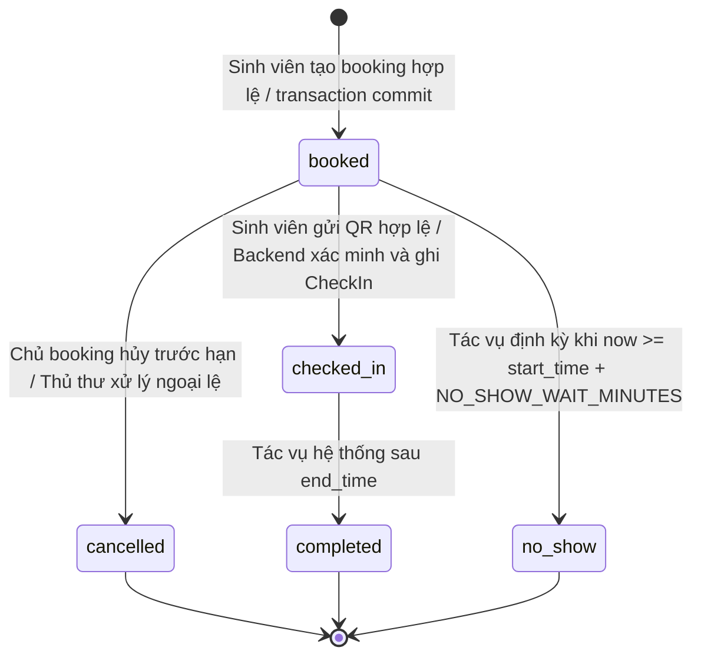
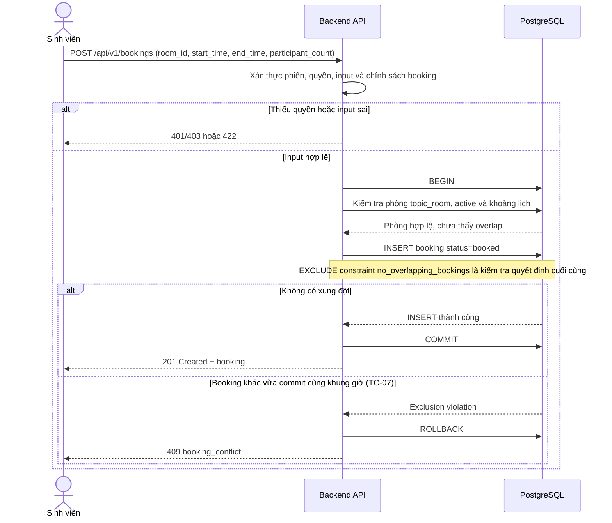

# Booking lifecycle và UC-02/03/04

Tài liệu này chuẩn hóa các luồng đặt phòng, check-in và no-show theo UC-02/03/04; điều kiện thời gian theo BR-05/06/07; xử lý đặt đồng thời theo TC-07. Trạng thái lưu trữ phải khớp với [ERD và bảng bookings](database-design.md): `booked`, `checked_in`, `completed`, `cancelled`, `no_show`. Không lưu trạng thái trung gian `pending`: booking chỉ được ghi sau khi kiểm tra và giữ lịch thành công.

## State diagram



| Chuyển trạng thái | Điều kiện bắt buộc | Tác nhân kích hoạt | Cập nhật dữ liệu |
|---|---|---|---|
| Mới → `booked` | User đã xác thực; phòng là `topic_room` đang hoạt động; input và giới hạn booking hợp lệ; không có khoảng đặt chồng lấn; transaction commit | Sinh viên gửi yêu cầu, Backend xác thực; PostgreSQL bảo đảm không overlap | Tạo `Booking(status=booked)` |
| `booked` → `checked_in` | Booking thuộc user; chưa hủy; `start_time <= now < start_time + NO_SHOW_WAIT_MINUTES`; QR đúng booking, chưa hết hạn và chưa dùng | Sinh viên quét QR trên camera điện thoại; Backend xác minh rồi ghi nhận | Trong một transaction, đặt `Booking.status=checked_in`, `checkin_at=now`; tạo đúng một `CheckIn(status=success, method=qr)` |
| `checked_in` → `completed` | `now >= end_time` | Tác vụ hệ thống định kỳ | Đặt `Booking.status=completed`; giữ `checkin_at` |
| `booked` → `cancelled` | Chưa check-in; chủ booking hủy trước `start_time - cancellation_cutoff`, hoặc thủ thư được phân quyền xử lý ngoại lệ | Chủ booking hoặc thủ thư | Đặt `status=cancelled`, ghi tác nhân/thời điểm vào audit log; giải phóng khoảng lịch |
| `booked` → `no_show` | Chưa check-in/hủy; `now >= start_time + NO_SHOW_WAIT_MINUTES` | Tác vụ hệ thống định kỳ; không do sinh viên gọi endpoint | Đặt `status=no_show`, ghi thời điểm xử lý; giải phóng phần thời gian còn lại theo BR-08 |

`NO_SHOW_WAIT_MINUTES` là cấu hình số phút, giá trị nội bộ tạm thời hiện là 15 và cần thư viện xác nhận trước vận hành. No-show chạy trước hoặc cùng thời điểm biên với check-in phải được tuần tự hóa bằng transaction/row lock: check-in chỉ thành công nếu trạng thái vẫn `booked` và thời gian còn trong cửa sổ; chỉ một trong hai thao tác được commit. Một booking ở `checked_in`, `completed`, `cancelled` hoặc `no_show` không được chuyển lại sang `no_show`; `completed`, `cancelled` và `no_show` là trạng thái kết thúc.

## Sequence UC-02 — Tạo booking



Kiểm tra overlap sơ bộ cải thiện thông báo nhưng không đủ để bảo vệ trước race condition. Transaction phải để PostgreSQL `EXCLUDE USING gist (room_id WITH =, tstzrange(start_time, end_time) WITH &&)` quyết định. Bắt exclusion violation, rollback transaction và trả `409 booking_conflict`; không retry tự động cùng dữ liệu. Constraint áp dụng cho trạng thái `booked` và `checked_in`, nhờ đó hủy/no-show không giữ khung giờ. Với PostgreSQL, exclusion constraint kiểm tra xung đột giữa giao dịch đồng thời khi commit; cần map đúng tên constraint để không biến lỗi DB khác thành 409.

## Sequence UC-03 — Check-in QR

Giả định câu 7 trong SRS: sinh viên quét bằng camera điện thoại (hiện xác định là Android); web có thể hiển thị QR/mã. Không yêu cầu máy quét chuyên dụng. QR là token opaque, khó đoán, gắn với một booking; Backend tạo token và lưu hash, không tin `booking_id` do client gửi tách rời khỏi token.

```mermaid
sequenceDiagram
    actor Student as Sinh viên
    participant App as Ứng dụng / camera điện thoại
    participant API as Backend API
    participant DB as PostgreSQL

    Student->>App: Mở booking hợp lệ, yêu cầu QR
    App->>API: GET QR cho booking (Bearer token)
    API->>DB: Xác minh booking thuộc user, status=booked
    DB-->>API: Booking và start_time
    API-->>App: QR token có exp = start_time + NO_SHOW_WAIT_MINUTES
    Student->>App: Quét QR
    App->>API: POST /api/v1/check-in (qr_token)
    API->>API: Giải mã token, kiểm exp/chữ ký
    alt Token sai hoặc không hợp lệ
        API-->>App: 422 invalid_qr
    else Token hết hạn hoặc ngoài cửa sổ check-in
        API-->>App: 409 qr_expired / checkin_window_closed
    else Token hợp lệ
        API->>DB: BEGIN; SELECT booking FOR UPDATE
        API->>DB: Kiểm tra owner, status=booked, chưa có CheckIn
        alt Đã check-in hoặc trạng thái không còn booked
            API->>DB: ROLLBACK
            API-->>App: 409 already_checked_in / booking_not_checkable
        else Booking còn hợp lệ
            API->>DB: INSERT CheckIn UNIQUE(booking_id); UPDATE Booking → checked_in
            API->>DB: COMMIT
            API-->>App: 200 checked_in + checked_in_at
        end
    end
```

API phải khóa booking trước khi kiểm trạng thái để tránh QR bị dùng đồng thời hai lần. Unique constraint `check_ins.booking_id` là lớp bảo vệ cuối; nếu một request lặp đến sau commit thì trả `409 already_checked_in` (không tạo CheckIn thứ hai). Nếu tác vụ no-show đã khóa và chuyển trạng thái trước, check-in bị từ chối. Nếu check-in khóa và commit trước thời điểm đóng cửa sổ, tác vụ no-show sau đó thấy `checked_in` và bỏ qua theo BR-06.

## Sequence UC-04 — No-show và nhả lịch

```mermaid
sequenceDiagram
    participant Scheduler as Tác vụ định kỳ
    participant API as Worker Backend
    participant DB as PostgreSQL

    loop Mỗi chu kỳ cấu hình
        Scheduler->>API: Chạy sweep no-show
        API->>DB: BEGIN; tìm booking booked có start_time + {{NO_SHOW_WAIT_MINUTES}} <= now
        API->>DB: SELECT ... FOR UPDATE SKIP LOCKED
        DB-->>API: Các booking đến hạn
        loop Mỗi booking
            API->>DB: Kiểm tra không có CheckIn và status vẫn booked
            alt Đủ thời gian chờ và chưa check-in/hủy
                API->>DB: UPDATE status=no_show, ghi no_show_at/audit
                API->>DB: Giải phóng phần lịch còn lại (qua status no_show)
            else Đã check-in/hủy hoặc chưa đến hạn
                API->>DB: Bỏ qua, không đổi trạng thái
            end
        end
        API->>DB: COMMIT
    end
```

Worker chọn theo `start_time + {{NO_SHOW_WAIT_MINUTES}} <= now`, khóa từng booking và cập nhật có điều kiện `WHERE status='booked'`; nhiều worker không xử lý trùng do `SKIP LOCKED` và kiểm tra trạng thái lại. Khi `no_show`, phần thời gian sau thời điểm xử lý được coi là đã nhả; booking vẫn giữ record để audit. Giá trị mặc định nội bộ là 15 phút theo BR-05/07 và phải cấu hình, không hard-code. Lỗi giữa batch phải rollback booking đang xử lý; worker ghi log và lần sweep kế tiếp thử lại.

## Đối chiếu SRS và ERD

- BR-05: QR chỉ chấp nhận booking chưa hủy trong cửa sổ từ `start_time` đến trước `start_time + {{NO_SHOW_WAIT_MINUTES}}`; tại hoặc sau biên thời gian, check-in đóng và no-show đủ điều kiện.
- BR-06: đã `checked_in` thì worker không được chuyển booking sang `no_show`.
- BR-07: `booked` chưa check-in sau thời gian chờ cấu hình được chuyển bởi worker thành `no_show`.
- TC-07: PostgreSQL exclusion constraint ngăn hai booking cùng phòng có khoảng thời gian giao nhau kể cả khi request chạy đồng thời.
- ERD: `Booking.status` chứa đúng `booked`, `checked_in`, `completed`, `cancelled`, `no_show`; `Booking.checkin_at` ghi giờ thành công; `CheckIn` có tối đa một hàng mỗi booking. Chuyển trạng thái không xóa booking.

Chính sách hủy chi tiết, tên thời điểm audit `no_show_at`, chu kỳ scheduler và xác nhận thư viện cho thời gian chờ vẫn là mục cần chốt. Các sequence mô tả contract mục tiêu; chúng không khẳng định endpoint/worker đã được triển khai trong mã hiện tại.
