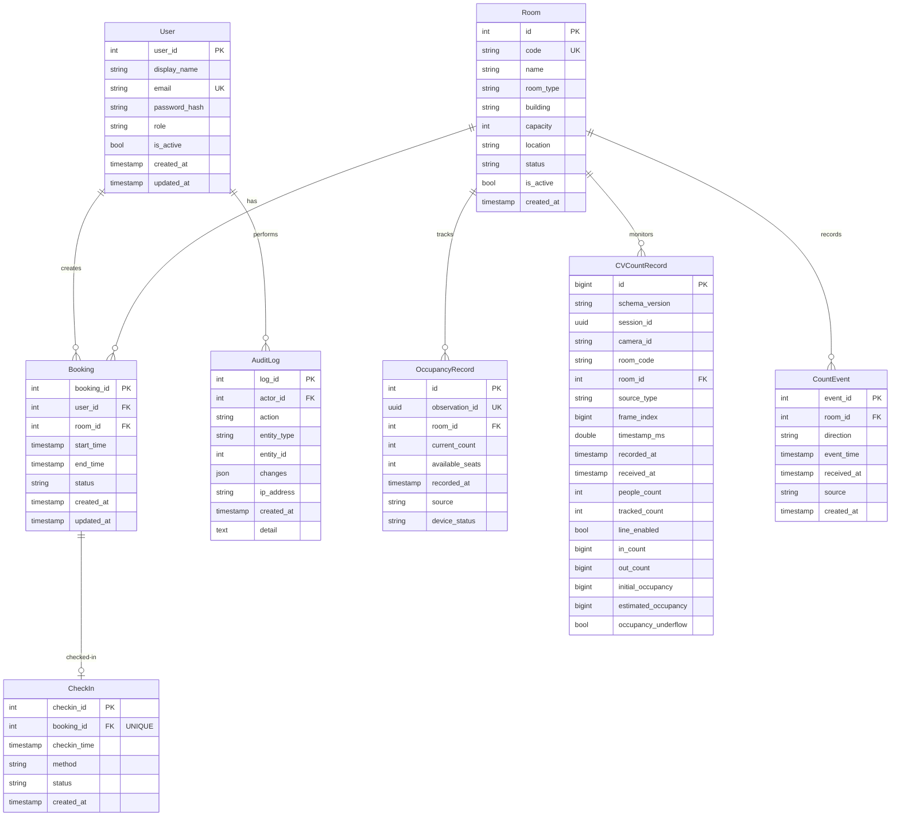

# Database Design - UTH SeatSense

Tài liệu này mô tả schema cơ sở dữ liệu PostgreSQL cho hệ thống đặt phòng và theo dõi mật độ UTH SeatSense, bao gồm ERD (Entity Relationship Diagram) và từ điển dữ liệu đầy đủ.

## Mục lục

1. [ERD - Sơ đồ quan hệ thực thể](#erd---sơ-đồ-quan-hệ-thực-thể)
2. [Từ điển dữ liệu](#từ-điển-dữ-liệu)
3. [Ràng buộc và quy tắc nghiệp vụ](#ràng-buộc-và-quy-tắc-nghiệp-vụ)
4. [Chỉ mục (Indexes)](#chỉ-mục-indexes)
5. [Bảo mật và quyền riêng tư](#bảo-mật-và-quyền-riêng-tư)
6. [Dữ liệu CV SEAT-24](#dữ-liệu-cv-seat-24)

---

## ERD - Sơ đồ quan hệ thực thể



**Giải thích quan hệ:**
- User → Booking: Một user có nhiều booking (1-nhiều)
- User → AuditLog: Một user thực hiện nhiều hành động audit (1-nhiều)
- Room → Booking: Một phòng có nhiều booking (1-nhiều)
- Room → OccupancyRecord: Một phòng có nhiều bản ghi mật độ (1-nhiều)
- Room → CVCountRecord: Một phòng có nhiều bản ghi CV (1-nhiều)
- Room → CountEvent: Một phòng có nhiều sự kiện đếm (1-nhiều)
- Booking → CheckIn: Một booking có tối đa một check-in (1-0..1)

---

## Từ điển dữ liệu

### Bảng: users

Xác thực và phân quyền người dùng.

| Trường | Kiểu dữ liệu | Null | Khóa | Mặc định | Ràng buộc |
|---|---|---|---|---|---|
| user_id | INTEGER | NOT NULL | PRIMARY KEY | auto-increment | — |
| display_name | VARCHAR(100) | NOT NULL | — | — | Tên hiển thị |
| email | VARCHAR(255) | NOT NULL | UNIQUE | — | Định dạng email, dùng để đăng nhập |
| password_hash | VARCHAR(255) | NOT NULL | — | — | **Không lưu plain text**. Dùng bcrypt/argon2 |
| role | VARCHAR(20) | NOT NULL | — | 'student' | CHECK: 'student', 'librarian', 'admin' |
| is_active | BOOLEAN | NOT NULL | — | TRUE | Cờ soft delete |
| created_at | TIMESTAMPTZ | NOT NULL | — | NOW() | Thời điểm tạo tài khoản |
| updated_at | TIMESTAMPTZ | NOT NULL | — | NOW() | Thời điểm cập nhật cuối |

**Chỉ mục:**
- `idx_users_email` trên (email)
- `idx_users_role` trên (role) WHERE is_active = TRUE

---

### Bảng: rooms

Phòng học/đọc khả dụng để đặt chỗ.

| Trường | Kiểu dữ liệu | Null | Khóa | Mặc định | Ràng buộc |
|---|---|---|---|---|---|
| id | INTEGER | NOT NULL | PRIMARY KEY | auto-increment | — |
| code | VARCHAR(50) | NOT NULL | UNIQUE | — | Mã phòng (vd: 'A101') |
| name | VARCHAR(150) | NOT NULL | — | — | Tên hiển thị |
| room_type | VARCHAR(50) | NOT NULL | — | — | CHECK: 'reading_room', 'group_study_room' |
| building | VARCHAR(150) | NULL | — | — | Tên cơ sở (vd: 'Cơ sở chính', 'Cơ sở 2') |
| capacity | INTEGER | NOT NULL | — | — | **CHECK: capacity > 0** |
| location | VARCHAR(255) | NULL | — | — | Vị trí cụ thể (vd: 'Tầng 1, Khu A') |
| status | VARCHAR(20) | NOT NULL | — | 'active' | CHECK: 'active', 'maintenance', 'closed' |
| is_active | BOOLEAN | NOT NULL | — | TRUE | Legacy soft delete |
| created_at | TIMESTAMPTZ | NOT NULL | — | NOW() | Thời điểm tạo |

**Chỉ mục:**
- Unique index trên `code`

**Ràng buộc:**
- `ck_rooms_capacity`: capacity > 0
- `ck_rooms_status`: status IN ('active', 'maintenance', 'closed')
- `ck_rooms_type`: room_type IN ('reading_room', 'group_study_room')

---

### Bảng: bookings

Đặt phòng của người dùng, có cơ chế chống trùng lịch (TC-07).

| Trường | Kiểu dữ liệu | Null | Khóa | Mặc định | Ràng buộc |
|---|---|---|---|---|---|
| booking_id | INTEGER | NOT NULL | PRIMARY KEY | auto-increment | — |
| user_id | INTEGER | NOT NULL | FOREIGN KEY → users.user_id | — | ON DELETE RESTRICT |
| room_id | INTEGER | NOT NULL | FOREIGN KEY → rooms.id | — | ON DELETE RESTRICT |
| start_time | TIMESTAMPTZ | NOT NULL | — | — | Thời gian bắt đầu |
| end_time | TIMESTAMPTZ | NOT NULL | — | — | Thời gian kết thúc |
| status | VARCHAR(20) | NOT NULL | — | 'pending' | CHECK: 'pending', 'confirmed', 'completed', 'cancelled' |
| created_at | TIMESTAMPTZ | NOT NULL | — | NOW() | Thời điểm tạo |
| updated_at | TIMESTAMPTZ | NOT NULL | — | NOW() | Thời điểm cập nhật |

**Chỉ mục:**
- `idx_bookings_room_start` trên (room_id, start_time)
- `idx_bookings_user` trên (user_id)
- `idx_bookings_status` trên (status) WHERE status IN ('pending', 'confirmed')

**Ràng buộc:**
- `ck_bookings_time_order`: end_time > start_time
- **`no_overlapping_bookings` (TC-07):** EXCLUDE USING gist (room_id WITH =, tstzrange(start_time, end_time) WITH &&) WHERE (status IN ('pending', 'confirmed'))

**State diagram trạng thái:**
- pending → confirmed
- pending → cancelled  
- confirmed → completed
- confirmed → cancelled

---

### Bảng: check_ins

Ghi nhận check-in thành công. Mỗi booking chỉ check-in được một lần.

| Trường | Kiểu dữ liệu | Null | Khóa | Mặc định | Ràng buộc |
|---|---|---|---|---|---|
| checkin_id | INTEGER | NOT NULL | PRIMARY KEY | auto-increment | — |
| booking_id | INTEGER | NOT NULL | FOREIGN KEY → bookings.booking_id, UNIQUE | — | ON DELETE CASCADE |
| checkin_time | TIMESTAMPTZ | NOT NULL | — | NOW() | Thời điểm check-in thực tế |
| method | VARCHAR(20) | NOT NULL | — | 'qr' | CHECK: 'qr', 'manual' |
| status | VARCHAR(20) | NOT NULL | — | 'success' | CHECK: 'success', 'failed', 'expired' |
| created_at | TIMESTAMPTZ | NOT NULL | — | NOW() | Thời điểm ghi nhận |

**Chỉ mục:**
- `idx_checkins_booking` trên (booking_id)
- `idx_checkins_time` trên (checkin_time)

---

### Bảng: occupancy_records

Quan sát mật độ phòng theo thời gian.

| Trường | Kiểu dữ liệu | Null | Khóa | Mặc định | Ràng buộc |
|---|---|---|---|---|---|
| id | INTEGER | NOT NULL | PRIMARY KEY | auto-increment | — |
| observation_id | UUID | NOT NULL | UNIQUE | — | ID duy nhất cho quan sát |
| room_id | INTEGER | NOT NULL | FOREIGN KEY → rooms.id | — | ON DELETE RESTRICT |
| current_count | INTEGER | NOT NULL | — | 0 | **CHECK: current_count >= 0**. Số người hiện tại |
| available_seats | INTEGER | NULL | — | — | CHECK: available_seats >= 0 hoặc NULL |
| recorded_at | TIMESTAMPTZ | NOT NULL | — | — | Thời điểm ghi nhận |
| source | VARCHAR(30) | NOT NULL | — | 'cv' | Nguồn: 'cv' hoặc 'manual' |
| device_status | VARCHAR(20) | NULL | — | — | CHECK: 'online', 'offline', 'error', hoặc NULL |

**Chỉ mục:**
- `idx_occupancy_room_recorded` trên (room_id, recorded_at DESC)
- Unique index trên `observation_id`

---

### Bảng: count_events

Sự kiện rời rạc (discrete events) vào/ra. Khác với cv_count_records (frame aggregates).

| Trường | Kiểu dữ liệu | Null | Khóa | Mặc định | Ràng buộc |
|---|---|---|---|---|---|
| event_id | INTEGER | NOT NULL | PRIMARY KEY | auto-increment | **Duy nhất cho mỗi sự kiện** |
| room_id | INTEGER | NOT NULL | FOREIGN KEY → rooms.id | — | ON DELETE RESTRICT |
| direction | VARCHAR(10) | NOT NULL | — | — | **CHECK: direction IN ('in', 'out')** |
| event_time | TIMESTAMPTZ | NOT NULL | — | — | Thời điểm sự kiện xảy ra |
| received_at | TIMESTAMPTZ | NOT NULL | — | NOW() | Thời điểm backend nhận được |
| source | VARCHAR(20) | NOT NULL | — | 'cv' | CHECK: 'cv', 'manual' |
| created_at | TIMESTAMPTZ | NOT NULL | — | NOW() | Thời điểm tạo bản ghi |

**Chỉ mục:**
- `idx_count_events_room` trên (room_id, event_time DESC)
- `idx_count_events_received` trên (received_at DESC)
- Primary key trên event_id đảm bảo tính duy nhất

---

### Bảng: audit_logs

Nhật ký kiểm toán hệ thống cho bảo mật và tuân thủ.

| Trường | Kiểu dữ liệu | Null | Khóa | Mặc định | Ràng buộc |
|---|---|---|---|---|---|
| log_id | INTEGER | NOT NULL | PRIMARY KEY | auto-increment | — |
| actor_id | INTEGER | NULL | FOREIGN KEY → users.user_id | — | ON DELETE SET NULL. NULL = hệ thống |
| action | VARCHAR(100) | NOT NULL | — | — | Hành động (vd: 'create_booking', 'login') |
| entity_type | VARCHAR(50) | NULL | — | — | Loại thực thể (vd: 'booking', 'room') |
| entity_id | INTEGER | NULL | — | — | ID của thực thể bị tác động |
| changes | JSONB | NULL | — | — | Giá trị cũ/mới cho update |
| ip_address | VARCHAR(45) | NULL | — | — | IP client (hỗ trợ IPv6) |
| created_at | TIMESTAMPTZ | NOT NULL | — | NOW() | Thời điểm ghi log |
| detail | TEXT | NULL | — | — | Chi tiết bổ sung |

**Chỉ mục:**
- `idx_audit_actor_time` trên (actor_id, created_at DESC)
- `idx_audit_entity` trên (entity_type, entity_id, created_at DESC)
- `idx_audit_action` trên (action, created_at DESC)

---

## Ràng buộc và quy tắc nghiệp vụ

### TC-07 / BR-04: Chống trùng lịch đặt phòng

**Yêu cầu:** Ngăn chặn các lượt đặt hợp lệ trên cùng phòng chồng lấn thời gian.

**Triển khai:**
```sql
CREATE EXTENSION IF NOT EXISTS btree_gist;

ALTER TABLE bookings
ADD CONSTRAINT no_overlapping_bookings
EXCLUDE USING gist (
    room_id WITH =,
    tstzrange(start_time, end_time) WITH &&
) WHERE (status IN ('pending', 'confirmed'));
```

**Hành vi:**
- Ngăn chặn nguyên tử (atomic) các booking chồng lấn đồng thời
- Chỉ áp dụng cho status đang hoạt động (pending, confirmed)
- Booking đã cancelled hoặc completed không chặn lịch tương lai
- Sử dụng PostgreSQL range types và GiST index

### Các quy tắc nghiệp vụ khác

1. **Sức chứa phòng:** capacity > 0 (CHECK constraint)
2. **Thứ tự thời gian booking:** end_time > start_time (CHECK constraint)
3. **Hướng sự kiện đếm:** direction IN ('in', 'out') (CHECK constraint)
4. **Một check-in mỗi booking:** UNIQUE constraint trên check_ins.booking_id
5. **Logic CV line counter:** Khi line_enabled=true, in_count và out_count bắt buộc; khi false phải NULL
6. **Tính estimated_occupancy:** max(0, initial_occupancy + in_count - out_count)

---

## Chỉ mục (Indexes)

### Mục đích

| Bảng | Chỉ mục | Mục đích |
|---|---|---|
| users | idx_users_email | Tra cứu nhanh email khi đăng nhập |
| users | idx_users_role | Lọc user theo role |
| rooms | UNIQUE trên code | Đảm bảo mã phòng duy nhất |
| bookings | idx_bookings_room_start | Truy vấn booking theo phòng và thời gian |
| bookings | idx_bookings_user | Lịch sử booking của user |
| bookings | idx_bookings_status | Lọc booking đang hoạt động |
| check_ins | idx_checkins_booking | Tra cứu check-in của booking |
| check_ins | idx_checkins_time | Truy vấn theo thời gian |
| occupancy_records | idx_occupancy_room_recorded | Lịch sử mật độ phòng |
| occupancy_records | UNIQUE trên observation_id | Chống trùng quan sát |
| cv_count_records | idx_cv_camera_recorded | Truy vấn dữ liệu CV theo camera |
| cv_count_records | idx_cv_room_recorded | Truy vấn dữ liệu CV theo phòng |
| cv_count_records | UNIQUE trên (session_id, frame_index) | Idempotency |
| count_events | idx_count_events_room | Lịch sử sự kiện theo phòng |
| count_events | idx_count_events_received | Sự kiện gần đây |
| audit_logs | idx_audit_actor_time | Audit trail theo user |
| audit_logs | idx_audit_entity | Lịch sử thay đổi thực thể |
| audit_logs | idx_audit_action | Audit theo loại hành động |

---

## Bảo mật và quyền riêng tư

### Bảo mật mật khẩu

- **Không bao giờ lưu plain text password**
- Sử dụng **bcrypt** (khuyến nghị) hoặc **argon2**
- Bcrypt work factor: tối thiểu 12 rounds
- Không log password hoặc password hash

### Thu thập dữ liệu cá nhân tối thiểu

**Thông tin thu thập:**
- Email (xác thực)
- Tên hiển thị (nhận diện user)

**KHÔNG thu thập:**
- CMND/CCCD
- Địa chỉ nhà
- Số điện thoại
- Ngày sinh
- Ảnh (CV không lưu hình ảnh)

### Kế hoạch xóa dữ liệu sau dự án

1. Ẩn danh hóa hoặc xóa tài khoản user
2. Giữ lại số liệu thống kê tổng hợp (không có PII)
3. Xóa lịch sử booking chi tiết
4. Giữ audit log theo thời hạn tuân thủ (vd: 90 ngày), sau đó xóa

### Quyền riêng tư video/ảnh (NFR-PRI-02)

- **CV module xử lý frame real-time**
- **Không lưu trữ video hoặc ảnh lâu dài**
- Chỉ gửi số liệu tổng hợp lên backend
- Không nhận diện khuôn mặt hay cá nhân
- Không lưu bounding box hoặc dữ liệu ảnh vào database

---

## Dữ liệu CV SEAT-24

`cv_count_records` lưu một hàng cho mỗi frame đã xử lý, độc lập với bảng
occupancy_records phục vụ số người trong phòng. Chỉ lưu số liệu tổng hợp,
không lưu video, ảnh, bbox hay nhận diện cá nhân. Migration chuẩn:
`database/init/002_cv_count_records.sql`.

| Trường | Kiểu | Quy tắc |
| --- | --- | --- |
| id | BIGINT IDENTITY | PK tự sinh |
| schema_version | VARCHAR(10) | Bắt buộc, hiện là 1.0 |
| session_id | UUID | Phiên do CV cấp |
| camera_id | VARCHAR(100) | Không rỗng |
| room_code | VARCHAR(100), null | Giữ nguyên room_id chuỗi từ CV |
| room_id | BIGINT, null | FK rooms.id; ON DELETE RESTRICT |
| source_type | VARCHAR(10) | video hoặc webcam |
| frame_index | BIGINT | Không âm; thứ tự frame trong phiên |
| timestamp_ms | DOUBLE PRECISION | Không âm, hữu hạn; thời gian tương đối |
| recorded_at | TIMESTAMPTZ | Thời điểm xử lý do CV gửi, hữu hạn |
| received_at | TIMESTAMPTZ | Database cấp NOW() khi ghi mới |
| people_count | INTEGER | Số người hiện thấy, không âm |
| tracked_count | INTEGER | 0 đến people_count |
| line_enabled | BOOLEAN | Bật hoặc tắt đếm qua đường |
| in_count / out_count | BIGINT, null | Không âm; bắt buộc nếu bật line, null nếu tắt |
| initial_occupancy | BIGINT, null | Số ban đầu nếu biết, không âm |
| estimated_occupancy | BIGINT, null | max(0, initial + IN - OUT); null nếu initial null |
| occupancy_underflow | BOOLEAN | true nếu công thức trước clamp âm |

Unique `(session_id, frame_index)` chống ghi trùng và hỗ trợ truy vấn frame
theo phiên. Index `(camera_id, recorded_at DESC, id DESC)` và partial index
`(room_id, recorded_at DESC, id DESC)` khi room_id khác null hỗ trợ lịch sử.
schema_migrations ghi phiên bản SQL đã áp dụng và applied_at.

### Ánh xạ đầu ra CV

Nguồn lưu là `backend_counts.jsonl`; từng dòng được kiểm tra bằng
`CVCountInput` ở Backend. Không đưa dữ liệu debug results.jsonl có bbox vào
schema này. UUID, giới hạn số nguyên, timestamp có múi giờ và tính nhất quán
counters được kiểm tra trước khi ghi; database tiếp tục áp dụng ràng buộc.

room_id từ CV được giữ ở room_code. Backend tìm đúng rooms.code để gán FK;
mã chưa có hoặc null cho FK null, không ép chuỗi số thành rooms.id và không
tạo phòng giả. Retry không thay đổi ánh xạ đã lưu khi danh mục phòng thay đổi.
Giới hạn rooms.code là 50 ký tự; mã CV dài hơn vẫn được lưu nhưng không khớp
danh mục phòng hiện tại.

people_count không có nghĩa là tổng người trong phòng. Không tự chuyển nó
sang occupancy_records. IN/OUT là counters tích lũy trong phiên, không cộng
chúng giữa các frame. estimated_occupancy chỉ có khi biết số người ban đầu;
độ tin cậy vẫn phụ thuộc vị trí camera và tracking. Chưa lưu từng crossing
event hoặc hợp nhất số đếm giữa nhiều camera.

### Thời gian, ghi trùng và truy vấn

TIMESTAMPTZ giữ thời điểm tuyệt đối, không giữ nhãn múi giờ ban đầu. Backend
từ chối datetime thiếu múi giờ, dùng session DB UTC và xuất DTO theo UTC.
recorded_at là giờ xử lý, không phải giờ camera quay. timestamp_ms của video
là frame_index/FPS, webcam là monotonic từ đầu phiên; không đổi trường này
thành ngày giờ thật. received_at là giờ nhận tại DB, không đổi khi retry.

Repository INSERT ON CONFLICT DO NOTHING theo unique phiên/frame. Cùng nội
dung trả bản cũ; nội dung khác gây CVRecordConflict. Cả batch rollback nếu
có lỗi, không lưu một phần batch. Cơ chế này cũng được kiểm tra khi hai yêu
cầu trùng nội dung chạy đồng thời.

Lịch sử mặc định mới nhất trước theo recorded_at, rồi id. Khoảng thời gian
lọc là [start,end), limit tối đa 500. Offset pagination không bảo đảm snapshot
khi dữ liệu đang được ghi mới. latest trả None nếu chưa có dữ liệu, không
trả số 0 giả.

### Triển khai

Volume mới chạy init 001/002; volume cũ phải áp dụng 002 riêng. Không sửa
schema bằng ORM create_all hoặc xóa volume để nâng cấp. File SQL chạy trong
transaction và có advisory lock; migration mới cần file phiên bản mới.
Xem [hướng dẫn database](../../database/README.md) và
[bàn giao SEAT-24](../seat24-handover.md).
