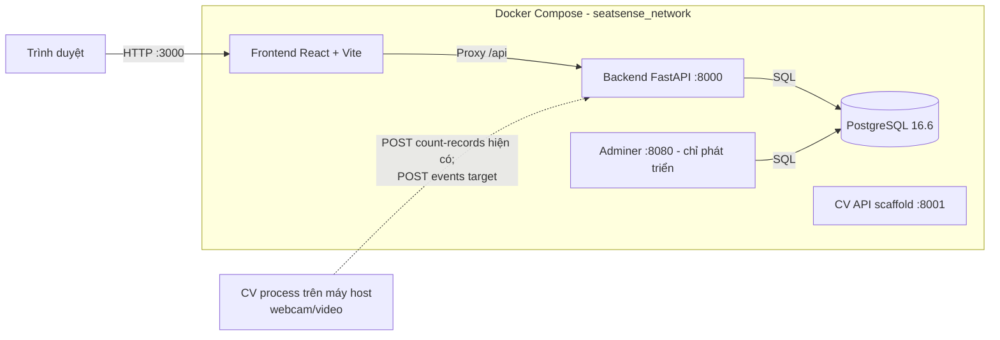

# Sơ đồ triển khai

## Phạm vi và trạng thái

Tài liệu phân biệt cấu hình Docker Compose hiện có với các tích hợp mục tiêu
Sprint 4. Compose đóng gói các service scaffold cho phát triển; điều đó không
chứng minh các luồng đặt phòng, occupancy theo phòng, camera thật hoặc API
event đã được triển khai.

CV cần truy cập webcam/video trên máy chạy CV. Theo SRS 1.9, chạy tiến trình CV
ngoài Docker khi cần dùng camera; service `cv` trong Compose hiện là scaffold
API. Endpoint nhận event, API key và heartbeat trong sơ đồ là target, chưa phải
luồng đã nghiệm thu. Xem [API contract](api-contracts.md) và
[SRS](../requirements/srs.md).

## Sơ đồ

Đường nét đứt biểu thị luồng/tích hợp CV mục tiêu, không phải bằng chứng rằng
camera hoặc `POST /api/v1/cv/events` đang hoạt động trong Compose. Backend hiện
có cấu hình phụ thuộc healthcheck của service `cv`; đây là phụ thuộc khởi động
được khai báo trong `docker-compose.yml`, không phải bằng chứng về hướng gọi
nghiệp vụ Backend → CV.

## Dịch vụ Compose hiện có

Các giá trị cổng dưới đây là mặc định; biến môi trường có thể đổi cổng host.

| Service | Image / build | Cổng host → container | Phụ thuộc / ghi chú |
|---|---|---|---|
| `db` | `postgres:16.6-alpine` | `5432 → 5432` | Healthcheck `pg_isready`; dữ liệu ở volume `postgres_data`; init scripts từ `database/init` |
| `cv` | `./cv` | `8001 → 8001` | API scaffold, healthcheck `/health`; không đại diện cho webcam đã tích hợp |
| `backend` | `./backend` | `8000 → 8000` | Chờ `db` và `cv` healthy; healthcheck `/health/db`; DB host là `db` |
| `frontend` | `./frontend` | `3000 → 3000` | Proxy API tới `http://backend:8000`; chờ Backend healthy |
| `adminer` | `adminer:4.8.1` | `8080 → 8080` | Chỉ dùng phát triển; chờ DB healthy |

Compose khai báo network bridge `seatsense_network`. Backend/Frontend/API chưa
được xem là production-ready chỉ vì container healthy; healthcheck xác nhận
chỉ khả năng phản hồi của health endpoint.

## API và luồng dữ liệu

| Luồng | Hiện trạng |
|---|---|
| Frontend → Backend | Frontend proxy `/api/*` tới Backend trong network Compose. |
| Backend → PostgreSQL | Backend kết nối DB bằng hostname `db` và thông tin `.env`. |
| CV → Backend, batch CountResult | `POST /api/v1/cv/count-records` đã có handler; API key chưa được thực thi. |
| CV → Backend, event IN/OUT | `POST /api/v1/cv/events` là target SEAT-51/53; yêu cầu `X-API-Key`, UUID idempotency và hàng đợi bền vững chưa được nghiệm thu. |
| CV → Backend, heartbeat | `PUT /api/v1/cv/devices/{device_id}/status` là target; không tạo event IN/OUT. |
| Giao diện → occupancy theo phòng | `/api/v1/occupancy/rooms/{room_id}/latest` có handler legacy; response target có N0, freshness và device status chưa triển khai đầy đủ. |
| Đặt phòng / check-in / dashboard | Các endpoint trong API contract còn là đề xuất nếu chưa có handler/OpenAPI tương ứng. |

## Lưu ý bảo mật và vận hành

- Cấu hình trong tài liệu chỉ dành cho phát triển cục bộ; không expose PostgreSQL
  hoặc Adminer ra Internet.
- Không commit `.env`, mật khẩu, API key, token hoặc dữ liệu camera/người dùng.
- Compose hiện publish cổng PostgreSQL và Adminer ra host; triển khai môi trường
  khác cần giới hạn truy cập và dùng secret store/TLS phù hợp.
- `docker compose down` giữ volume mặc định. Chỉ xóa volume sau khi đã xác nhận
  không cần dữ liệu và có bản sao lưu; không dùng lệnh xóa dữ liệu như bước khắc
  phục thông thường.
- Native Android là client mục tiêu theo SRS; thiết bị và phiên bản tối thiểu
  chưa chốt theo Q-17, nên kiểm thử native TC-17 vẫn Blocked.

## Nguồn cấu hình

- Compose: [`docker-compose.yml`](../../docker-compose.yml)
- Hướng dẫn chạy: [`README-full.md`](../README-full.md)
- Hợp đồng API: [`api-contracts.md`](api-contracts.md)
- Kế hoạch kiểm thử: [`test-plan.md`](../test-plan.md)
