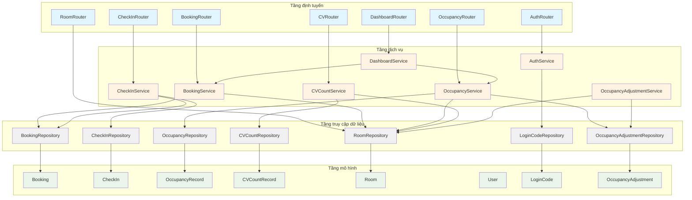
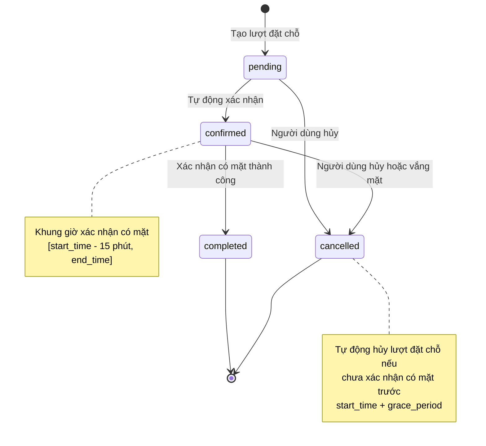
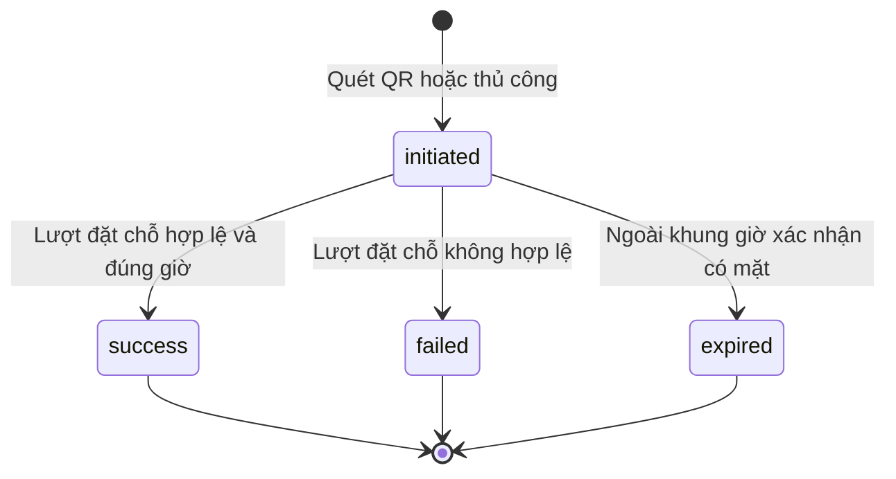
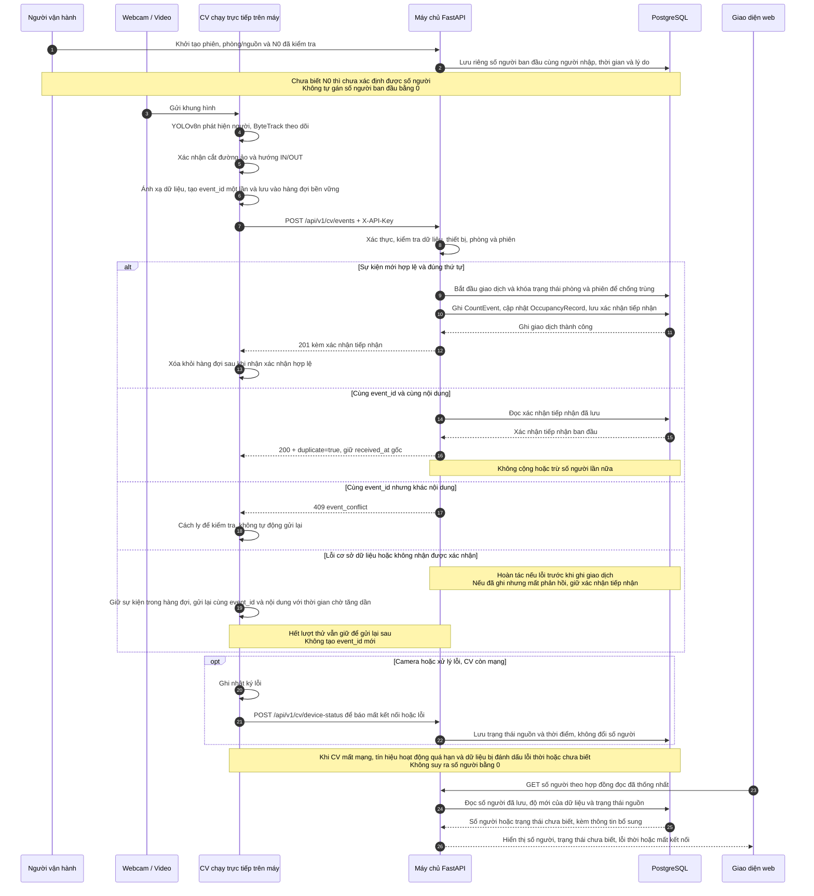

# Kiến trúc hệ thống – UTH-SeatSense

## Tổng quan

Dự án được tổ chức theo mô hình một kho mã dùng Docker Compose:

- **Giao diện:** React/Vite cho giao diện người dùng
- **Máy chủ:** FastAPI cung cấp API và các dịch vụ nghiệp vụ
- **Dịch vụ CV:** FastAPI dùng để xử lý video (dự kiến)
- **Cơ sở dữ liệu:** PostgreSQL lưu thông tin phòng, lượt đặt chỗ và dữ liệu mật độ

Máy chủ điều phối các luồng xử lý của ứng dụng và dùng dữ liệu mật độ từ dịch vụ CV. Bộ khung ban đầu chưa triển khai xác thực, hợp đồng API và giao tiếp giữa các dịch vụ.

---

## Sơ đồ lớp

### Tầng mô hình nghiệp vụ

Các mô hình nghiệp vụ chứa quy tắc xử lý và được tầng dịch vụ sử dụng. Chúng tương ứng với cấu trúc trong [Thiết kế cơ sở dữ liệu](./database-design.md).


**Các phương thức nghiệp vụ**

**User (Người dùng):**
- `has_role(role)`: Kiểm tra người dùng có vai trò cụ thể
- `is_student()`, `is_librarian()`, `is_admin()`: Các phương thức hỗ trợ phân quyền

**Room (Phòng):**
- `available_seats(current_count)`: Tính số ghế trống theo `capacity - current_count`
- `is_available()`: Kiểm tra phòng đang hoạt động (`status = 'active'`)
- `can_accommodate(count)`: Kiểm tra phòng có đủ chỗ cho số người

**Booking (Đặt chỗ):**
- `overlaps(other)`: Kiểm tra trùng lịch với lượt đặt chỗ khác (TC-07)
- `can_check_in(current_time)`: Kiểm tra lượt đặt chỗ ở trạng thái `confirmed` và còn trong khung giờ xác nhận có mặt
- `mark_no_show()`: Đánh dấu lượt đặt chỗ là `cancelled` nếu quá giờ
- `is_active()`: Kiểm tra trạng thái là `pending` hoặc `confirmed`
- `is_in_checkin_window(current_time)`: Kiểm tra còn trong khung giờ xác nhận có mặt
- `is_valid_group_size()`: Kiểm tra số người tham gia nằm trong giới hạn (BR-18: 2-6 người)

**CheckIn (Xác nhận có mặt)**
- `is_successful()`: Kiểm tra đã xác nhận có mặt thành công
- `verify_timing(booking)`: Xác minh thời điểm xác nhận có mặt hợp lệ

**OccupancyRecord (Bản ghi mật độ):**
- `is_stale(threshold_seconds)`: Kiểm tra dữ liệu đã quá ngưỡng lỗi thời (mặc định 30 giây)
- `calculate_available_seats(room)`: Tính số ghế trống

**CountEvent (Sự kiện đếm):**
- `is_entry()`: Kiểm tra là sự kiện vào
- `is_exit()`: Kiểm tra là sự kiện ra

**AuditLog (Nhật ký kiểm toán):**
- `format_message()`: Định dạng thông điệp nhật ký

**LoginCode (Mã OTP đăng nhập):**
- `is_expired()`: Kiểm tra mã đã hết hạn (FR-AUTH-04: hết hạn sau 5 phút)
- `can_retry()`: Kiểm tra có thể thử lại (BR-15: tối đa 5 lần nhập sai, gửi lại sau 60 giây)
- `mark_used()`: Đánh dấu mã đã được sử dụng (chỉ dùng một lần)
- `increment_attempts()`: Tăng số lần nhập sai

**OccupancyAdjustment (Hiệu chỉnh số đếm):**
- `get_diff()`: Tính chênh lệch giữa số người sau hiệu chỉnh và số người trước đó
- `format_log()`: Định dạng thông điệp phục vụ truy vết
- `has_valid_reason()`: Kiểm tra lý do hiệu chỉnh hợp lệ (FR-OCC-06, BR-21)

---

### Kiến trúc phân lớp của máy chủ

Máy chủ dùng kiến trúc phân lớp theo thứ tự phụ thuộc **Định tuyến → Dịch vụ → Truy cập dữ liệu → Mô hình**.



**Quy tắc phụ thuộc:**
1. **Tầng định tuyến chỉ gọi tầng dịch vụ** và không truy cập trực tiếp lớp truy cập dữ liệu hay mô hình.
2. **Tầng dịch vụ gọi tầng truy cập dữ liệu** và chứa quy tắc nghiệp vụ.
3. **Tầng truy cập dữ liệu gọi tầng mô hình** và chỉ xử lý việc truy cập dữ liệu.
4. **Một dịch vụ có thể gọi dịch vụ khác**. Tránh phụ thuộc vòng.

---

### Chi tiết các dịch vụ

#### BookingService (Dịch vụ đặt chỗ)
**Phụ thuộc:** BookingRepository, RoomRepository

**Phương thức**
- `create_booking(data)`: Tạo lượt đặt chỗ mới
- `get_booking(id)`: Lấy thông tin lượt đặt chỗ
- `list_bookings(filters)`: Liệt kê lượt đặt chỗ theo bộ lọc
- `cancel_booking(id)`: Hủy lượt đặt chỗ
- `check_availability(room_id, start, end)`: Kiểm tra phòng có trống
- `auto_cancel_no_shows()`: Tự động hủy lượt đặt chỗ khi người đặt vắng mặt

#### CheckInService (Dịch vụ xác nhận có mặt)
**Phụ thuộc:** CheckInRepository, BookingRepository

**Phương thức**
- `check_in(booking_id)`: Xác nhận có mặt
- `verify_qr_code(token)`: Xác minh mã QR
- `get_check_in(id)`: Lấy thông tin xác nhận có mặt

#### OccupancyService (Dịch vụ mật độ)
**Phụ thuộc:** OccupancyRepository, RoomRepository

**Phương thức**
- `get_current_occupancy()`: Lấy mật độ hiện tại toàn thư viện
- `get_room_occupancy(room_id)`: Lấy mật độ của một phòng
- `get_history(room_id, start, end)`: Lịch sử mật độ
- `update_from_cv_data(cv_data)`: Cập nhật từ dữ liệu CV

#### CVCountService (Dịch vụ đếm CV)
**Phụ thuộc:** CVCountRepository, RoomRepository

**Phương thức**
- `save_count_records(records)`: Lưu một lô bản ghi CV
- `get_latest_by_room(room_id)`: Lấy bản ghi mới nhất của phòng
- `get_history(filters)`: Lấy lịch sử bản ghi CV

#### DashboardService (Dịch vụ bảng tổng quan)
**Phụ thuộc:** OccupancyService, BookingService

**Phương thức**
- `get_statistics()`: Thống kê tổng quan
- `get_real_time_data()`: Dữ liệu theo thời gian thực cho bảng tổng quan

#### AuthService (Dịch vụ xác thực)
**Phụ thuộc:** LoginCodeRepository

**Phương thức**
- `send_otp(email)`: Gửi mã OTP qua email (FR-AUTH-02)
- `verify_otp(email, code)`: Xác minh mã OTP (FR-AUTH-04)
- `create_session(user)`: Tạo phiên đăng nhập
- `invalidate_old_codes(email)`: Vô hiệu hóa các mã cũ

#### OccupancyAdjustmentService (Dịch vụ hiệu chỉnh mật độ)
**Phụ thuộc:** OccupancyAdjustmentRepository, RoomRepository

**Phương thức**
- `record_initial_count(room_id, count, actor_id, reason)`: Ghi số người ban đầu (FR-OCC-06, BR-24)
- `adjust_count(room_id, new_count, actor_id, reason)`: Hiệu chỉnh số đếm có truy vết (BR-21, Q-15)
- `get_adjustment_history(room_id, session_id)`: Lịch sử hiệu chỉnh theo phòng/phiên
- `get_latest_adjustment(room_id)`: Lấy hiệu chỉnh mới nhất

---

### Cấu trúc dữ liệu Pydantic theo tuyến API

> **Lưu ý:** Cấu trúc dữ liệu chi tiết sẽ được hoàn thiện trong hợp đồng API của SEAT-40.
>
> Đây là bản thảo dựa trên thiết kế cơ sở dữ liệu và yêu cầu hiện tại.

#### API đặt chỗ

| Tuyến API | Phương thức | Cấu trúc đầu vào | Cấu trúc đầu ra |
|----------|--------|--------------|---------------|
| `/api/v1/bookings` | POST | `BookingCreate` | `BookingResponse` |
| `/api/v1/bookings/{id}` | GET | — | `BookingResponse` |
| `/api/v1/bookings` | GET | Tham số truy vấn | `BookingList` |
| `/api/v1/bookings/{id}/cancel` | PUT | — | `BookingResponse` |

**Cấu trúc dữ liệu dự thảo**
```python
class BookingCreate(BaseModel):
    room_id: int
    start_time: datetime
    end_time: datetime
    participant_count: int  # BR-18: 2-6 người

class BookingResponse(BaseModel):
    booking_id: int
    user_id: int
    room_id: int
    start_time: datetime
    end_time: datetime
    participant_count: int
    status: str  # 'pending' | 'confirmed' | 'completed' | 'cancelled'
    created_at: datetime
    updated_at: datetime

class BookingList(BaseModel):
    bookings: List[BookingResponse]
    total: int
```

#### API xác nhận có mặt

| Tuyến API | Phương thức | Cấu trúc đầu vào | Cấu trúc đầu ra |
|----------|--------|--------------|---------------|
| `/api/v1/check-ins` | POST | `CheckInRequest` | `CheckInResponse` |
| `/api/v1/check-ins/{id}` | GET | — | `CheckInResponse` |
| `/api/v1/check-ins/verify-qr` | POST | `QRVerifyRequest` | `CheckInResponse` |

**Cấu trúc dữ liệu dự thảo**
```python
class CheckInRequest(BaseModel):
    booking_id: int

class QRVerifyRequest(BaseModel):
    qr_token: str

class CheckInResponse(BaseModel):
    checkin_id: int
    booking_id: int
    checkin_time: datetime
    method: str  # 'qr' | 'manual'
    status: str  # 'success' | 'failed' | 'expired'
    created_at: datetime
```

#### API số người trong phòng

| Tuyến API | Phương thức | Cấu trúc đầu vào | Cấu trúc đầu ra |
|----------|--------|--------------|---------------|
| `/api/v1/occupancy/current` | GET | — | `CurrentOccupancyResponse` |
| `/api/v1/occupancy/history/{room_id}` | GET | Tham số truy vấn | `OccupancyHistoryResponse` |

**Cấu trúc dữ liệu dự thảo**
```python
class CurrentOccupancyResponse(BaseModel):
    current_count: Optional[int]
    updated_at: Optional[datetime]
    location: str

class OccupancyHistoryResponse(BaseModel):
    room_id: int
    records: List[OccupancyRecordResponse]

class OccupancyRecordResponse(BaseModel):
    id: int
    room_id: int
    current_count: int
    available_seats: Optional[int]
    recorded_at: datetime
    source: str
    device_status: Optional[str]
```

#### API nhận bản ghi số đếm CV

| Tuyến API | Phương thức | Cấu trúc đầu vào | Cấu trúc đầu ra |
|----------|--------|--------------|---------------|
| `/api/v1/cv/count-records` | POST | `CVCountBatch` | `CVCountBatchResponse` |

Xem cấu trúc dữ liệu trong [Hợp đồng API cho dữ liệu CV](./api-contracts.md)

#### API phòng

| Tuyến API | Phương thức | Cấu trúc đầu vào | Cấu trúc đầu ra |
|----------|--------|--------------|---------------|
| `/api/v1/rooms` | GET | Tham số truy vấn | `RoomList` |
| `/api/v1/rooms/{id}` | GET | — | `RoomResponse` |
| `/api/v1/rooms/{id}/availability` | GET | Tham số truy vấn | `RoomAvailability` |

**Cấu trúc dữ liệu dự thảo**
```python
class RoomResponse(BaseModel):
    id: int
    code: str
    name: str
    room_type: str
    building: Optional[str]
    capacity: int
    location: Optional[str]
    status: str
    is_active: bool

class RoomList(BaseModel):
    rooms: List[RoomResponse]
    total: int

class RoomAvailability(BaseModel):
    room_id: int
    available: bool
    current_occupancy: Optional[int]
    available_slots: List[TimeSlot]
```

#### API bảng tổng quan

| Tuyến API | Phương thức | Cấu trúc đầu vào | Cấu trúc đầu ra |
|----------|--------|--------------|---------------|
| `/api/v1/dashboard/stats` | GET | — | `DashboardStats` |
| `/api/v1/dashboard/occupancy` | GET | — | `DashboardOccupancy` |

**Cấu trúc dữ liệu dự thảo** Sẽ được xác định trong SEAT-40

#### API xác thực

| Tuyến API | Phương thức | Cấu trúc đầu vào | Cấu trúc đầu ra |
|----------|--------|--------------|---------------|
| `/api/v1/auth/send-otp` | POST | `SendOTPRequest` | `SendOTPResponse` |
| `/api/v1/auth/verify-otp` | POST | `VerifyOTPRequest` | `AuthResponse` |
| `/api/v1/auth/logout` | POST | — | `LogoutResponse` |

**Cấu trúc dữ liệu dự thảo**
```python
class SendOTPRequest(BaseModel):
    email: str  # Email trong danh sách được phép

class SendOTPResponse(BaseModel):
    success: bool
    message: str
    retry_after: Optional[int]  # Giây cần chờ nếu gửi quá nhanh

class VerifyOTPRequest(BaseModel):
    email: str
    code: str  # Mã OTP 6 số

class AuthResponse(BaseModel):
    access_token: str
    user_id: int
    display_name: str
    student_code: Optional[str]
    role: str
    is_first_login: bool  # Giá trị đúng nếu tự tạo hồ sơ lần đầu (FR-AUTH-01)

class LogoutResponse(BaseModel):
    success: bool
```

#### API hiệu chỉnh số người

| Tuyến API | Phương thức | Cấu trúc đầu vào | Cấu trúc đầu ra |
|----------|--------|--------------|---------------|
| `/api/v1/occupancy/adjustments` | POST | `OccupancyAdjustmentCreate` | `OccupancyAdjustmentResponse` |
| `/api/v1/occupancy/adjustments/history/{room_id}` | GET | Tham số truy vấn | `AdjustmentHistoryResponse` |

**Cấu trúc dữ liệu dự thảo**
```python
class OccupancyAdjustmentCreate(BaseModel):
    room_id: int
    session_id: Optional[uuid.UUID]
    adjusted_count: int  # Số người sau hiệu chỉnh
    reason: str  # Lý do hiệu chỉnh (bắt buộc để truy vết)

class OccupancyAdjustmentResponse(BaseModel):
    adjustment_id: int
    room_id: int
    session_id: Optional[uuid.UUID]
    previous_count: Optional[int]
    adjusted_count: int
    reason: str
    actor_id: int
    created_at: datetime

class AdjustmentHistoryResponse(BaseModel):
    room_id: int
    adjustments: List[OccupancyAdjustmentResponse]
    total: int
```

---

### Ánh xạ lỗi nghiệp vụ sang mã trạng thái HTTP

> **Lưu ý:** Mã lỗi chi tiết sẽ được xác định trong hợp đồng API của SEAT-40.

| Lỗi nghiệp vụ | Mã HTTP | Thông báo dự thảo |
|---------------|-----------|-------------------|
| `BookingOverlapError` | 409 – Xung đột | "Phòng đã có người đặt trong khung giờ này" |
| `BookingNotFoundError` | 404 – Không tìm thấy | "Không tìm thấy lượt đặt chỗ" |
| `CheckInWindowExpiredError` | 400 – Yêu cầu không hợp lệ | "Đã hết thời gian xác nhận có mặt" |
| `BookingAlreadyCancelledError` | 409 – Xung đột | "Lượt đặt chỗ đã bị hủy" |
| `BookingAlreadyCheckedInError` | 409 – Xung đột | "Lượt đặt chỗ đã được xác nhận có mặt" |
| `RoomNotAvailableError` | 400 – Yêu cầu không hợp lệ | "Phòng không khả dụng" |
| `RoomNotFoundError` | 404 – Không tìm thấy | "Không tìm thấy phòng" |
| `InvalidTimeRangeError` | 422 – Dữ liệu không hợp lệ | "Thời gian kết thúc phải sau thời gian bắt đầu" |
| `InvalidCredentialsError` | 401 – Chưa xác thực | "Email hoặc mật khẩu không đúng" |
| `UnauthorizedError` | 403 – Không có quyền | "Không có quyền truy cập" |
| `TokenExpiredError` | 401 – Chưa xác thực | "Mã truy cập đã hết hạn" |
| `OTPExpiredError` | 401 – Chưa xác thực | "Mã OTP đã hết hạn" |
| `OTPInvalidError` | 401 – Chưa xác thực | "Mã OTP không đúng" |
| `OTPAttemptsExceededError` | 429 – Quá nhiều yêu cầu | "Đã nhập sai quá số lần cho phép" |
| `OTPRateLimitError` | 429 – Quá nhiều yêu cầu | "Vui lòng đợi 60 giây trước khi gửi lại mã" |
| `EmailNotAllowedError` | 403 – Không có quyền | "Email không có trong danh sách được phép" |
| `InvalidGroupSizeError` | 422 – Dữ liệu không hợp lệ | "Số người trong nhóm phải từ 2-6 người" |
| `AdjustmentNotAllowedError` | 403 – Không có quyền | "Không có quyền hiệu chỉnh số đếm" |
| `ValidationError` | 422 – Dữ liệu không hợp lệ | Chi tiết lỗi kiểm tra dữ liệu |
| `CVRecordConflictError` | 409 – Xung đột | "Bản ghi CV đã tồn tại với nội dung khác" |
| `DatabaseError` | 500 – Lỗi máy chủ | "Lỗi hệ thống" |

**Cấu trúc phản hồi lỗi chuẩn**
```json
{
  "error": {
    "code": "BOOKING_OVERLAP",
    "message": "Phòng đã có người đặt trong khung giờ này",
    "details": {
      "room_id": 1,
      "conflicting_booking_id": 42,
      "time_range": "2026-11-10T10:00:00Z - 2026-11-10T12:00:00Z"
    }
  }
}
```

---

### Sơ đồ trạng thái

#### Các trạng thái của lượt đặt chỗ



#### Các trạng thái xác nhận có mặt



---

### Ghi chú

- **Mô hình nghiệp vụ** tương ứng với cấu trúc trong [Thiết kế cơ sở dữ liệu](./database-design.md).
- **Các phương thức nghiệp vụ** triển khai quy tắc từ yêu cầu SRS và các tình huống kiểm thử.
- **Ràng buộc chống trùng lịch (TC-07)** áp dụng ở cả cơ sở dữ liệu (ràng buộc loại trừ) và tầng dịch vụ (quy tắc nghiệp vụ).
- **Cấu trúc dữ liệu Pydantic** sẽ được hoàn thiện sau SEAT-40.
- **Mã lỗi** sẽ được chuẩn hóa trong hợp đồng API của SEAT-40.
- **Dịch vụ xác thực và phân quyền** sẽ được thiết kế sau khi có yêu cầu từ SEAT-40.

## Sơ đồ tuần tự UC-06: Đếm qua đường ảo

SEAT-34 · Người soạn: Lê Văn Trí · Bản thiết kế cho luồng đếm qua đường ảo và giao tiếp CV → máy chủ.

### Thành phần và căn cứ

| Thành phần | Vai trò |
|---|---|
| Webcam máy tính / video thử nghiệm | Cung cấp khung hình. Video thử ngoại tuyến không cập nhật số đếm trực tiếp |
| CV chạy trực tiếp trên máy | YOLOv8n → ByteTrack → đường ảo → lượt IN/OUT; xử lý ảnh tại chỗ |
| Máy chủ FastAPI | Kiểm tra quyền nguồn/dữ liệu, chống trùng, lưu dữ liệu và cung cấp API |
| PostgreSQL | Lưu bản ghi tại từng thời điểm, sự kiện, trạng thái nguồn và số người theo hợp đồng được chốt |
| Giao diện web React + Vite | Gọi máy chủ để hiển thị số người ước tính, chỗ trống và trạng thái dữ liệu |

Máy chủ API, PostgreSQL và giao diện chạy bằng Docker Compose. CV dùng webcam và chạy trên
máy chạy Docker theo SRS.
- [SRS v1.9](../requirements/UTH-SeatSense_SRS_v1.9.md): UC-06, FR-OCC-05,
  BR-02, BR-17, BR-21–24, NFR-PRI-01/02, Q-03/Q-15/Q-16.
- [Điều lệ dự án hiện hành](../requirements/Project%20Charter.md): phiên bản 1.7.
- [Hợp đồng CV v1.0](cv-data-contract.md): đầu ra CV cục bộ của SEAT-17.
- [Hợp đồng API](api-contracts.md): mục 4 cho bản ghi số đếm; [mục 14](api-contracts.md#14-uc-06-dữ-liệu-cv-gửi-máy-chủ-cho-seat-34) cho sự kiện UC-06.

### Hiện trạng trên dev

| Phần | Có trong mã nguồn | Giới hạn |
|---|---|---|
| CV | Xuất `CountResult` và `CrossingEvent` dưới dạng JSONL, có giao diện thử webcam và video | Chưa có bộ gửi HTTP, hàng đợi lưu qua lần khởi động lại, khóa API hay tín hiệu báo nguồn còn hoạt động |
| POST bản ghi số đếm | `/api/v1/cv/count-records`, nhận theo lô, khai báo HTTP 200 | Ghi `cv_count_records`; không ghi `CountEvent` hoặc cập nhật số người theo sự kiện |
| GET theo phòng | `/api/v1/occupancy/rooms/{room_id}/latest` | Đọc bản ghi webcam. Đánh dấu lỗi thời sau 30 giây tính từ `received_at` |
| Tuyến GET giao diện đang dùng | `/api/v1/occupancy/current`; giao diện làm mới mỗi 30 giây | Đọc `occupancy_records`; khác nguồn của GET theo phòng |
| Mô hình sự kiện | Có `CountEvent` và `OccupancyRecord` | Mã sự kiện là số nguyên tự tăng. Chưa tiếp nhận và chống trùng theo UUID từ CV |
| Xác thực nguồn | `security.py` mới là phần giữ chỗ | Chưa có khóa tiếp nhận hoặc tuyến báo trạng thái thiết bị |


### Sơ đồ tuần tự đề xuất

Khiêm và Thắng cần xác nhận tuyến API, cấu trúc dữ liệu, tiêu đề HTTP và mã phản hồi trong sơ đồ theo
[Dữ liệu CV, mục 14](api-contracts.md#14-uc-06-dữ-liệu-cv-gửi-máy-chủ-cho-seat-34).



### Quy tắc tính số người và vận hành

1. Số đếm gắn với khu tự học tự do và cơ sở qua phòng đã cấu hình. Không cộng
   gộp CS1/CS3 hoặc camera có vùng nhìn trùng khi chưa có quy tắc hợp nhất.
2. Mỗi phiên có N0 do người vận hành kiểm tra. Biết N0 thì tính
   `max(0, N0 + IN - OUT)`; đánh dấu nếu kết quả trước khi áp dụng ngưỡng dưới 0 là số âm. Vượt sức chứa giữ
   ước tính và đánh dấu, chỗ trống kẹp ở 0. Không lấy `people_count` làm N0.
3. Lưu riêng số người ban đầu và các lần hiệu chỉnh, có phiên, người thực hiện, thời gian,
   trước/sau và lý do. Không sửa/xóa sự kiện thô hay lịch sử đã ghi (BR-21/24).
4. Chưa biết N0 thì chưa xác định được số người; vẫn có thể lưu sự kiện hợp lệ nhưng không
   công bố chỗ trống/mức đông chính thức. Cần xác định mốc áp dụng số người ban đầu khi gửi lại để
   không tính sự kiện cũ vào số người ban đầu mới.
5. Hàng đợi và máy chủ xử lý theo thứ tự của từng nguồn và phiên. Chốt cách xử lý mất thứ tự,
   phiên đóng và nhiều bộ gửi; lỗi không được bỏ im lặng rồi tiếp tục cộng.
6. Mỗi phòng/phiên chỉ có một nguồn tính số người, là bản ghi số đếm hoặc sự kiện.
   Không dùng bản ghi đã chứa số lượt vào/ra rồi cộng lại từng sự kiện.
7. API sự kiện không gửi ảnh, video, khung bao, khuôn mặt, mã theo dõi hoặc mã sự kiện cục bộ
   có chứa mã theo dõi. UUID gửi mạng chỉ dùng chống trùng sự kiện.

### Bàn giao và điều kiện nghiệm thu

| Yêu cầu SEAT-34 | Đầu ra | Trạng thái |
|---|---|---|
| Sơ đồ tuần tự, CountEvent → OccupancyRecord → HTTP 201 | Sơ đồ tuần tự đề xuất và API mục 14.3 | Đã soạn thiết kế |
| Dữ liệu gửi, UTC, `event_id` và quyền riêng tư | API mục 14.2 | Đã soạn, chờ chốt hợp đồng |
| Gửi lại, sự kiện trùng và mất kết nối camera | Sơ đồ tuần tự đề xuất, quy tắc vận hành và API mục 14.3–14.4 | Đã mô tả mục tiêu |
| Khóa API và lệnh curl đối chiếu SEAT-19 | API mục 14.5–14.6 | Có ví dụ, chưa kiểm thử khi chạy |
| Khiêm và Thắng xác nhận | API mục 14.7 | Chưa có xác nhận mới |
