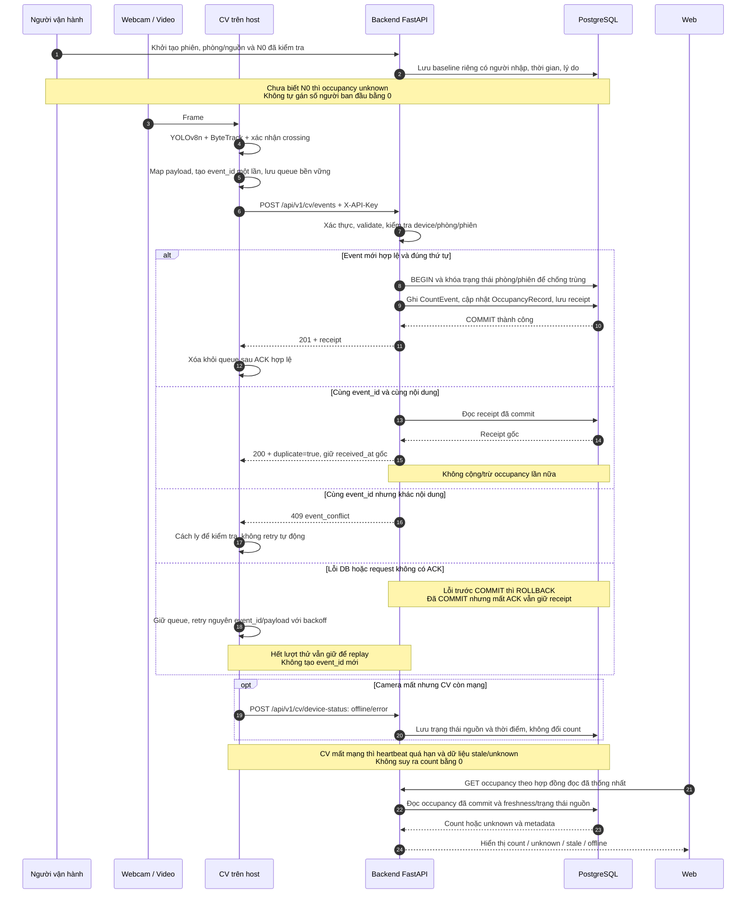

# Kiến trúc hệ thống và sequence UC-06

SEAT-34 · Người soạn: Lê Văn Trí · Ngày đối chiếu: 11/11/2026.

Tài liệu mô tả luồng đếm qua đường ảo và giao tiếp CV → Backend.
## 1. Thành phần và căn cứ

| Thành phần | Vai trò |
|---|---|
| Webcam máy tính / video thử nghiệm | Cung cấp frame; video offline không cập nhật số đếm live |
| CV trên host | YOLOv8n → ByteTrack → đường ảo → lượt IN/OUT; xử lý ảnh tại chỗ |
| Backend FastAPI | Kiểm tra quyền nguồn/dữ liệu, chống trùng, lưu dữ liệu và cung cấp API |
| PostgreSQL | Lưu snapshot, event, trạng thái nguồn và occupancy theo hợp đồng được chốt |
| Web React + Vite | Gọi Backend để hiển thị số người ước tính, chỗ trống và trạng thái dữ liệu |

Backend, PostgreSQL và web chạy bằng Docker Compose; CV dùng webcam chạy trên
host theo SRS. 
- [SRS v1.8](../requirements/UTH-SeatSense_SRS_v1.8.md): UC-06, FR-OCC-05,
  BR-02, BR-17, BR-21–24, NFR-PRI-01/02, Q-03/Q-15/Q-16.
- [Charter hiện hành](../requirements/Project%20Charter.md): phiên bản 1.7.
- [Hợp đồng CV v1.0](cv-data-contract.md): đầu ra CV cục bộ của SEAT-17.
- [API contracts](api-contracts.md): SEAT-18/19 và Payload CV của SEAT-34, mục 13.

## 2. Hiện trạng trên dev

| Phần | Có trong source | Giới hạn |
|---|---|---|
| CV | CountResult và CrossingEvent xuất JSONL; UI thử webcam/video | Chưa có sender HTTP, queue bền vững, API key hoặc heartbeat |
| POST snapshot | `/api/v1/cv/count-records`, batch, khai báo HTTP 200 | Ghi `cv_count_records`; không ghi CountEvent/cập nhật occupancy theo event |
| GET theo phòng | `/api/v1/occupancy/rooms/{room_id}/latest` | Đọc snapshot webcam; stale sau 30 giây theo `received_at` |
| GET web đang dùng | `/api/v1/occupancy/current`; web refresh 30 giây | Đọc `occupancy_records`; khác nguồn của GET theo phòng |
| Model sự kiện | Có CountEvent và OccupancyRecord | Event ID là integer tự tăng; chưa có ingest/dedup bằng UUID từ CV |
| Xác thực nguồn | `security.py` còn placeholder | Chưa có ingest key hoặc device-status route |

## 3. Sequence UC-06 đề xuất

Route, schema, header và mã response trong sơ đồ cần Khiêm/Thắng xác nhận theo
[Payload CV, mục 13](api-contracts.md).

## 4. Quy tắc occupancy và vận hành

1. Số đếm gắn với khu tự học tự do và cơ sở qua phòng đã cấu hình. Không cộng
   gộp CS1/CS3 hoặc camera có vùng nhìn trùng khi chưa có quy tắc hợp nhất.
2. Mỗi phiên có N0 do người vận hành kiểm tra. Biết N0 thì tính
   `max(0, N0 + IN - OUT)`; ghi underflow nếu trước kẹp âm. Vượt sức chứa giữ
   ước tính và đánh dấu, chỗ trống kẹp ở 0. Không lấy `people_count` làm N0.
3. Baseline/hiệu chỉnh lưu riêng, có phiên, người thực hiện, thời gian,
   trước/sau và lý do. Không sửa/xóa event thô hay lịch sử đã ghi (BR-21/24).
4. Chưa biết N0 thì occupancy unknown; vẫn có thể lưu event hợp lệ nhưng không
   công bố chỗ trống/mức đông chính thức. Ranh giới baseline/replay phải rõ để
   không áp dụng event cũ lên baseline mới.
5. Queue và Backend xử lý thứ tự theo nguồn/phiên. Chốt cách xử lý mất thứ tự,
   phiên đóng và nhiều sender; lỗi không được bỏ im lặng rồi tiếp tục cộng.
6. Mỗi phòng/phiên chỉ có một nguồn tính occupancy: snapshot hoặc event.
   Không dùng snapshot đã chứa IN/OUT rồi cộng lại từng event.
7. API event không gửi ảnh/video, bbox, khuôn mặt, track ID hoặc event ID cục bộ
   đang nhúng track ID. UUID gửi mạng chỉ dùng chống trùng sự kiện.

## 5. Bàn giao và điều kiện nghiệm thu

| Yêu cầu SEAT-34 | Đầu ra | Trạng thái |
|---|---|---|
| Sequence; CountEvent → OccupancyRecord → 201 | Mục 3 và API mục 13.3 | Đã soạn thiết kế |
| Payload, UTC, event_id và quyền riêng tư | API mục 13.2 | Đã soạn; chờ chốt contract |
| Retry, trùng event và mất camera | Mục 3–4 và API mục 13.3–13.4 | Đã mô tả mục tiêu |
| API key và curl đối chiếu SEAT-19 | API mục 13.5–13.6 | Có ví dụ; chưa xác thực runtime |
| Khiêm và Thắng xác nhận | API mục 13.7 | Chưa có xác nhận mới |