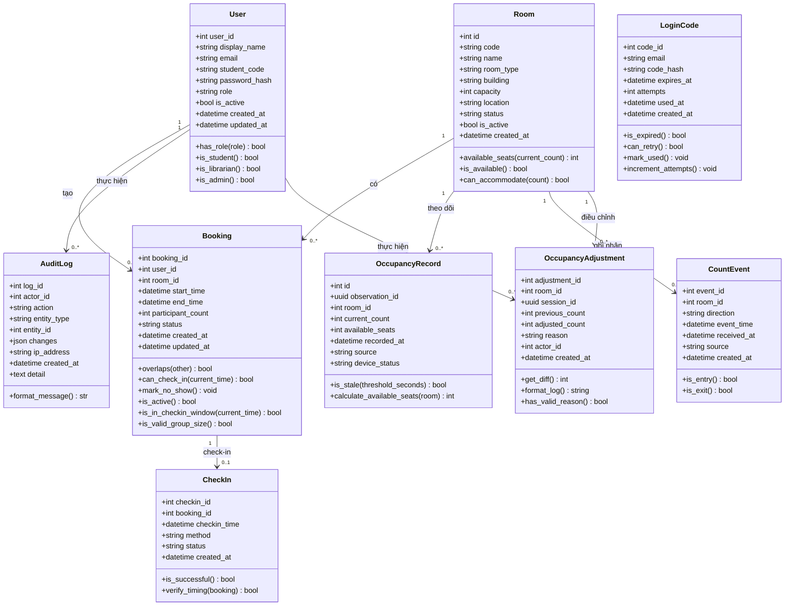
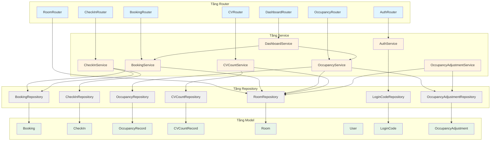
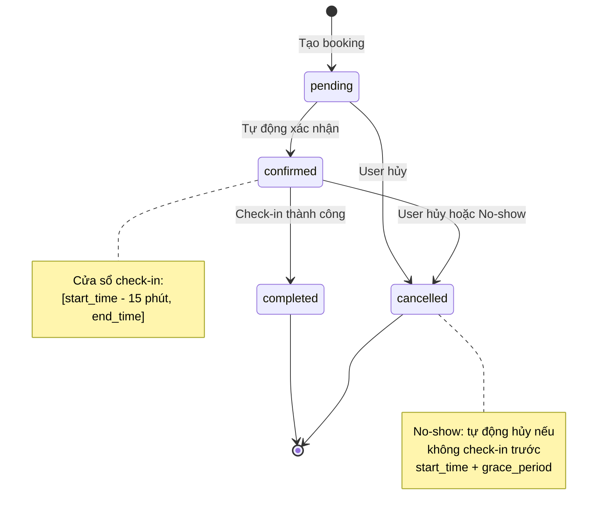
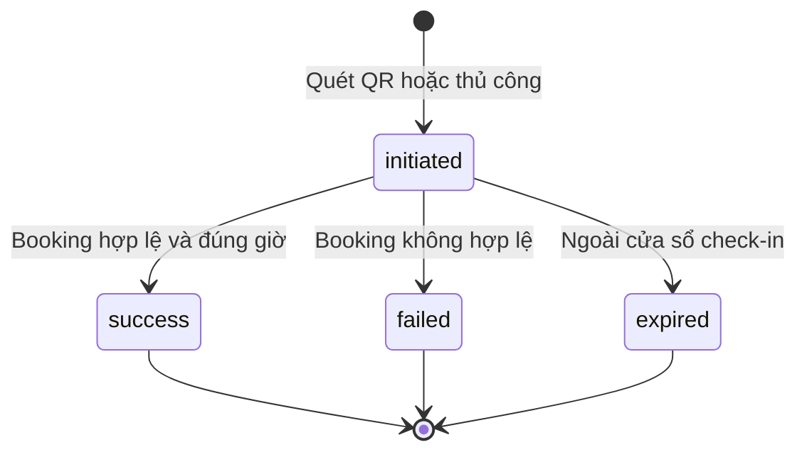

# Kiến trúc Hệ thống - UTH SeatSense

## Tổng quan

Dự án được tổ chức theo mô hình Docker Compose monorepo:

- **Frontend:** React/Vite cho giao diện người dùng
- **Backend:** FastAPI cho API và domain services
- **CV Service:** FastAPI cho xử lý video (tương lai)
- **Database:** PostgreSQL lưu trữ phòng, đặt chỗ, và dữ liệu mật độ

Backend điều phối các workflow ứng dụng và tiêu thụ dữ liệu mật độ từ CV service. Xác thực, API contracts và giao tiếp giữa các service chưa được triển khai trong scaffold.

---

## Sơ đồ Lớp (Class Diagram)

### Tầng Domain Models với Business Logic

Domain models chứa business logic và được sử dụng bởi tầng service. Các models này tương ứng với database schema trong [Database Design](./database-design.md).



**Giải thích Business Methods:**

**User (Người dùng):**
- `has_role(role)`: Kiểm tra user có vai trò cụ thể
- `is_student()`, `is_librarian()`, `is_admin()`: Helper methods cho phân quyền

**Room (Phòng):**
- `available_seats(current_count)`: Tính số ghế trống = capacity - current_count
- `is_available()`: Kiểm tra phòng đang hoạt động (status = 'active')
- `can_accommodate(count)`: Kiểm tra phòng có đủ chỗ cho số người

**Booking (Đặt chỗ):**
- `overlaps(other)`: Kiểm tra trùng lịch với booking khác (logic TC-07)
- `can_check_in(current_time)`: Kiểm tra có thể check-in (status confirmed, trong cửa sổ thời gian)
- `mark_no_show()`: Đánh dấu booking là cancelled nếu quá giờ
- `is_active()`: Kiểm tra status IN ('pending', 'confirmed')
- `is_in_checkin_window(current_time)`: Kiểm tra có trong cửa sổ check-in
- `is_valid_group_size()`: Kiểm tra participant_count trong giới hạn (BR-18: 2-6 người)

**CheckIn:**
- `is_successful()`: Kiểm tra check-in thành công
- `verify_timing(booking)`: Xác minh thời gian check-in hợp lệ

**OccupancyRecord (Bản ghi mật độ):**
- `is_stale(threshold_seconds)`: Kiểm tra dữ liệu đã cũ quá threshold (mặc định 30s)
- `calculate_available_seats(room)`: Tính số ghế trống

**CountEvent (Sự kiện đếm):**
- `is_entry()`: Kiểm tra là sự kiện vào
- `is_exit()`: Kiểm tra là sự kiện ra

**AuditLog (Nhật ký kiểm toán):**
- `format_message()`: Format thông điệp log

**LoginCode (Mã OTP đăng nhập):**
- `is_expired()`: Kiểm tra mã đã hết hạn (FR-AUTH-04: hết hạn sau 5 phút)
- `can_retry()`: Kiểm tra có thể thử lại (BR-15: tối đa 5 lần nhập sai, gửi lại sau 60 giây)
- `mark_used()`: Đánh dấu mã đã được sử dụng (chỉ dùng một lần)
- `increment_attempts()`: Tăng số lần nhập sai

**OccupancyAdjustment (Hiệu chỉnh số đếm):**
- `get_diff()`: Tính chênh lệch giữa adjusted_count và previous_count
- `format_log()`: Format thông điệp log cho audit trail
- `has_valid_reason()`: Kiểm tra lý do hiệu chỉnh hợp lệ (FR-OCC-06, BR-21)

---

### Kiến trúc Backend: Thiết kế Phân lớp

Backend tuân theo kiến trúc phân lớp với luồng phụ thuộc: **Router → Service → Repository → Model**.



**Quy tắc phụ thuộc:**
1. **Router chỉ gọi Service** - không truy cập trực tiếp Repository hay Model
2. **Service gọi Repository** - business logic nằm ở Service layer
3. **Repository gọi Model** - data access layer, không chứa business logic
4. **Service có thể gọi Service khác** - nhưng tránh circular dependency

---

### Chi tiết Services

#### BookingService (Dịch vụ đặt chỗ)
**Phụ thuộc:** BookingRepository, RoomRepository

**Methods:**
- `create_booking(data)`: Tạo booking mới
- `get_booking(id)`: Lấy thông tin booking
- `list_bookings(filters)`: Danh sách booking theo filter
- `cancel_booking(id)`: Hủy booking
- `check_availability(room_id, start, end)`: Kiểm tra phòng có trống
- `auto_cancel_no_shows()`: Tự động hủy booking no-show

#### CheckInService (Dịch vụ check-in)
**Phụ thuộc:** CheckInRepository, BookingRepository

**Methods:**
- `check_in(booking_id)`: Thực hiện check-in
- `verify_qr_code(token)`: Xác minh mã QR
- `get_check_in(id)`: Lấy thông tin check-in

#### OccupancyService (Dịch vụ mật độ)
**Phụ thuộc:** OccupancyRepository, RoomRepository

**Methods:**
- `get_current_occupancy()`: Lấy mật độ hiện tại toàn thư viện
- `get_room_occupancy(room_id)`: Lấy mật độ của một phòng
- `get_history(room_id, start, end)`: Lịch sử mật độ
- `update_from_cv_data(cv_data)`: Cập nhật từ dữ liệu CV

#### CVCountService (Dịch vụ đếm CV)
**Phụ thuộc:** CVCountRepository, RoomRepository

**Methods:**
- `save_count_records(records)`: Lưu batch CV records
- `get_latest_by_room(room_id)`: Lấy record mới nhất của phòng
- `get_history(filters)`: Lịch sử CV records

#### DashboardService (Dịch vụ dashboard)
**Phụ thuộc:** OccupancyService, BookingService

**Methods:**
- `get_statistics()`: Thống kê tổng quan
- `get_real_time_data()`: Dữ liệu real-time cho dashboard

#### AuthService (Dịch vụ xác thực)
**Phụ thuộc:** LoginCodeRepository

**Methods:**
- `send_otp(email)`: Gửi mã OTP qua email (FR-AUTH-02)
- `verify_otp(email, code)`: Xác minh mã OTP (FR-AUTH-04)
- `create_session(user)`: Tạo phiên đăng nhập
- `invalidate_old_codes(email)`: Vô hiệu hóa các mã cũ

#### OccupancyAdjustmentService (Dịch vụ hiệu chỉnh mật độ)
**Phụ thuộc:** OccupancyAdjustmentRepository, RoomRepository

**Methods:**
- `record_initial_count(room_id, count, actor_id, reason)`: Ghi số người ban đầu (FR-OCC-06, BR-24)
- `adjust_count(room_id, new_count, actor_id, reason)`: Hiệu chỉnh số đếm có truy vết (BR-21, Q-15)
- `get_adjustment_history(room_id, session_id)`: Lịch sử hiệu chỉnh theo phòng/phiên
- `get_latest_adjustment(room_id)`: Lấy hiệu chỉnh mới nhất

---

### Pydantic Schemas theo Endpoint

> **Lưu ý:** Chi tiết schemas sẽ được finalize trong SEAT-40 API Contract.  
> Dưới đây là draft dựa trên database design và yêu cầu hiện tại.

#### Booking Endpoints

| Endpoint | Method | Input Schema | Output Schema |
|----------|--------|--------------|---------------|
| `/api/v1/bookings` | POST | `BookingCreate` | `BookingResponse` |
| `/api/v1/bookings/{id}` | GET | — | `BookingResponse` |
| `/api/v1/bookings` | GET | Query params | `BookingList` |
| `/api/v1/bookings/{id}/cancel` | PUT | — | `BookingResponse` |

**Draft Schemas:**
```python
class BookingCreate(BaseModel):
    room_id: int
    start_time: datetime
    end_time: datetime
    participant_count: int  # BR-18: 2-6 người

class BookingResponse(BaseModel):
    booking_id: int
    user_id: int
    room_id: int
    start_time: datetime
    end_time: datetime
    participant_count: int
    status: str  # 'pending' | 'confirmed' | 'completed' | 'cancelled'
    created_at: datetime
    updated_at: datetime

class BookingList(BaseModel):
    bookings: List[BookingResponse]
    total: int
```

#### Check-In Endpoints

| Endpoint | Method | Input Schema | Output Schema |
|----------|--------|--------------|---------------|
| `/api/v1/check-ins` | POST | `CheckInRequest` | `CheckInResponse` |
| `/api/v1/check-ins/{id}` | GET | — | `CheckInResponse` |
| `/api/v1/check-ins/verify-qr` | POST | `QRVerifyRequest` | `CheckInResponse` |

**Draft Schemas:**
```python
class CheckInRequest(BaseModel):
    booking_id: int

class QRVerifyRequest(BaseModel):
    qr_token: str

class CheckInResponse(BaseModel):
    checkin_id: int
    booking_id: int
    checkin_time: datetime
    method: str  # 'qr' | 'manual'
    status: str  # 'success' | 'failed' | 'expired'
    created_at: datetime
```

#### Occupancy Endpoints

| Endpoint | Method | Input Schema | Output Schema |
|----------|--------|--------------|---------------|
| `/api/v1/occupancy/current` | GET | — | `CurrentOccupancyResponse` |
| `/api/v1/occupancy/history/{room_id}` | GET | Query params | `OccupancyHistoryResponse` |

**Draft Schemas:**
```python
class CurrentOccupancyResponse(BaseModel):
    current_count: Optional[int]
    updated_at: Optional[datetime]
    location: str

class OccupancyHistoryResponse(BaseModel):
    room_id: int
    records: List[OccupancyRecordResponse]

class OccupancyRecordResponse(BaseModel):
    id: int
    room_id: int
    current_count: int
    available_seats: Optional[int]
    recorded_at: datetime
    source: str
    device_status: Optional[str]
```

#### CV Count Records Endpoint

| Endpoint | Method | Input Schema | Output Schema |
|----------|--------|--------------|---------------|
| `/api/v1/cv/count-records` | POST | `CVCountBatch` | `CVCountBatchResponse` |

**Schemas:** Xem [API Contracts - CV Data Contract](./api-contracts.md)

#### Room Endpoints

| Endpoint | Method | Input Schema | Output Schema |
|----------|--------|--------------|---------------|
| `/api/v1/rooms` | GET | Query params | `RoomList` |
| `/api/v1/rooms/{id}` | GET | — | `RoomResponse` |
| `/api/v1/rooms/{id}/availability` | GET | Query params | `RoomAvailability` |

**Draft Schemas:**
```python
class RoomResponse(BaseModel):
    id: int
    code: str
    name: str
    room_type: str
    building: Optional[str]
    capacity: int
    location: Optional[str]
    status: str
    is_active: bool

class RoomList(BaseModel):
    rooms: List[RoomResponse]
    total: int

class RoomAvailability(BaseModel):
    room_id: int
    available: bool
    current_occupancy: Optional[int]
    available_slots: List[TimeSlot]
```

#### Dashboard Endpoints

| Endpoint | Method | Input Schema | Output Schema |
|----------|--------|--------------|---------------|
| `/api/v1/dashboard/stats` | GET | — | `DashboardStats` |
| `/api/v1/dashboard/occupancy` | GET | — | `DashboardOccupancy` |

**Draft Schemas:** Sẽ được xác định trong SEAT-40

#### Authentication Endpoints

| Endpoint | Method | Input Schema | Output Schema |
|----------|--------|--------------|---------------|
| `/api/v1/auth/send-otp` | POST | `SendOTPRequest` | `SendOTPResponse` |
| `/api/v1/auth/verify-otp` | POST | `VerifyOTPRequest` | `AuthResponse` |
| `/api/v1/auth/logout` | POST | — | `LogoutResponse` |

**Draft Schemas:**
```python
class SendOTPRequest(BaseModel):
    email: str  # Email trong danh sách được phép

class SendOTPResponse(BaseModel):
    success: bool
    message: str
    retry_after: Optional[int]  # Giây cần chờ nếu gửi quá nhanh

class VerifyOTPRequest(BaseModel):
    email: str
    code: str  # Mã OTP 6 số

class AuthResponse(BaseModel):
    access_token: str
    user_id: int
    display_name: str
    student_code: Optional[str]
    role: str
    is_first_login: bool  # True nếu tự tạo hồ sơ lần đầu (FR-AUTH-01)

class LogoutResponse(BaseModel):
    success: bool
```

#### Occupancy Adjustment Endpoints

| Endpoint | Method | Input Schema | Output Schema |
|----------|--------|--------------|---------------|
| `/api/v1/occupancy/adjustments` | POST | `OccupancyAdjustmentCreate` | `OccupancyAdjustmentResponse` |
| `/api/v1/occupancy/adjustments/history/{room_id}` | GET | Query params | `AdjustmentHistoryResponse` |

**Draft Schemas:**
```python
class OccupancyAdjustmentCreate(BaseModel):
    room_id: int
    session_id: Optional[uuid.UUID]
    adjusted_count: int  # Số người sau hiệu chỉnh
    reason: str  # Lý do hiệu chỉnh (bắt buộc cho audit trail)

class OccupancyAdjustmentResponse(BaseModel):
    adjustment_id: int
    room_id: int
    session_id: Optional[uuid.UUID]
    previous_count: Optional[int]
    adjusted_count: int
    reason: str
    actor_id: int
    created_at: datetime

class AdjustmentHistoryResponse(BaseModel):
    room_id: int
    adjustments: List[OccupancyAdjustmentResponse]
    total: int
```

---

### Ánh xạ Lỗi nghiệp vụ sang HTTP Status Code

> **Lưu ý:** Error codes chi tiết sẽ được xác định trong SEAT-40 API Contract.

| Lỗi nghiệp vụ | HTTP Code | Thông báo (draft) |
|---------------|-----------|-------------------|
| `BookingOverlapError` | 409 Conflict | "Phòng đã có người đặt trong khung giờ này" |
| `BookingNotFoundError` | 404 Not Found | "Không tìm thấy booking" |
| `CheckInWindowExpiredError` | 400 Bad Request | "Đã hết thời gian check-in" |
| `BookingAlreadyCancelledError` | 409 Conflict | "Booking đã bị hủy" |
| `BookingAlreadyCheckedInError` | 409 Conflict | "Booking đã được check-in" |
| `RoomNotAvailableError` | 400 Bad Request | "Phòng không khả dụng" |
| `RoomNotFoundError` | 404 Not Found | "Không tìm thấy phòng" |
| `InvalidTimeRangeError` | 422 Unprocessable Entity | "Thời gian kết thúc phải sau thời gian bắt đầu" |
| `InvalidCredentialsError` | 401 Unauthorized | "Email hoặc mật khẩu không đúng" |
| `UnauthorizedError` | 403 Forbidden | "Không có quyền truy cập" |
| `TokenExpiredError` | 401 Unauthorized | "Token đã hết hạn" |
| `OTPExpiredError` | 401 Unauthorized | "Mã OTP đã hết hạn" |
| `OTPInvalidError` | 401 Unauthorized | "Mã OTP không đúng" |
| `OTPAttemptsExceededError` | 429 Too Many Requests | "Đã nhập sai quá số lần cho phép" |
| `OTPRateLimitError` | 429 Too Many Requests | "Vui lòng đợi 60 giây trước khi gửi lại mã" |
| `EmailNotAllowedError` | 403 Forbidden | "Email không có trong danh sách được phép" |
| `InvalidGroupSizeError` | 422 Unprocessable Entity | "Số người trong nhóm phải từ 2-6 người" |
| `AdjustmentNotAllowedError` | 403 Forbidden | "Không có quyền hiệu chỉnh số đếm" |
| `ValidationError` | 422 Unprocessable Entity | Chi tiết lỗi validation |
| `CVRecordConflictError` | 409 Conflict | "CV record đã tồn tại với nội dung khác" |
| `DatabaseError` | 500 Internal Server Error | "Lỗi hệ thống" |

**Định dạng Error Response chuẩn:**
```json
{
  "error": {
    "code": "BOOKING_OVERLAP",
    "message": "Phòng đã có người đặt trong khung giờ này",
    "details": {
      "room_id": 1,
      "conflicting_booking_id": 42,
      "time_range": "2026-11-10T10:00:00Z - 2026-11-10T12:00:00Z"
    }
  }
}
```

---

### State Diagrams

#### Booking Status State Machine



#### Check-In Status Flow



---

### Ghi chú

- **Domain models** tương ứng với database schema trong [Database Design](./database-design.md)
- **Business methods** triển khai logic từ yêu cầu SRS và test cases
- **TC-07 constraint** (chống trùng lịch) được enforce ở cả database level (exclusion constraint) và service level (business logic)
- **Pydantic schemas** draft sẽ được finalize sau SEAT-40
- **Error codes** sẽ được chuẩn hóa trong SEAT-40 API Contract
- **Authentication/Authorization** service sẽ được thiết kế sau khi có yêu cầu từ SEAT-40
