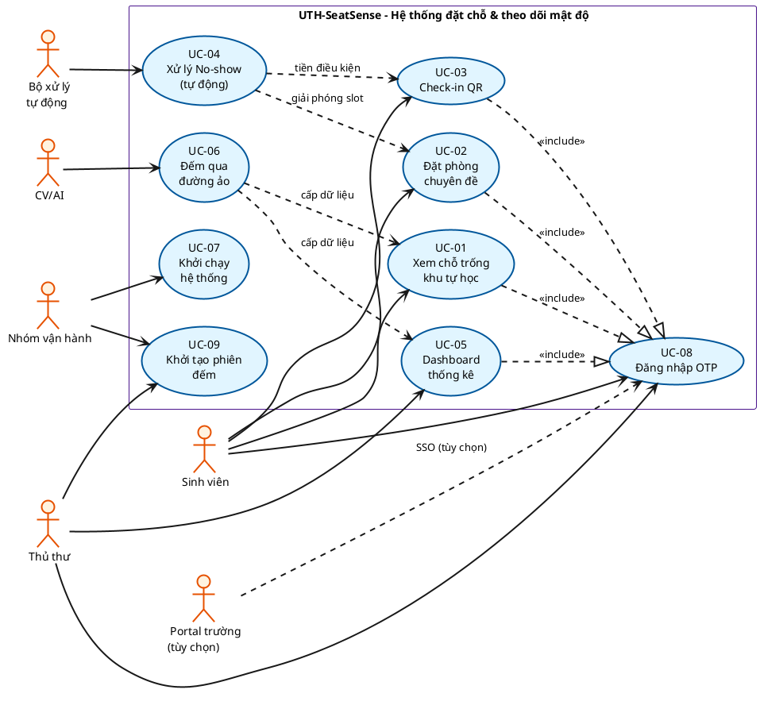
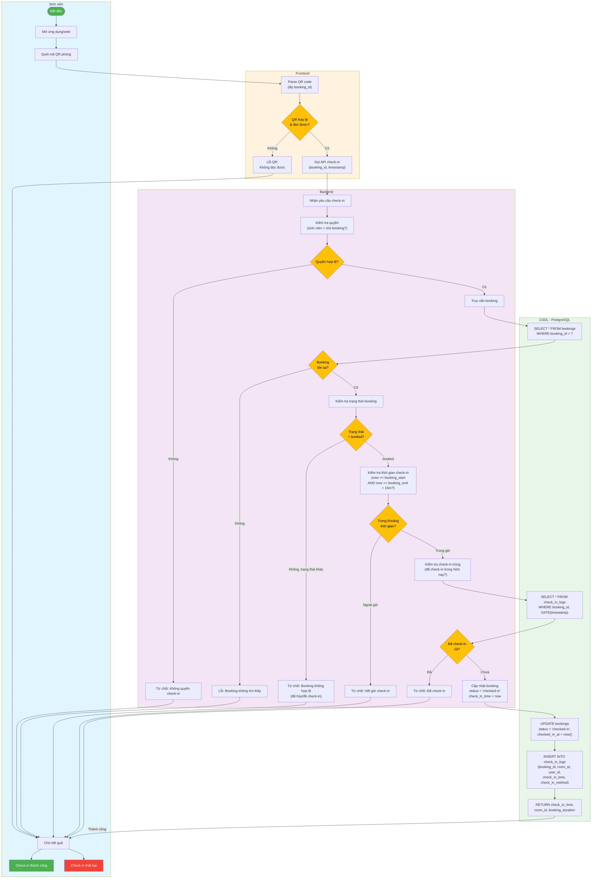
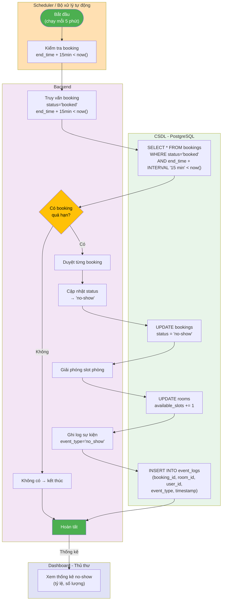

# Use Cases - UTH-SeatSense

# A. Use Case Diagram

## 6 Tác nhân
-  Sinh viên
-  Thủ thư
-  CV/AI
-  Bộ xử lý tự động
-  Nhóm vận hành
-  Portal trường (tùy chọn)

## 9 Use Cases
| Mã | Tên | Tác nhân | Loại |
|----|-----|---------|------|
| UC-01 | Xem chỗ trống khu tự học | Sinh viên | Must |
| UC-02 | Đặt phòng chuyên đề | Sinh viên | Must |
| UC-03 | Check-in QR | Sinh viên | Should |
| UC-04 | Xử lý No-show (tự động) | Auto | Should |
| UC-05 | Dashboard thống kê | Thủ thư | Should |
| UC-06 | Đếm qua đường ảo | CV/AI | Must |
| UC-07 | Khởi chạy hệ thống | Ops | Should |
| UC-08 | Đăng nhập OTP ⏳ | SV/TT | Must |
| UC-09 | Khởi tạo phiên đếm | Thủ thư/Ops | Must |

## Relationships
- **Include:** UC-01, UC-02, UC-03, UC-05 ..|> UC-08
- **Data flow:** UC-06 → UC-01, UC-05
- **Precondition:** UC-04 ← UC-03
- **Release slot:** UC-04 → UC-02

## Diagram



---

# B. Mô tả Use Cases (UC-01 → UC-08)

## UC-01: Xem chỗ trống khu tự học

**Mã:** UC-01 | **Tác nhân:** Sinh viên | **Ưu tiên:** Must

### Tiền điều kiện
- Sinh viên đã đăng nhập hoặc lần đầu
- Dữ liệu mật độ cập nhật (< 5 phút)
- Phòng tự học cấu hình sức chứa

### Hậu điều kiện
- Sinh viên xem: số người, sức chứa, mức đông, thời điểm cập nhật
- Dữ liệu hiển thị chính xác

### Luồng chính
1. Sinh viên mở trang chủ
2. Hệ thống hiển thị danh sách khu tự học (CS1/CS3)
3. Mỗi phòng hiển thị: tên, sức chứa, số người, mức độ đông, chỗ trống, time
4. Sinh viên xem thông tin

### Luồng thay thế
- **A1:** Dữ liệu lỗi thời → cảnh báo (BR-12)
- **A2:** Thiếu số ban đầu/sức chứa → "Chưa đủ dữ liệu"
- **A3:** Không có phòng → "Chưa cấu hình"

### BR, FR, TC
- **BR:** 01, 02, 12, 14
- **FR:** OCC-03, OCC-04, OCC-05, ROOM-01
- **TC:** 01, 02, 03, 20

---

## UC-02: Đặt phòng chuyên đề

**Mã:** UC-02 | **Tác nhân:** Sinh viên | **Ưu tiên:** Must

### Tiền điều kiện
- Sinh viên đã đăng nhập (UC-08)
- Có quyền đặt (không bị khóa)
- Phòng chuyên đề cấu hình

### Hậu điều kiện
- Lượt đặt lưu, status = 'booked'
- Slot phòng giảm 1
- Sinh viên nhận xác nhận + QR

### Luồng chính
1. Sinh viên chọn: ngày, giờ, số người, phòng
2. Frontend: xác thực format
3. Backend: kiểm tra 8 điều kiện (xem A1-A7)
4. CSDL: INSERT booking, UPDATE room
5. Trả về xác nhận + QR

### Luồng thay thế
- **A1:** Dữ liệu sai → Frontend reject → "Kiểm tra lại"
- **A2:** Không quyền → Backend reject → "Không quyền"
- **A3:** Thời lượng ∉ [30-120]m → "Phải 30-120 phút"
- **A4:** Khoảng ∉ (0, 7]d → "Phải 0-7 ngày tới"
- **A5:** Số người ∉ [2, 6] → "Phải 2-6 người"
- **A6:** Vượt 1/ngày → "Đã đặt hôm nay"
- **A7:** Trùng lịch → "Trùng giờ, chọn khác"

### BR, FR, TC
- **BR:** 03, 04, 18
- **FR:** BOOK-01, BOOK-02, BOOK-03, BOOK-04, BOOK-05
- **TC:** 05, 06, 07

---

## UC-03: Check-in QR

**Mã:** UC-03 | **Tác nhân:** Sinh viên | **Ưu tiên:** Should

### Tiền điều kiện
- Sinh viên đã đặt phòng (UC-02, status='booked')
- Ở trong phòng, sẵn sàng check-in
- QR hợp lệ

### Hậu điều kiện
- Lượt đặt: status = 'checked-in', checked_in_at = now()
- Bản ghi check-in lưu
- Xác nhận thành công

### Luồng chính
1. Sinh viên quét QR
2. Frontend: parse, kiểm tra format
3. Backend: kiểm tra 6 điều kiện (xem A1-A6)
4. CSDL: UPDATE booking, INSERT check_in_logs
5. Trả về xác nhận

### Luồng thay thế
- **A1:** QR sai/không đọc → "Không thể đọc QR"
- **A2:** Không quyền (QR người khác) → "Không quyền check-in"
- **A3:** Booking không tìm → "Không tìm thấy"
- **A4:** Status ≠ 'booked' → "Trạng thái không hợp lệ"
- **A5:** now > end+15m → "Hết thời gian check-in"
- **A6:** Đã check-in → "Đã check-in rồi"

### BR, FR, TC
- **BR:** 05, 06
- **FR:** CHK-01, CHK-02, CHK-03
- **TC:** 08, 09

---

## UC-04: Xử lý No-show (Tự động)

**Mã:** UC-04 | **Tác nhân:** Bộ xử lý tự động | **Ưu tiên:** Should

### Tiền điều kiện
- Booking: status = 'booked'
- now >= end_time + 15 phút
- Scheduler chạy mỗi 5 phút

### Hậu điều kiện
- Lượt đặt: status = 'no-show'
- Slot phòng giải phóng (available_slots += 1)
- Event ghi log

### Luồng chính
1. Scheduler trigger
2. Query: SELECT booking WHERE status='booked' AND end+15m < now()
3. Duyệt từng booking:
   - Update: status = 'no-show'
   - Giải phóng slot
   - Ghi log event
4. Hoàn tất

### Luồng thay thế
- **A1:** Booking đã check-in → bỏ qua
- **A2:** Booking đã hủy → bỏ qua
- **A3:** Lỗi DB → ghi log, tiếp tục

### BR, FR, TC
- **BR:** 07, 08
- **FR:** BOOK-07
- **TC:** 09

---

## UC-05: Dashboard thống kê

**Mã:** UC-05 | **Tác nhân:** Thủ thư | **Ưu tiên:** Should

### Tiền điều kiện
- Thủ thư đã đăng nhập (UC-08, role='librarian')
- Dữ liệu tích lũy ≥ 1 giờ

### Hậu điều kiện
- Xem: biểu đồ mật độ, tỷ lệ sử dụng, no-show
- Dữ liệu chính xác theo bộ lọc

### Luồng chính
1. Thủ thư đăng nhập → UC-08
2. Chọn bộ lọc: khoảng thời gian, cơ sở, phòng
3. Hệ thống hiển thị:
   - Biểu đồ mật độ (line/bar)
   - Tỷ lệ sử dụng, no-show
   - Bảng tổng hợp
4. Xuất báo cáo (PDF/CSV)

### Luồng thay thế
- **A1:** Dữ liệu ít → "Dữ liệu chưa đủ"
- **A2:** Không quyền → từ chối
- **A3:** Dữ liệu chậm → cảnh báo timestamp

### BR, FR, TC
- **BR:** 23
- **FR:** DASH-01, DASH-02
- **TC:** 10

---

## UC-06: Đếm qua đường ảo (CV/AI)

**Mã:** UC-06 | **Tác nhân:** CV/AI | **Ưu tiên:** Must

### Tiền điều kiện
- Webcam cấu hình, hướng lối đi
- YOLOv8n + ByteTrack khởi động
- Đường ảo cấu hình

### Hậu điều kiện
- Sự kiện vào/ra ghi: event_id, room_id, direction, timestamp
- Dữ liệu gửi Backend

### Luồng chính
1. CV/AI đọc khung hình
2. YOLOv8n phát hiện người (bbox)
3. ByteTrack theo dõi (track_id)
4. Khi track cắt đường ảo:
   - Xác định hướng (IN/OUT)
   - Kiểm tra: deadband, cooldown, hết hạn
   - Ghi sự kiện
5. Gửi API → Backend

### Luồng thay thế
- **A1:** Camera lỗi → ghi log, gửi 'OFFLINE'
- **A2:** FPS thấp → ghi log 'Performance warning'
- **A3:** Event trùng → bỏ qua (khử duplicate)

### BR, FR, TC
- **BR:** 13, 21
- **FR:** CV-01, CV-02, CV-03
- **TC:** 04, 22

---

## UC-07: Khởi chạy hệ thống

**Mã:** UC-07 | **Tác nhân:** Nhóm vận hành | **Ưu tiên:** Should

### Tiền điều kiện
- Docker, Docker Compose cài
- .env, docker-compose.yml cấu hình
- Dữ liệu seed sẵn

### Hậu điều kiện
- Service chạy thành công
- Dữ liệu restore từ volume
- Website truy cập được

### Luồng chính
1. Chuẩn bị: .env, docker daemon
2. `docker-compose up -d`
3. Khởi động: PostgreSQL → Backend → Frontend → CV/AI
4. Kiểm tra: `docker-compose ps`, health
5. Dữ liệu khôi phục

### Luồng thay thế
- **A1:** Port bị chiếm → thay .env
- **A2:** Env var sai → cấu hình lại
- **A3:** Volume corrupt → backup, xóa, restart
- **A4:** Git lỗi → kiểm tra SSH/token

### BR, FR, TC
- **BR:** —
- **FR:** OPS-01, OPS-02
- **TC:** 12

---

## UC-08: Đăng nhập OTP 

**Mã:** UC-08 | **Tác nhân:** Sinh viên, Thủ thư | **Ưu tiên:** Must

### Tiền điều kiện
- Email thuộc domain được phép
- SMTP hoạt động
- Người dùng chưa đăng nhập

### Hậu điều kiện
- OTP gửi email
- Xác minh → tạo hồ sơ (lần đầu) / đăng nhập
- Phiên cấp, token hợp lệ

### Luồng chính
1. Người dùng chọn "Đăng nhập"
2. Nhập email
3. Backend: kiểm tra domain + whitelist
4. Tạo OTP 6 số: hash, expires (5m), attempts (0)
5. Gửi email: "OTP: [CODE]"
6. Người dùng nhập mã
7. Backend: kiểm tra hash, hạn, dùng, attempts < 5
8. Tìm/tạo user (nếu lần đầu)
9. Cấp token/session (24h)
10. Đăng nhập thành công

### Luồng thay thế
- **A1:** Email không được phép → "Email không hợp lệ"
- **A2:** Email không whitelist → "Chưa được cấp quyền"
- **A3:** Mã sai → attempts++ → "Sai [n/5]"
- **A4:** Mã hết hạn (> 5m) → "Hết hạn"
- **A5:** Yêu cầu < 60s → "Chờ [secs]s"
- **A6:** SMTP lỗi → "Không thể gửi email"

### BR, FR, TC
- **BR:** 15, 16
- **FR:** AUTH-01, AUTH-02, AUTH-03, AUTH-04
- **TC:** 15

###  Phần chờ nhà trường (Portal SSO - FR-AUTH-05)

| Yếu tố | Trạng thái | Ghi chú |
|--------|-----------|--------|
| Phương thức mặc định | OTP Email | 6 số, 5m, 1 lần, max 5 sai |
| Portal SSO | Tùy chọn | Chờ trường cấp văn bản |
| Đầu mối kỹ thuật | Chờ | Contact từ trường |
| API Endpoint |  Chờ | URL, credentials, scope, redirect_uri |
| Phương thức | Chờ | OAuth2 / SAML / API |
| Bảo mật | Đã định | Không tiếp nhận/lưu password |

**Luồng mở rộng (sau phê duyệt):**
1. Chọn "Đăng nhập Portal Trường"
2. Chuyển hướng → Portal SSO
3. Portal xác thực → trả token
4. Tạo/cập nhật user
5. Cấp phiên (không lưu password)

---

# C. Activity Diagrams với Swimlane

## AD-01: Room Booking (UC-02)

**Swimlane:** Sinh viên | Frontend | Backend | CSDL

**Luồng chính (8 kiểm tra):**
1. Sinh viên: chọn phòng, ngày, giờ, số người
2. Frontend: xác thực format (không trống, định dạng)
3. Backend: kiểm tra quyền sinh viên
4. Backend: kiểm tra thời lượng ∈ [30, 120] phút
5. Backend: kiểm tra khoảng ∈ (0, 7] ngày
6. Backend: kiểm tra số người ∈ [2, 6]
7. Backend: kiểm tra tối đa 1/ngày (SELECT COUNT)
8. Backend: kiểm tra trùng lịch (SELECT OVERLAPS)
9. CSDL: INSERT booking, UPDATE available_slots

**Nhánh lỗi:**
-  Format sai → Frontend reject
-  Không quyền → Backend reject
-  Thời lượng sai → Backend reject
-  Khoảng sai → Backend reject
-  Số người sai → Backend reject
-  Vượt 1/ngày → Backend reject
-  Trùng lịch → Backend reject

```mermaid
graph TD
    subgraph SV[" Sinh viên"]
        start([" Bắt đầu"])
        view[" Xem danh sách phòng<br/>chuyên đề khả dụng"]
        select[" Chọn phòng, ngày,<br/>giờ, số người"]
        submit[" Gửi yêu cầu đặt"]
        sv_receive[" Nhận kết quả"]
        end_success[" Đặt phòng thành công"]
        end_fail[" Đặt phòng thất bại"]
    end
    
    subgraph FE[" Frontend"]
        fe_validate[" Xác thực format<br/>(ngày, giờ, người)"]
        fe_check1{Dữ liệu<br/>đầu vào<br/>hợp lệ?}
        fe_invalid[" Lỗi dữ liệu<br/>không trống"]
        fe_call[" Gọi API booking"]
    end
    
    subgraph BE[" Backend"]
        be_receive[" Nhận yêu cầu"]
        be_auth[" Kiểm tra quyền<br/>sinh viên"]
        be_check1{Quyền<br/>hợp lệ?}
        be_no_auth[" Từ chối:<br/>Không quyền"]
        
        be_duration[" Kiểm tra thời lượng<br/>(end - start)"]
        be_check2{Thời lượng<br/>∈[30,120]<br/>phút?}
        be_bad_duration[" Từ chối:<br/>Thời lượng sai"]
        
        be_booking_window[" Kiểm tra khoảng đặt<br/>(0 < days <= 7)"]
        be_check3{Ngày bắt đầu<br/>hợp lệ?}
        be_bad_window[" Từ chối:<br/>Khoảng đặt sai"]
        
        be_participant[" Kiểm tra số người<br/>(2 <= count <= 6)"]
        be_check4{Số người<br/>hợp lệ?}
        be_bad_participant[" Từ chối:<br/>Số người sai"]
        
        be_daily_limit[" Kiểm tra tối đa<br/>1 lượt/người/ngày"]
        be_check5{Chưa vượt<br/>giới hạn?}
        be_exceed_limit[" Từ chối:<br/>Đã đặt trong hôm nay"]
        
        be_dup_check[" Kiểm tra trùng lịch<br/>(cùng phòng, thời gian)"]
        be_check6{Không trùng<br/>lịch?}
        be_dup[" Từ chối:<br/>Trùng lịch"]
        
        be_create[" Tạo bản ghi booking"]
    end
    
    subgraph DB[" CSDL - PostgreSQL"]
        db_check_daily["SELECT COUNT(*) FROM bookings<br/>WHERE user_id AND<br/>DATE(created_at) = today()"]
        db_check_dup["SELECT * FROM bookings<br/>WHERE room_id AND<br/>((start_time, end_time)<br/>OVERLAPS (req_start, req_end))"]
        db_insert["INSERT INTO bookings<br/>(user_id, room_id,<br/>start_time, end_time,<br/>participant_count,<br/>status='booked')"]
        db_update_room["UPDATE rooms<br/>available_slots -= 1"]
        db_return["RETURN booking_id,<br/>status, start_time,<br/>end_time"]
    end
    
    start --> view
    view --> select
    select --> submit
    submit --> fe_validate
    
    fe_validate --> fe_check1
    fe_check1 -->| Không| fe_invalid
    fe_invalid --> sv_receive
    sv_receive --> end_fail
    
    fe_check1 -->| Có| fe_call
    fe_call --> be_receive
    
    be_receive --> be_auth
    be_auth --> be_check1
    be_check1 -->| Không| be_no_auth
    be_no_auth --> sv_receive
    
    be_check1 -->| Có| be_duration
    be_duration --> be_check2
    be_check2 -->| Không| be_bad_duration
    be_bad_duration --> sv_receive
    
    be_check2 -->| Có| be_booking_window
    be_booking_window --> be_check3
    be_check3 -->| Không| be_bad_window
    be_bad_window --> sv_receive
    
    be_check3 -->| Có| be_participant
    be_participant --> be_check4
    be_check4 -->| Không| be_bad_participant
    be_bad_participant --> sv_receive
    
    be_check4 -->| Có| be_daily_limit
    be_daily_limit --> db_check_daily
    db_check_daily --> be_check5
    be_check5 -->| Không| be_exceed_limit
    be_exceed_limit --> sv_receive
    
    be_check5 -->| Có| be_dup_check
    be_dup_check --> db_check_dup
    db_check_dup --> be_check6
    be_check6 -->| Không| be_dup
    be_dup --> sv_receive
    
    be_check6 -->| Có| be_create
    be_create --> db_insert
    db_insert --> db_update_room
    db_update_room --> db_return
    
    db_return -->| Thành công| sv_receive
    sv_receive --> end_success
    
    style SV fill:#e1f5ff
    style FE fill:#fff3e0
    style BE fill:#f3e5f5
    style DB fill:#e8f5e9
    style start fill:#4caf50,color:#fff
    style end_success fill:#4caf50,color:#fff
    style end_fail fill:#f44336,color:#fff
    style fe_check1 fill:#ffc107,color:#000
    style be_check1 fill:#ffc107,color:#000
    style be_check2 fill:#ffc107,color:#000
    style be_check3 fill:#ffc107,color:#000
    style be_check4 fill:#ffc107,color:#000
    style be_check5 fill:#ffc107,color:#000
    style be_check6 fill:#ffc107,color:#000

```

---

## AD-02: QR Check-in (UC-03)

**Swimlane:** Sinh viên | Frontend | Backend | CSDL

**Luồng chính (6 kiểm tra):**
1. Sinh viên: quét QR code
2. Frontend: parse QR, lấy booking_id
3. Frontend: xác thực format QR
4. Backend: kiểm tra quyền (user_id = booking.user_id)
5. Backend: kiểm tra booking tồn tại
6. Backend: kiểm tra status = 'booked'
7. Backend: kiểm tra thời gian ∈ [start, end+15m]
8. Backend: kiểm tra không check-in lặp (SELECT check_in_logs)
9. CSDL: UPDATE booking status, INSERT check_in_logs

**Nhánh lỗi:**
-  QR sai/không đọc → Frontend reject
-  Không quyền → Backend reject
-  Booking không tìm → Backend reject
-  Status sai → Backend reject
-  Hết giờ check-in → Backend reject
-  Check-in lặp → Backend reject



---

## AD-03: No-show Processing (UC-04)

**Swimlane:** Scheduler | Backend | CSDL

**Luồng chính:**
1. Scheduler: trigger (mỗi 5 phút)
2. Backend: query booking WHERE status='booked' AND end+15m < now()
3. Nếu không có → kết thúc
4. Nếu có → duyệt từng booking:
   - Update: status = 'no-show'
   - Giải phóng slot: available_slots += 1
   - Ghi log event
5. CSDL: SELECT, UPDATE bookings, UPDATE rooms, INSERT event_logs

**Nhánh lỗi:**
- Booking đã check-in → bỏ qua
- Booking đã hủy → bỏ qua
- Lỗi DB → ghi log, tiếp tục



---

# D. State Diagram (Đối chiếu SEAT-41)

**Trạng thái Booking:**
- Pending (tạo lượt đặt)
- Booked (xác nhận đặt)
- CheckedIn (check-in QR)
- NoShow (quá hạn không check-in)
- Cancelled (hủy)

**Liên kết UC:**
- UC-02 (Room Booking) → Pending → Booked
- UC-03 (QR Check-in) → Booked → CheckedIn
- UC-04 (No-show Auto) → Booked → NoShow
- UC-02 extend (Cancel) → Booked → Cancelled

**Guard conditions & Transitions:**
- Pending → Booked: xác nhận thành công
- Booked → CheckedIn: check-in trong [start, end+15m]
- Booked → NoShow: now >= end+15m, chưa check-in
- Booked → Cancelled: hủy trước start-30m
- CheckedIn → (end) ✓
- NoShow → (end) ✓
- Cancelled → (end) ✓


**Chờ SEAT-41:** Xem để đối chiếu chi tiết state transitions
