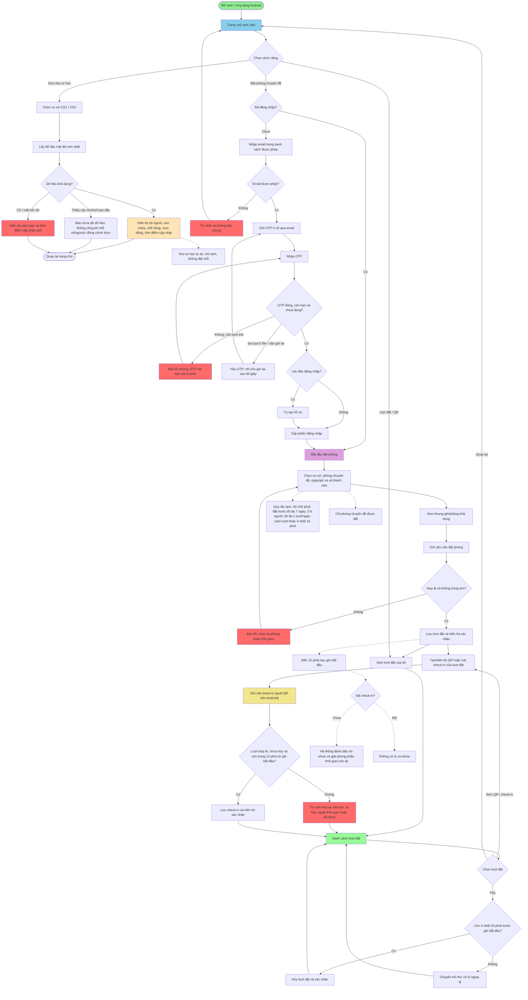
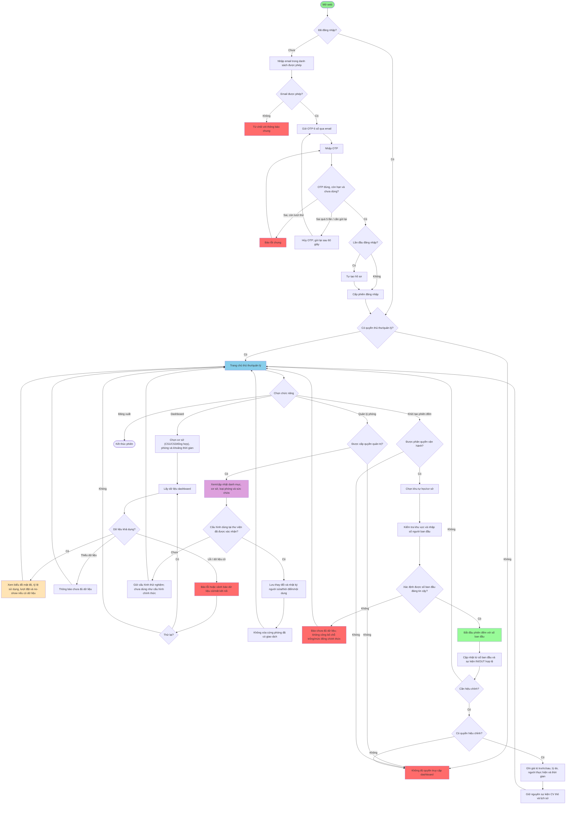

# Luồng Màn Hình & Trạng Thái Giao Diện 

## 1. Flowchart Luồng Tổng Quan

### 1.1 Luồng Sinh Viên

Luồng dưới đây bám theo SRS v1.8: xem khu tự học tự do không cần đặt chỗ; đăng nhập OTP được yêu cầu khi đặt phòng; check-in và no-show là các luồng Should.

### 1.2 Luồng Thủ Thư - Dashboard

Luồng này theo SRS v1.8: dashboard và quản lý phòng chỉ dành cho vai trò được cấp quyền; cấu hình dùng tại thư viện cần đại diện thư viện xác nhận. Khởi tạo phiên đếm là tác vụ người vận hành (UC-09), không mặc định là quyền của mọi thủ thư.

---

## 2. Bảng Trạng Thái Giao Diện (UI States)

### 2.1 Trạng Thái Chung - Tất Cả Màn Hình

| Trạng Thái | Điều Kiện | Hiển Thị | Người Dùng Làm | Ghi Chú |
|---|---|---|---|---|
| Loading | API đang xử lý, lần đầu mở màn hình | Spinner - "Đang tải..." | Chờ hoặc hủy | Timeout > 10s -> Error |
| Success | API trả 200, dữ liệu hợp lệ | Hiển thị dữ liệu đầy đủ | Tương tác với dữ liệu | Dữ liệu cache 5s |
| Empty | API 200 nhưng list = 0 | "Không có dữ liệu" | Quay lại hoặc tạo mới | Kiểm tra bộ lọc |
| Error API | API trả 4xx/5xx | Thông báo lỗi tiếng Việt + mã lỗi | Thử lại, quay lại, liên hệ | Nút "Thử lại" bật len |
| Error No Connection | Không kết nối Internet | "Mất kết nối mạng" | Kiểm tra WiFi/3G, thử lại | Retry tự động sau 30s |
| Error 404 | Resource không tồn tại | "Không tìm thấy" cụ thể | Quay lại, xem lại danh sách | Kiểm tra ID |
| Stale Data | received_at > 30s | Dữ liệu + cảnh báo "Cập nhật cách đây XX giây" | Thử lại để cập nhật | Chỉ dùng cho occupancy |
| Unauthorized | Token hết hạn, không đủ quyền 403 | "Không đủ quyền" hoặc "Phiên hết, đăng nhập lại" | Đăng nhập lại | Redirect login screen |

### 2.2 Màn Hình Tình Trạng Phòng (Occupancy)

| Trạng Thái | Điều Kiện | Hiển Thị | Người Dùng Làm | Ghi Chú |
|---|---|---|---|---|
| Loading | Mở lần đầu - Nhấn Refresh | Skeleton phòng - "Đang tải..." | Chờ | Fetch từ GET /api/v1/occupancy |
| Loaded Fresh | API 200, is_stale=false | Phòng + số người + % công suất + "Cập nhật: 2 phút trước" | Xem chi tiết - Đặt phòng | Polling 5s |
| Loaded Stale | API 200, is_stale=true | Phòng + số người + "Dữ liệu cũ >30s" | Nhấn Refresh | Vẫn hiển thị, cảnh báo |
| No Data 404 | occupancy_not_found | "Phòng chưa có dữ liệu" | Chọn phòng khác | CV chưa gửi count |
| Empty | API 200, count=0 | Phòng - "0/60 người" | Có thể đặt phòng | Hợp lệ, không lỗi |
| Error API | API 5xx - timeout - connection fail | "Lỗi tải dữ liệu. Thử lại" | Nhấn Thử lại | Retry với backoff |
| Error No Connection | Mất mạng | "Mất kết nối mạng" | Kiểm tra WiFi | Auto-retry 5s |

### 2.3 Màn Hình Đặt Phòng

| Trạng Thái | Điều Kiện | Hiển Thị | Người Dùng Làm | Ghi Chú |
|---|---|---|---|---|
| Idle | Lần đầu mở form | Form trống, nút "Đặt phòng" xám | Nhập liệu | - |
| Validation Error | Frontend reject | Cảnh báo từng trường | Sửa đầu vào | Không gửi API |
| Submitting | Gửi API booking | Nút xám + spinner - "Đang xử lý..." | Chờ | POST /api/v1/bookings/create |
| Success | API 201 | "Đặt phòng thành công" - Booking ID + QR | Xem QR - Về trang chủ | Tự chuyển schedule sau 2s |
| Error Conflict | API 409 booking_conflict | "Phòng trùng giờ. Chọn phòng/giờ khác" | Sửa form | Phòng đã có booking |
| Error Daily Limit | API 409, vượt 1/ngày | "Đã đặt 1 lần hôm nay. Quay lại ngày khác" | Chọn ngày khác | Max 1/day |
| Error Invalid Participant | API 422 số người sai | "Số người phải 2-6" | Sửa form | BR-04 |
| Error Room Not Found | API 404 room_not_found | "Phòng không tồn tại" | Quay lại - tải lại | Phòng bị xóa |
| Error API Server | API 5xx | "Lỗi hệ thống. Thử lại sau" | Thử lại | Retry sau 10s |

### 2.4 Màn Hình Check-in QR

| Trạng Thái | Điều Kiện | Hiển Thị | Người Dùng Làm | Ghi Chú |
|---|---|---|---|---|
| Ready Scan | Lần đầu mở, camera OK | Viewfinder QR - "Quét mã QR" | Quét | Camera bật, focus |
| Scanning | Đang parse QR | Spinner - "Đang quét..." | Chờ | Không gửi API ngay |
| QR Invalid | Format QR sai | "Không thể đọc mã QR. Thử lại" | Quét lại | Không phải QR hợp lệ |
| Submitting | Gửi API check-in | Nút xám - "Đang xác nhận..." | Chờ | POST /api/v1/check-ins |
| Success | API 200 | "Check-in thành công" - Phòng + thời gian | Nhấn OK -> Lịch đặt | Booking status = checked-in |
| Error No Permission | API 403 | "Không có quyền check-in QR này" | Liên hệ thủ thư | QR của người khác |
| Error Booking Not Found | API 404 booking_not_found | "Không tìm thấy lượt đặt" | Kiểm tra QR | booking_id không tồn tại |
| Error Overdue | API 422 now > end+15m | "Hết thời gian check-in hôm nay XX:XX" | Liên hệ thủ thư | Chỉ check-in trong end+15m |
| Error Duplicate | API 409 duplicate_checkin | "Đã check-in rồi" | Xem lại lịch | Cùng booking quét lần 2 |
| Error QR Expired | API 422 booking cancel | "Mã QR hết hạn" | Tạo QR mới | Booking > 24h |

### 2.5 Màn Hình Lịch Đặt & QR

| Trạng Thái | Điều Kiện | Hiển Thị | Người Dùng Làm | Ghi Chú |
|---|---|---|---|---|
| Loading | Mở lần đầu - Refresh | Skeleton list - "Đang tải..." | Chờ | GET /api/v1/bookings/my-bookings |
| Loaded | API 200, danh sách > 0 | Danh sách booking Phòng - Ngày - Giờ - Status - QR | Nhấn booking xem chi tiết | Sắp xếp theo ngày DESC |
| Empty | API 200, danh sách = 0 | "Chưa có lượt đặt nào" - nút "Đặt phòng mới" | Đặt phòng mới | Lần đầu hoặc hết hạn |
| Detail Modal | Nhấn 1 booking | Phòng - Ngày - Giờ - Người - Status - QR code | Xem QR - Hủy - Check-in | QR chỉ hiển thị nếu status=booked |
| QR Display | Nhấn "Xem QR" | Mã QR + booking_id + "Sử dụng để check-in" | Quét hoặc lưu ảnh | QR hợp lệ 24h |
| Cancel Modal | Nhấn "Hủy" | Xác nhận - "Bạn chắc hủy?" | Xác nhận hoặc quay lại | Chỉ hủy nếu status=booked |
| Error API | API 5xx | "Lỗi tải dữ liệu" | Thử lại | Retry |

### 2.6 Màn Hình Tình Trạng Mật Độ - Thủ Thư

| Trạng Thái | Điều Kiện | Hiển Thị | Người Dùng Làm | Ghi Chú |
|---|---|---|---|---|
| Loading | Mở lần đầu - Thay bộ lọc | Skeleton biểu đồ - "Đang tải..." | Chờ | GET /api/v1/occupancy/summary |
| Loaded | API 200, dữ liệu > 0 | Biểu đồ mật độ + thống kê (max/min/avg) | Xem biểu đồ - thay bộ lọc | Cache 1 phút |
| Empty | API 200, dữ liệu = 0 | "Chưa có dữ liệu trong khoảng này" | Thay ngày/giờ | Chọn khoảng có dữ liệu |
| Stale | received_at > 30s | Biểu đồ + "Dữ liệu cũ >30s" | Nhấn Refresh | Vẫn hiển thị, cảnh báo |
| Error No Permission | API 403 | "Không đủ quyền xem dashboard" | Liên hệ admin | Role = librarian |
| Error API | API 5xx | "Lỗi tải dữ liệu" | Thử lại sau | Retry |

### 2.7 Màn Hình Thống Kê & Báo Cáo - Thủ Thư

| Trạng Thái | Điều Kiện | Hiển Thị | Người Dùng Làm | Ghi Chú |
|---|---|---|---|---|
| Loading | Mở lần đầu - Thay bộ lọc | Skeleton biểu đồ - "Đang tính toán..." | Chờ | GET /api/v1/analytics/report |
| Loaded | API 200 | Tỷ lệ sử dụng + Tỷ lệ no-show + Bảng tổng hợp + nút Xuất | Xem báo cáo - Xuất PDF/CSV | Cache 5 phút |
| Empty | Không có booking trong khoảng | "Chưa có dữ liệu trong khoảng này" | Thay khoảng thời gian | Chọn ngày có hoạt động |
| Insufficient Data | Dữ liệu < 1 giờ | "Dữ liệu chưa đủ minimum 1 giờ" | Chọn khoảng dài hơn | UC-05 tiền điều kiện |
| Exporting PDF | Nhấn "Xuất PDF" | "Đang tạo báo cáo..." | Chờ hoặc hủy | Timeout > 30s -> error |
| Export Success | API 200 | "Báo cáo sẵn sàng" - nút "Tải xuống" | Tải file | File .pdf |
| Error Export | API 5xx | "Không thể xuất báo cáo" | Thử lại | Retry |

---

## 3. Thông Báo Lỗi Tiếng Việt (44 Messages)

### 3.1 Lỗi Xác Thực & Phê Duyệt (8 lỗi)

| Mã Lỗi API | HTTP | Thông Báo Tiếng Việt | Hành Động | Ghi Chú |
|---|---|---|---|---|
| unauthorized | 401 | Phiên hết hạn. Vui lòng đăng nhập lại. | Redirect login | Token/session expired |
| forbidden | 403 | Không đủ quyền thực hiện hành động này. | Quay lại - Liên hệ | Role không phù hợp |
| invalid_email | 422 | Email không hợp lệ. | Kiểm tra lại email | Format sai |
| email_not_allowed | 422 | Email chưa được phép sử dụng. Liên hệ admin. | Liên hệ | Domain/whitelist sai |
| otp_invalid | 422 | Mã OTP sai. Bạn còn X lần thử. | Nhập lại | Attempts tracking |
| otp_expired | 422 | Mã OTP hết hạn 5 phút. Yêu cầu mã mới. | Gửi OTP lại | Expired > 5m |
| otp_throttled | 429 | Gửi quá nhanh. Vui lòng chờ X giây. | Chờ | Rate limit |
| smtp_error | 503 | Không thể gửi email. Thử lại sau. | Thử lại | SMTP service down |

### 3.2 Lỗi Đặt Phòng (11 lỗi)

| Mã Lỗi API | HTTP | Thông Báo Tiếng Việt | Hành Động | Ghi Chú |
|---|---|---|---|---|
| validation_error | 422 | Dữ liệu không hợp lệ: chi tiết | Sửa form | Kiểm tra từng trường |
| invalid_duration | 422 | Thời lượng phải từ 30 đến 120 phút. | Sửa giờ | BR-04 |
| invalid_date_range | 422 | Chỉ có thể đặt trong 7 ngày tới. | Chọn ngày khác | BR-04 (0 < days ≤ 7) |
| invalid_participant_count | 422 | Số người phải từ 2 đến 6. | Sửa số người | BR-04 |
| daily_limit_exceeded | 409 | Đã đặt 1 lần hôm nay. Quay lại ngày khác. | Chọn ngày khác | BR-03 (max 1/day) |
| booking_conflict | 409 | Phòng đã được đặt trong khoảng thời gian này. Chọn phòng hoặc giờ khác. | Thay phòng/giờ | OVERLAPS query |
| room_not_found | 404 | Phòng không tồn tại. | Tải lại danh sách | room_id invalid |
| room_unavailable | 422 | Phòng không khả dụng bảo trì. | Chọn phòng khác | room.status ≠ 'active' |
| user_not_found | 404 | Người dùng không tồn tại. Đăng nhập lại. | Đăng nhập lại | user_id missing |
| user_blocked | 403 | Tài khoản bị khóa. Liên hệ quản lý. | Liên hệ admin | user.is_blocked = true |
| insufficient_slots | 409 | Phòng không còn chỗ trống. | Chọn phòng/giờ khác | room.available_slots = 0 |

### 3.3 Lỗi Check-in (7 lỗi)

| Mã Lỗi API | HTTP | Thông Báo Tiếng Việt | Hành Động | Ghi Chú |
|---|---|---|---|---|
| qr_invalid | 422 | Mã QR không hợp lệ hoặc bị hỏng. | Quét lại hoặc tạo QR mới | Format/checksum sai |
| booking_not_found | 404 | Lượt đặt không tồn tại. | Kiểm tra lại QR | booking_id không match |
| no_permission | 403 | Bạn không có quyền check-in lượt đặt này khác người sở hữu. | Liên hệ thủ thư | user_id ≠ booking.user_id |
| invalid_booking_status | 422 | Lượt đặt không hợp lệ đã check-in/hủy. | Xem lại lịch | status ≠ 'booked' |
| checkin_overdue | 422 | Hết thời gian check-in. Phòng được giải phóng lúc XX:XX. | Liên hệ thủ thư | now > end_time + 15m |
| duplicate_checkin | 409 | Đã check-in rồi. | Xem lại lịch | Đã check-in trong hôm |
| qr_expired | 422 | Mã QR hết hạn >24h hoặc booking đã hủy. | Tạo QR mới từ booking | QR cũ |

### 3.4 Lỗi Occupancy (3 lỗi)

| Mã Lỗi API | HTTP | Thông Báo Tiếng Việt | Hành Động | Ghi Chú |
|---|---|---|---|---|
| occupancy_not_found | 404 | Phòng chưa có dữ liệu mật độ. Thử lại sau hoặc liên hệ OPS. | Thử lại - Liên hệ OPS | CV chưa gửi count |
| room_not_found | 404 | Phòng không tồn tại. | Tải lại danh sách | room_id invalid |
| cv_connection_error | 503 | Nguồn đếm chưa kết nối. Liên hệ OPS. | Liên hệ OPS | CV service down |

### 3.5 Lỗi Dashboard & Thống Kê (4 lỗi)

| Mã Lỗi API | HTTP | Thông Báo Tiếng Việt | Hành Động | Ghi Chú |
|---|---|---|---|---|
| insufficient_data | 200 logic | Dữ liệu chưa đủ minimum 1 giờ hoạt động. Chọn khoảng dài hơn. | Thay khoảng thời gian | Condition check |
| export_timeout | 504 | Xuất báo cáo quá lâu. Thử lại sau. | Thử lại - Giảm khoảng | Export > 30s |
| export_failed | 500 | Không thể tạo báo cáo. Thử lại sau. | Thử lại | Export API error |
| invalid_filter | 422 | Bộ lọc không hợp lệ ngày, phòng, vv. | Kiểm tra bộ lọc | Filter params sai |

### 3.6 Lỗi Hệ Thống & Kết Nối (11 lỗi)

| Mã Lỗi API | HTTP | Thông Báo Tiếng Việt | Hành Động | Ghi Chú |
|---|---|---|---|---|
| internal_server_error | 500 | Lỗi hệ thống. Thử lại sau hoặc liên hệ support. | Thử lại sau vài giây | Server crash/error |
| service_unavailable | 503 | Hệ thống đang bảo trì. Vui lòng thử lại sau. | Thử lại sau | Server down/maintenance |
| database_error | 503 | Lỗi cơ sở dữ liệu. Thử lại sau. | Thử lại | DB down/query error |
| timeout | 504 | Yêu cầu quá lâu. Thử lại. | Thử lại | Response > 30s |
| no_network | offline | Mất kết nối mạng. Kiểm tra WiFi/3G. | Kiểm tra kết nối | Client offline |
| connection_refused | offline | Không thể kết nối tới server. Kiểm tra URL. | Kiểm tra cấu hình | Server unreachable |
| json_parse_error | client | Dữ liệu lỗi. Thử lại hoặc tải lại trang. | Tải lại trang | Malformed JSON response |
| malformed_json | 400 | Yêu cầu không hợp lệ. Liên hệ support. | Liên hệ support | Client sends bad JSON |

---

## 4. Quy Tắc Xử Lý Lỗi

### 4.1 Retry Logic
- **Automatic Retry:** Network timeout - Retry 1, 2, 4 giây (3 lần) -> show error
- **Automatic Retry:** 503 Service Unavailable - Retry 1, 2, 4 giây (3 lần) -> show error
- **Manual Retry:** Nút "Thử lại" bật lên cho 4xx/5xx
- **Max Manual:** Tối đa 3 lần bấm, sau đó cảnh báo "Liên hệ support"

### 4.2 Timeout
- **API Request:** 30 giây
- **Occupancy Polling:** 5 giây / lần
- **Dashboard Auto-Refresh:** 1 phút / lần
- **QR Timeout:** 24 giờ

### 4.3 Caching & Freshness
- **Occupancy Data:** Cache 5s; stale threshold 30s
- **Booking List:** Cache 5s
- **Dashboard Data:** Cache 1-5 phút
- **Invalidate Cache:** Khi user thay bộ lọc / refresh manual

### 4.4 Fallback UI States
- **Degraded Mode:** Nếu một API fail, hiển thị cached data nếu có
- **Offline Mode:** Simple app mode (không booking, chỉ xem lịch)
- **Error Boundary:** Trang lỗi khác người dùng có thể quay lại home

